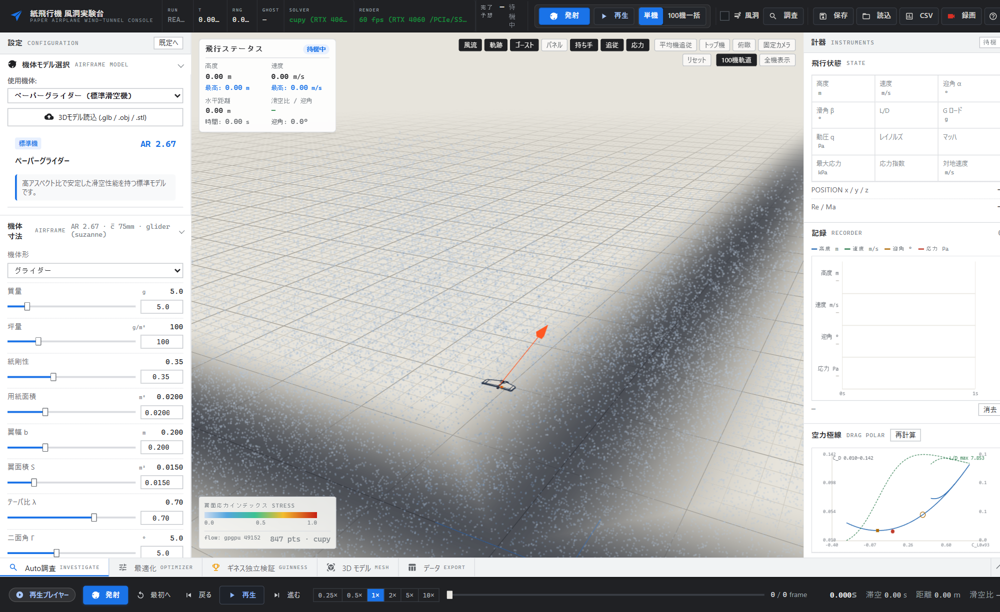
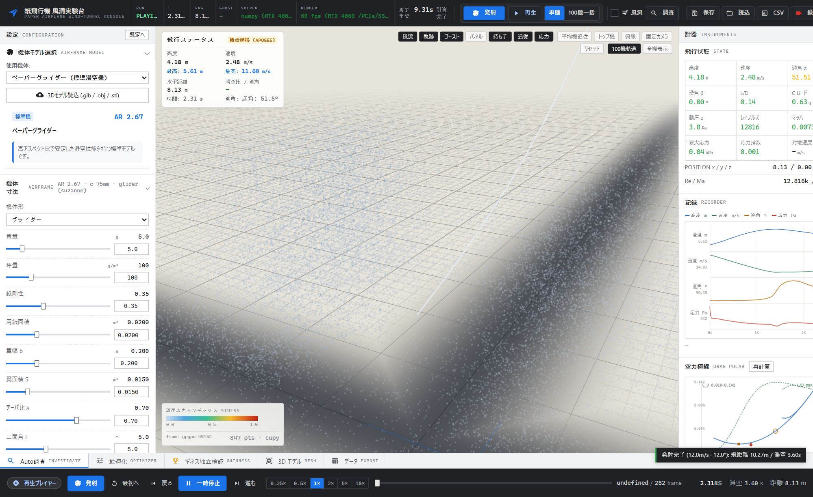
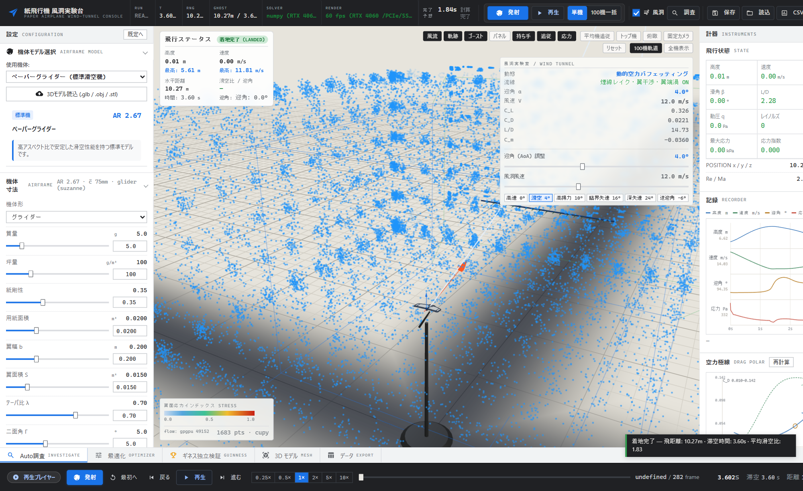
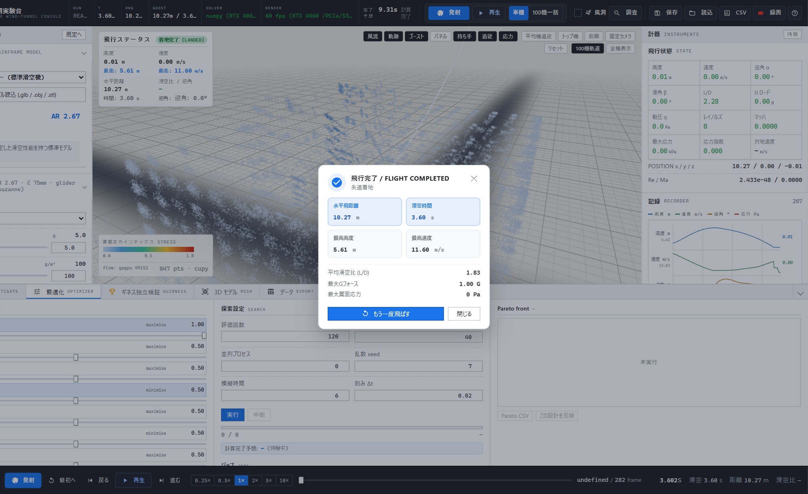
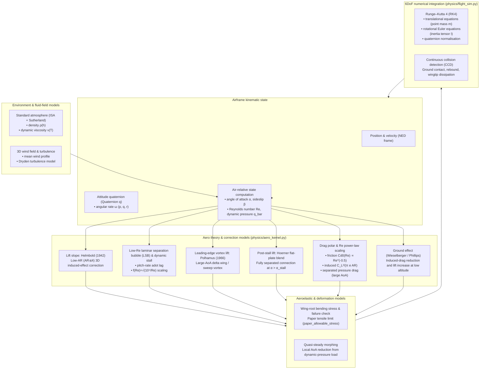

<div align="center">

# ✈️ 3D Paper Airplane Simulator

**6DoF RK4 flight dynamics × WebGL 3D × GPU parallel optimisation — an academically grounded paper-airplane simulation platform**

Flask REST API + Three.js WebGL visualises real-time 3D flight paths, attitude, and streamlines in the browser, and explores the low-Reynolds-number ($Re \sim 10^3 \sim 10^5$) aerodynamics (Helmbold / Polhamus / Hoerner / LSB) with GPU batch computation and evolutionary optimisation.

[](https://www.python.org/downloads/)
[](https://flask.palletsprojects.com/)
[](https://threejs.org/)
[]()
[]()
[](https://github.com/minetan1229/air_simulation/actions/workflows/ci.yml)
[](https://github.com/minetan1229/air_simulation/actions/workflows/codeql.yml)
[](./LICENSE)

[Documentation](https://minetan1229.github.io/air_simulation/) ·
[API Reference](./docs/api.md) ·
[Physics Models](./docs/PHYSICS_MODELS.md) ·
[Contributing](./CONTRIBUTING.md) ·
[Citation](./CITATION.cff) ·
[日本語](./README.md)

</div>

> **About the demo media**: 1920×1080 trajectory / wind-tunnel loop GIFs are not bundled to keep the repository lean. Each screen is introduced with a still image instead, and you can explore them interactively by running locally (60 FPS instrument panel, timeline scrubbing, GPU flow particles). See [docs/README.md §Screenshots](./docs/README.md) for GIF-encoding instructions.

---

## ⚡ Run in 30 seconds (Quickstart)

> Prerequisite: [Python 3.10+](https://www.python.org/downloads/) / WebGL2 browser (Chrome / Edge / Firefox)
> GPU (NVIDIA / CUDA 12.x) is optional. Without it, the simulator falls back automatically to NumPy / `multiprocessing`.

=== "Docker (recommended, fastest)"

    ```bash
    git clone https://github.com/minetan1229/air_simulation.git
    cd air_simulation
    docker compose up --build
    # → open http://127.0.0.1:5000 in your browser
    ```

    > If no Compose file is present, use:
    > `docker build -t paper-sim . && docker run --rm -p 5000:5000 paper-sim`

=== "Python venv (Windows PowerShell)"

    ```powershell
    git clone https://github.com/minetan1229/air_simulation.git
    cd air_simulation
    python -m venv .venv
    .\.venv\Scripts\Activate.ps1
    pip install -e ".[dev]"
    python app.py
    # → http://127.0.0.1:5000
    ```

=== "Python venv (Linux / macOS / WSL)"

    ```bash
    git clone https://github.com/minetan1229/air_simulation.git
    cd air_simulation
    python3 -m venv .venv
    source .venv/bin/activate
    pip install -e ".[dev]"
    python app.py
    # → http://127.0.0.1:5000
    ```

**Smoke test**:

```bash
curl http://127.0.0.1:5000/api/v1/meta/health
curl http://127.0.0.1:5000/healthz/live
```

**Interactive API docs**: after starting the server, open <http://127.0.0.1:5000/docs> (Swagger UI) / <http://127.0.0.1:5000/api/openapi.json> (OpenAPI 3.0)

See [docs/getting-started.md](./docs/getting-started.md) for full environment setup, `.env` and GPU verification.

---

## ✨ Feature Matrix

<div align="center">

| Area | Technology | What you can do |
| :--- | :--- | :--- |
| 🚀 **6DoF flight dynamics** | Quaternion + RK4 + adaptive sub-stepping | Integrate translational + rotational Euler equations over 13 states in real time. Continuous collision detection (CCD), ground contact and wingtip energy dissipation are handled consistently |
| 🌬️ **Aero + environment models** | Helmbold (1942) / Polhamus (1966) / Hoerner (1965) / LSB / ISA + Sutherland / Dryden turbulence | Unified formulas for low-AR lift slope, leading-edge vortex lift, post-stall flat-plate lift, low-Re laminar separation bubble, ground effect and 3D wind fields |
| 🎛️ **3D interactive view** | Three.js WebGL + GPU flow particles | 60 FPS instrument panel, flight-path & attitude tracking, per-vertex stress heatmaps, virtual wind tunnel, timeline scrubbing |
| ⚡ **GPU parallel & optimisation** | CuPy vectorisation + automatic CPU fallback + NSGA-II / DE / CMA-ES / Surrogate | Ensemble of up to 100 aircraft, Pareto search, asynchronous jobs with ETA. Schemas remain identical across backends |
| 🧬 **GA 2.0 research platform** | `physics/ga2/` scaling, surrogate, VRAM management | Large-scale evolutionary search in stages (Stage 0–3) with checkpoints, journals and resume |
| 🔌 **REST API + OpenAPI** | Flask + Swagger UI / `openapi.json` | Headless flights via `POST /api/v1/simulation/launch`, single-source UI schemas via `GET /api/v1/meta/schemas` |
| 🧪 **Verification (V&V)** | `pytest` + closed-form tests + `smoke_test.py` | ISA, induced drag, Sutherland and Helmbold closed forms verified to $10^{-6} \sim 10^{-3}$. CI matrix: Linux / Windows × Python 3.10–3.12 |

</div>

---

## 🖥️ Screenshots

| Main console | 3D flight path & attitude |
| :---: | :---: |
|  |  |
| **Wind-tunnel mode (flow analysis)** | **Workbench (optimisation)** |
|  |  |

> For other screens (Workbench investigation / 3D mesh / 100-plane ensemble), see [docs/README.md](./docs/README.md).

---

## 🧮 Physics & Theory Architecture

This simulator integrates the low-Reynolds-number ($Re \sim 10^3 \sim 10^5$) nonlinear phenomena and 6DoF flight dynamics of paper aircraft as academically grounded mathematical models.



### Adopted physical theories

| Phenomenon / theory | Applied model / equation | Literature basis | Canonical module |
|---|---|---|---|
| **Low-AR lift slope** | Helmbold (1942) 3D correction | Helmbold (1942), *Jahrbuch D. Luftfahrtforschung* | `physics/aero_kernel.py` |
| **Post-stall behaviour** | Hoerner flat-plate fully separated blend | Hoerner (1965), *Fluid-Dynamic Drag* | `physics/aero_kernel.py` |
| **Low-Re laminar separation bubble (LSB)** | Dynamic-stall hysteresis ($Re^{-0.5}$) | Pelletier & Mueller (2000), Sunada et al. (2002) | `physics/aero_kernel.py` |
| **Leading-edge vortex lift** | Polhamus leading-edge suction analogy | Polhamus (1966), NASA TN D-3767 | `physics/aero_kernel.py` |
| **6DoF real-time motion** | Quaternion + RK4 | Rigid-body dynamics / Euler rotational equations | `physics/flight_sim.py` |
| **Environment & turbulence** | ISA + Sutherland viscosity + Dryden turbulence | US Standard Atmosphere 1976 / MIL-F-8785C | `physics/atmosphere_domain.py`, `physics/wind_domain.py` |
| **Structure & aeroelasticity** | Wing-root stress reduction + quasi-steady morphing | Thin-plate bending theory / first-order aeroelastic reduction | `physics/stress_domain.py`, `physics/aeroelastic_domain.py` |

> The mathematical canonical sources are [docs/SPECIFICATION.md](./docs/SPECIFICATION.md) / [docs/PHYSICS_MODELS.md](./docs/PHYSICS_MODELS.md), and verification & validation is in [docs/VALIDATION.md](./docs/VALIDATION.md).

---

## 📁 Directory Tree

```text
├── app.py               # Application entry point (Flask)
├── api/                 # REST API endpoints (Blueprint group)
├── physics/             # Physics, aero models and optimisation engine
├── examples/            # Headless examples (quick_simulation.py)
├── static/              # Frontend (Three.js, UI)
├── templates/           # UI templates + Swagger UI
├── tests/               # Unit / integration test suite
├── docs/                # Detailed specs and architecture (MkDocs build target)
└── .github/workflows/   # CI / CodeQL / Dependency Review / Docs deploy
```

---

## 📚 Detailed Documentation

Web site: <https://minetan1229.github.io/air_simulation/> (auto-published to GitHub Pages from `mkdocs.yml`)

| Category | Documents |
| :--- | :--- |
| **Getting started** | [docs/getting-started.md](./docs/getting-started.md) setup & launch, `[docs/usage.md](./docs/usage.md)` UI operation |
| **Physics & theory** | [docs/SPECIFICATION.md](./docs/SPECIFICATION.md) canonical spec, `[docs/PHYSICS_MODELS.md](./docs/PHYSICS_MODELS.md)` equations, `[docs/VALIDATION.md](./docs/VALIDATION.md)` V&V |
| **API** | [docs/api.md](./docs/api.md) REST reference, `GET /api/openapi.json` OpenAPI 3.0, `GET /docs` Swagger UI |
| **Development & ops** | [docs/architecture.md](./docs/architecture.md), `[docs/development.md](./docs/development.md)`, `[CONTRIBUTING.md](./CONTRIBUTING.md)` |

---

## 👥 Contributing

- **Issues / PRs**: Follow [CONTRIBUTING.md](./CONTRIBUTING.md) conventions (`feat(scope):` / `fix(scope):` etc.) and use the **physics-model / issue templates**.
- **Zero-Placeholder policy**: `TODO`, empty functions and dummy placeholders are forbidden. Ship only working code.
- **Branch isolation**: do not commit directly to `master` during the `genetic-project` phase. Every mission runs on a `mission/<slug>` branch.
- **Security**: see [SECURITY.md](./SECURITY.md) for reporting.
- **Code of Conduct**: [CODE_OF_CONDUCT.md](./CODE_OF_CONDUCT.md)

---

## 📖 Citation

If you cite this software in a paper or report, please use (see [CITATION.cff](./CITATION.cff) for details):

```bibtex
@software{air_simulation_2026,
  title   = {3D Paper Airplane Simulator: 6DoF RK4 Flight Dynamics, Low-Reynolds Aerodynamics and GPU Ensemble Optimisation},
  author  = {minetan1229},
  year    = {2026},
  url     = {https://github.com/minetan1229/air_simulation},
  version = {3.0.0}
}
```

---

## 📄 License

This software is distributed under a proprietary (non-public) licence. See [LICENSE](./LICENSE) for details.
