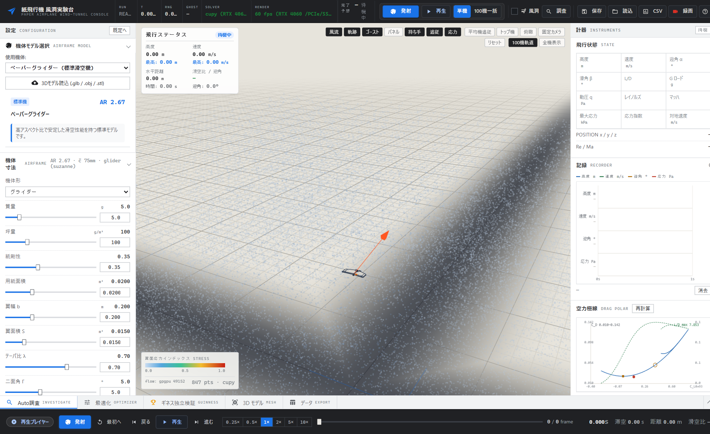
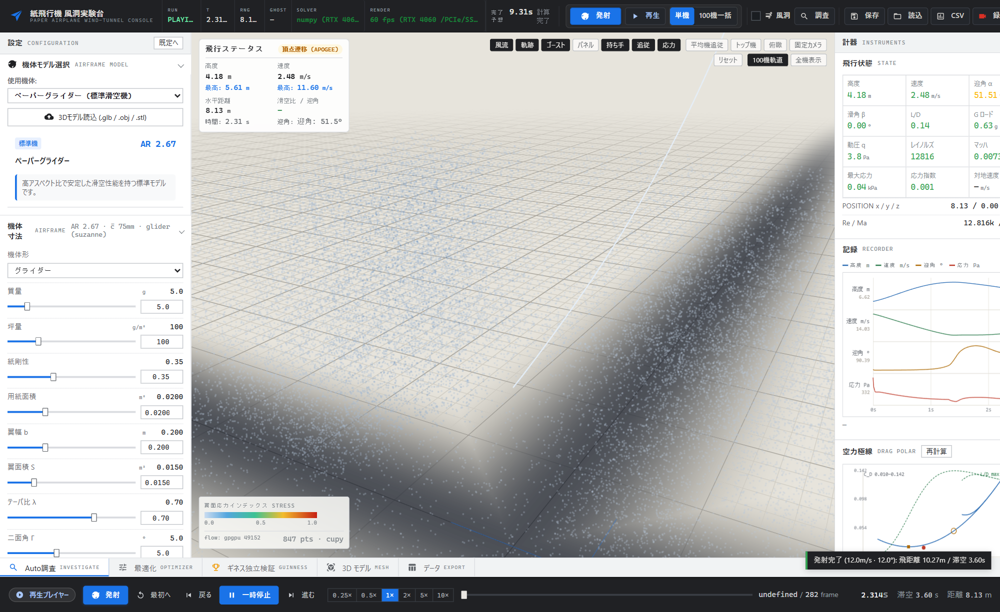
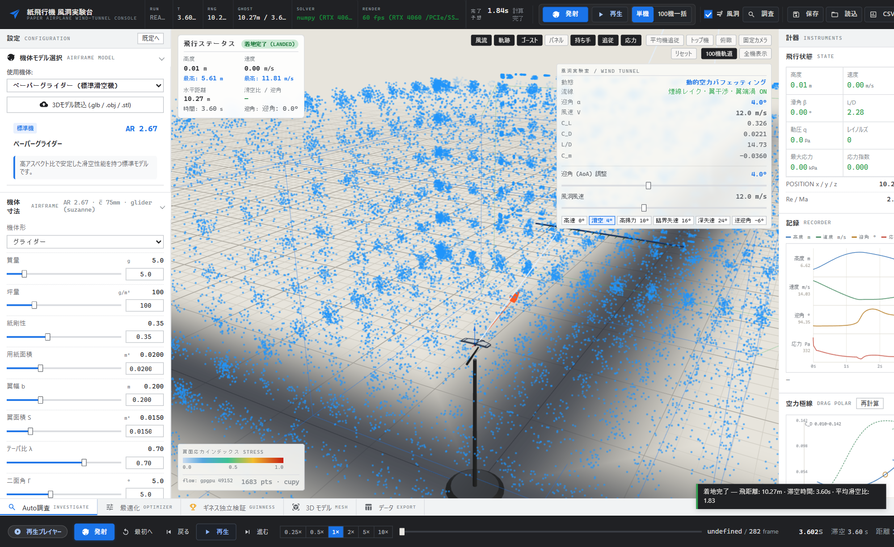
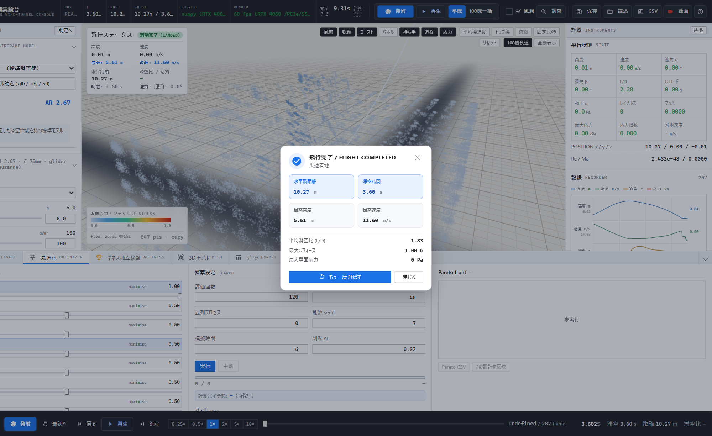
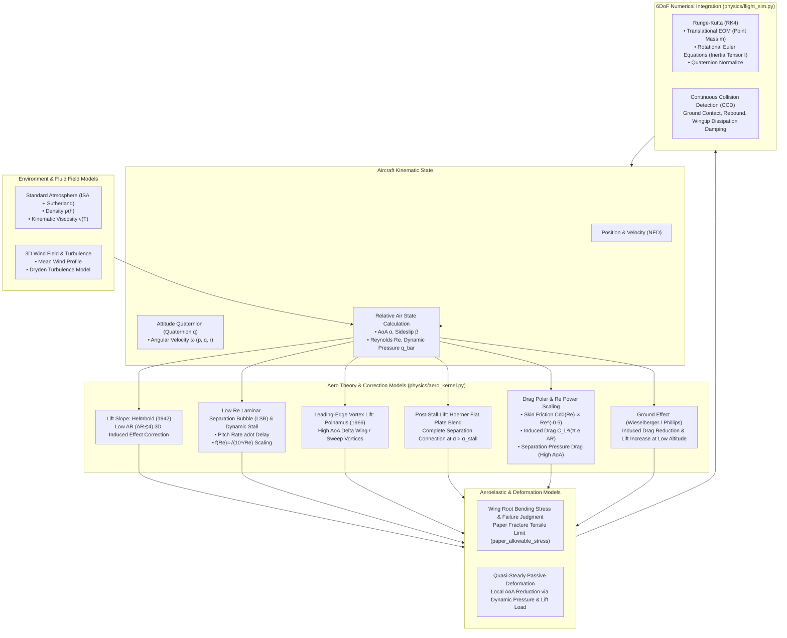

<div align="center">

# ✈️ 3D Paper Airplane Simulator

**6DoF RK4 Flight Dynamics × WebGL 3D × GPU Parallel Optimization — Paper Airplane Simulation Foundation with Academic Foundation**

Flask REST API + Three.js WebGL visualizes real-time 3D flight trajectories, attitudes, and airflow, exploring low Reynolds number ($Re \sim 10^3 \sim 10^5$) specific nonlinear aerodynamics (Helmbold / Polhamus / Hoerner / LSB) via GPU batch computation and genetic algorithms.

[](https://www.python.org/downloads/)
[](https://flask.palletsprojects.com/)
[](https://threejs.org/)
[]()
[]()
[](https://github.com/minetan1229/air_simulation/actions/workflows/ci.yml)
[](https://github.com/minetan1229/air_simulation/actions/workflows/codeql.yml)
[](./LICENSE)

[Documentation](https://minetan1229.github.io/air_simulation/) ·
[API Reference](./docs/api.md) ·
[Physics Models](./docs/PHYSICS_MODELS.md) ·
[Development Guide](./CONTRIBUTING.md) ·
[Academic Citation](./CITATION.cff) ·
[English](./README.en.md)

</div>

> **About Demo Videos**: 1920×1080 trajectory/wind tunnel loop GIFs are not included to keep repository size down. Instead, screenshots show each screen; run locally for interactive verification (60 FPS instrument panel, timeline seek, GPU airflow particles). See [docs/README.md §Screen Images](./docs/README.md) for GIF creation steps.

---

## ⚡ Quickstart (30 Seconds)

> Prerequisites: [Python 3.10+](https://www.python.org/downloads/) / WebGL2 compatible browser (Chrome / Edge / Firefox)
> GPU (NVIDIA / CUDA 12.x) optional. Auto-fallback to NumPy / `multiprocessing` when unavailable.

=== "Docker (Recommended, Fastest)"

```bash
git clone https://github.com/minetan1229/air_simulation.git
cd air_simulation
docker compose up --build
# → Open http://127.0.0.1:5000 in browser
```

> If Docker Compose file missing: `docker build -t paper-sim . && docker run --rm -p 5000:5000 paper-sim`

=== "Python venv (Windows PowerShell)"

```powershell
git clone https://github.com/minetan1229/air_simulation.git
cd air_simulation
python -m venv .venv
.\.venv\Scripts\Activate.ps1
pip install -e ".[dev]"
python app.py
# → http://127.0.0.1:5000
```

=== "Python venv (Linux / macOS / WSL)"

```bash
git clone https://github.com/minetan1229/air_simulation.git
cd air_simulation
python3 -m venv .venv
source .venv/bin/activate
pip install -e ".[dev]"
python app.py
# → http://127.0.0.1:5000
```

**Connectivity Check**:

```bash
curl http://127.0.0.1:5000/api/v1/meta/health
curl http://127.0.0.1:5000/healthz/live
```

**Interactive API Documentation**: After server start, <http://127.0.0.1:5000/docs> (Swagger UI) / <http://127.0.0.1:5000/api/openapi.json> (OpenAPI 3.0 spec)

See [docs/getting-started.md](./docs/getting-started.md) for detailed environment setup, `.env`, GPU verification.

---

## ✨ Feature Matrix

<div align="center">

| Domain | Technology | Capabilities |
| :--- | :--- | :--- |
| 🚀 **6DoF Flight Dynamics** | Quaternion + RK4 + Adaptive Sub-stepping | Real-time integration of translational + rotational Euler equations in 13 states. Continuous collision detection (CCD), ground contact, wingtip dissipation all integrated. |
| 🌬️ **Aero & Environment Models** | Helmbold (1942) / Polhamus (1966) / Hoerner (1965) / LSB / ISA + Sutherland / Dryden Turbulence | Low AR wing lift slope, leading-edge vortex lift, post-stall flat plate lift, low Re laminar separation bubble, ground effect, 3D wind field integrated as formulas. |
| 🎛️ **3D Interactive Display** | Three.js WebGL + GPU Airflow Particles | 60 FPS instrument panel, flight trajectory & attitude tracking, vertex stress heatmap, virtual wind tunnel, timeline seek. |
| ⚡ **GPU Parallel & Optimization** | CuPy Vectorization + CPU Auto-fallback + NSGA-II / DE / CMA-ES / Surrogate | Multi-aircraft ensemble (100 planes), Pareto search, ETA-enabled async jobs. Schema equivalence maintained. |
| 🧬 **GA 2.0 Research Foundation** | `physics/ga2/` Scaling, Surrogate, VRAM Management | Large-scale evolutionary search stages (Stage 0–3), checkpoints, journal, resume. |
| 🔌 **REST API + OpenAPI** | Flask + Swagger UI / `openapi.json` | Headless flight via `POST /api/v1/simulation/launch`, UI schema single canonical via `GET /api/v1/meta/schemas`. |
| 🧪 **Verification (V&V)** | `pytest` + Closed-form Tests + `smoke_test.py` | ISA, induced drag, Sutherland, Helmbold closed-form verified at $10^{-6} \sim 10^{-3}$. CI on Linux / Windows × Python 3.10–3.12. |

</div>

---

## 🖥️ Screenshots

| Main Console | 3D Flight Trajectory & Attitude |
| :---: | :---: |
|  |  |
| **Wind Tunnel Mode (Airflow Analysis)** | **Workbench (Optimization)** |
|  |  |

> Other screens (Workbench Investigate / 3D Mesh / Ensemble 100 Planes) at [docs/README.md](./docs/README.md).

---

## 🧮 Physics & Theory Architecture

This simulator integrates paper airplane low Reynolds number environment ($Re \sim 10^3 \sim 10^5$) specific nonlinear phenomena and 6-DoF flight dynamics as mathematical models with academic foundations.



### Adopted Physics Theories & Applications

| Physical Phenomenon / Theory | Applied Model / Equation | Literature Basis / Academic Background | Canonical Module |
|---|---|---|---|
| **Low AR Lift Slope** | Helmbold (1942) 3D Correction Formula | Helmbold (1942), *Jahrbuch D. Luftfahrtforschung* | `physics/aero_kernel.py` |
| **Post-Stall Behavior** | Hoerner Flat Plate Complete Separation Blend | Hoerner (1965), *Fluid-Dynamic Drag* | `physics/aero_kernel.py` |
| **Low Re Laminar Separation Bubble (LSB)** | Dynamic Stall Hysteresis ($Re^{-0.5}$) | Pelletier & Mueller (2000), Sunada et al. (2002) | `physics/aero_kernel.py` |
| **Leading-Edge Vortex Lift** | Polhamus Leading-Edge Suction Analogy | Polhamus (1966), NASA TN D-3767 | `physics/aero_kernel.py` |
| **6DoF Real-Time Motion** | Quaternion + Runge-Kutta 4th Order (RK4) | Rigid Body Dynamics, Euler Rotation Equations | `physics/flight_sim.py` |
| **Environment & Turbulence** | ISA Atmosphere + Sutherland Viscosity + Dryden Turbulence | US Standard Atmosphere 1976 / MIL-F-8785C | `physics/atmosphere_domain.py`, `physics/wind_domain.py` |
| **Structure & Aeroelastic** | Wing Root Stress Reduction + Quasi-Steady Deformation | Thin Plate Bending Theory / Aeroelastic First-Order Reduction | `physics/stress_domain.py`, `physics/aeroelastic_domain.py` |

> Formula canonical sources: [docs/SPECIFICATION.md](./docs/SPECIFICATION.md) / [docs/PHYSICS_MODELS.md](./docs/PHYSICS_MODELS.md), Verification & Validation (V&V): [docs/VALIDATION.md](./docs/VALIDATION.md).

---

## 📁 Directory Structure

```text
├── app.py               # Application entry point (Flask)
├── api/                 # REST API endpoints (Blueprint group)
├── physics/             # Physics computation, aero models, optimization engine
├── examples/            # Headless execution samples (quick_simulation.py)
├── static/              # Frontend (Three.js rendering, UI)
├── templates/           # UI templates HTML + Swagger UI
├── tests/               # Unit & integration test suite
├── docs/                # Detailed specs, architecture docs (MkDocs build target)
└── .github/workflows/   # CI / CodeQL / Dependency Review / Docs deploy
```

---

## 📚 Detailed Documentation

Website version: <https://minetan1229.github.io/air_simulation/> (auto-published to GitHub Pages from `mkdocs.yml`)

| Category | Documents |
| :--- | :--- |
| **Getting Started** | [docs/getting-started.md](./docs/getting-started.md) Setup & Launch, `[docs/usage.md](./docs/usage.md)` Screen Operation |
| **Physics & Theory** | [docs/SPECIFICATION.md](./docs/SPECIFICATION.md) Technical Spec Canonical, `[docs/PHYSICS_MODELS.md](./docs/PHYSICS_MODELS.md)` Formula Details, `[docs/VALIDATION.md](./docs/VALIDATION.md)` V&V |
| **API** | [docs/api.md](./docs/api.md) REST Reference, `GET /api/openapi.json` OpenAPI 3.0, `GET /docs` Swagger UI |
| **Development & Operations** | [docs/architecture.md](./docs/architecture.md), `[docs/development.md](./docs/development.md)`, `[CONTRIBUTING.md](./CONTRIBUTING.md)` |

---

## 👥 Development & Contribution

- **Issue / PR**: Follow [CONTRIBUTING.md](./CONTRIBUTING.md) conventions (`feat(scope):` / `fix(scope):` etc.), file using **Physics Model / Issues templates**.
- **Zero-Placeholder Policy**: `TODO`, empty functions, dummy placeholders prohibited. Working code only.
- **Branch Isolation**: `genetic-project` phase prohibits direct commits to `master`. All missions on `mission/<slug>` branches.
- **Security**: See [SECURITY.md](./SECURITY.md) for vulnerability reporting.
- **Code of Conduct**: [CODE_OF_CONDUCT.md](./CODE_OF_CONDUCT.md)

---

## 📖 Academic Citation

When citing this software in papers/reports, use below (details in [CITATION.cff](./CITATION.cff)):

```bibtex
@software{air_simulation_2026,
  title   = {3D Paper Airplane Simulator: 6DoF RK4 Flight Dynamics, Low-Reynolds Aerodynamics and GPU Ensemble Optimisation},
  author  = {minetan1229},
  year    = {2026},
  url     = {https://github.com/minetan1229/air_simulation},
  version = {3.0.0}
}
```

---

## 📄 License

This software is under a proprietary (non-public) license. See [LICENSE](./LICENSE) for details.