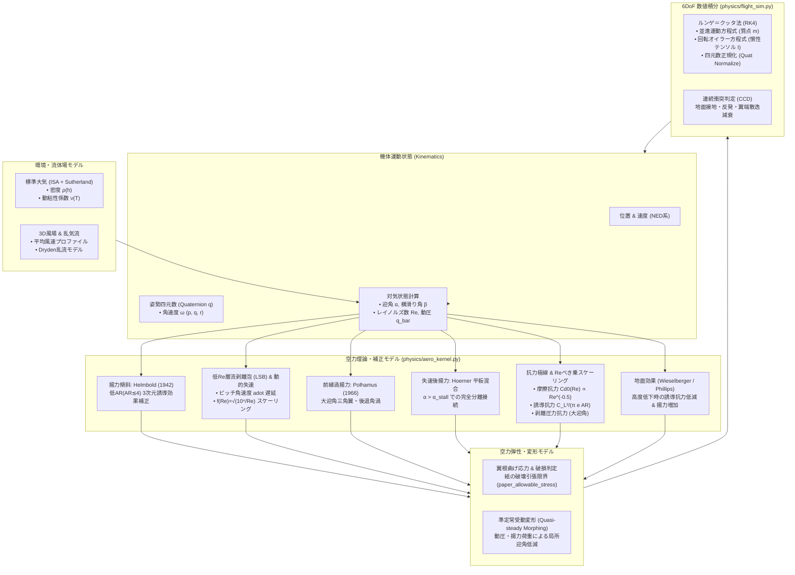

<div align="center">

# ✈️ 3D Paper Airplane Simulator

**6DoF RK4 飛行力学 × WebGL 3D × GPU 並列最適化 — 学術根拠を持つ紙飛行機シミュレーション基盤**

Flask REST API + Three.js WebGL でリアルタイム 3D 飛行軌跡・姿勢・気流を可視化し、
低レイノルズ数（$Re \sim 10^3 \sim 10^5$）特有の非線形空力（Helmbold / Polhamus / Hoerner / LSB）を
GPU バッチ計算と遺伝的アルゴリズムで探索します。

[](https://www.python.org/downloads/)
[](https://flask.palletsprojects.com/)
[](https://threejs.org/)
[]()
[]()
[](https://github.com/minetan1229/air_simulation/actions/workflows/ci.yml)
[](https://github.com/minetan1229/air_simulation/actions/workflows/codeql.yml)
[](./LICENSE)

[ドキュメント](https://minetan1229.github.io/air_simulation/) ·
[API リファレンス](./docs/api.md) ·
[物理モデル](./docs/PHYSICS_MODELS.md) ·
[開発ガイド](./CONTRIBUTING.md) ·
[学術引用](./CITATION.cff) ·
[English](./README.en.md)

</div>

> **デモ動画について**: 1920×1080 の軌跡・風洞ループ GIF はリポジトリ容量抑制のため
> 未同梱です。代わりに静止画で各画面を紹介し、ローカル起動でインタラクティブに
> ご確認いただけます（60 FPS 計器盤・タイムラインシーク・GPU 気流パーティクル）。
> GIF 化の手順は [docs/README.md §画面イメージ](./docs/README.md) を参照してください。

---

## ⚡ 30 秒で動かす (Quickstart)

> 前提: [Python 3.10+](https://www.python.org/downloads/) / WebGL2 対応ブラウザ（Chrome / Edge / Firefox）
> GPU（NVIDIA / CUDA 12.x）は任意。未搭載時は NumPy / `multiprocessing` へ自動フォールバックします。

=== "Docker (推奨・最速)"

    ```bash
    git clone https://github.com/minetan1229/air_simulation.git
    cd air_simulation
    docker compose up --build
    # → http://127.0.0.1:5000 をブラウザで開く
    ```

    > Docker Compose ファイルが無い場合は以下をご参照ください。
    > `docker build -t paper-sim . && docker run --rm -p 5000:5000 paper-sim`

=== "Python venv (Windows PowerShell)"

    ```powershell
    git clone https://github.com/minetan1229/air_simulation.git
    cd air_simulation
    python -m venv .venv
    .\.venv\Scripts\Activate.ps1
    pip install -e ".[dev]"
    python app.py
    # → http://127.0.0.1:5000
    ```

=== "Python venv (Linux / macOS / WSL)"

    ```bash
    git clone https://github.com/minetan1229/air_simulation.git
    cd air_simulation
    python3 -m venv .venv
    source .venv/bin/activate
    pip install -e ".[dev]"
    python app.py
    # → http://127.0.0.1:5000
    ```

**疎通確認**:

```bash
curl http://127.0.0.1:5000/api/v1/meta/health
curl http://127.0.0.1:5000/healthz/live
```

**インタラクティブ API ドキュメント**: サーバー起動後に <http://127.0.0.1:5000/docs>（Swagger UI） / <http://127.0.0.1:5000/api/openapi.json>（OpenAPI 3.0 仕様）

詳細な環境構築・`.env`・GPU 検証は [docs/getting-started.md](./docs/getting-started.md) を参照。

---

## ✨ 機能ハイライト (Feature Matrix)

<div align="center">

| 領域 | 技術 | 何ができるか |
| :--- | :--- | :--- |
| 🚀 **6DoF 飛行力学** | Quaternion + RK4 + 適応サブステッピング | 並進 + 回転オイラー方程式を 13 状態で実時間積分。連続衝突判定（CCD）・地表接地・翼端散逸まで一貫処理 |
| 🌬️ **空力・環境モデル** | Helmbold（1942）/ Polhamus（1966）/ Hoerner（1965）/ LSB / ISA + Sutherland / Dryden 乱流 | 低 AR 翼の揚力傾斜・前縁渦揚力・失速後平板揚力・低 Re 層流剥離泡・地面効果・3D 風場を数式として統合 |
| 🎛️ **3D インタラクティブ表示** | Three.js WebGL + GPU 気流パーティクル | 60 FPS 計器盤、飛行軌道・姿勢追跡、頂点応力ヒートマップ、仮想風洞、タイムラインシーク |
| ⚡ **GPU 並列 & 最適化** | CuPy ベクトル化 + CPU 自動フォールバック + NSGA-II / DE / CMA-ES / Surrogate | 多機同時アンサンブル（100 機）・パレート探索・ETA 付き非同期ジョブ。スキーマ等価性を維持 |
| 🧬 **GA 2.0 研究基盤** | `physics/ga2/` スケーリング・サロゲート・VRAM 管理 | 大規模進化探索の段階（Stage 0–3）・チェックポイント・ジャーナル・レジューム |
| 🔌 **REST API + OpenAPI** | Flask + Swagger UI / `openapi.json` | `POST /api/v1/simulation/launch` でヘッドレス飛行、`GET /api/v1/meta/schemas` で UI スキーマ単一正本化 |
| 🧪 **検証 (V&V)** | `pytest` + 閉形式テスト + `smoke_test.py` | ISA・誘導抗力・Sutherland・Helmbold 閉形式を $10^{-6} \sim 10^{-3}$ で検証。CI で Linux / Windows × Python 3.10–3.12 |

</div>

---

## 🖥️ スクリーンショット

| メインコンソール | 3D 飛行軌道・姿勢追跡 |
| :---: | :---: |
|  |  |
| **風洞モード (気流解析)** | **Workbench (最適化)** |
|  |  |

> その他の画面（Workbench 調査 / 3D メッシュ / アンサンブル 100 機）は [docs/README.md](./docs/README.md) を参照。

---

## 🧮 物理・理論アーキテクチャ (Physics & Theory Architecture)

本シミュレータは、紙飛行機の低レイノルズ数環境（$Re \sim 10^3 \sim 10^5$）特有の非線形現象と6自由度飛行力学を、学術的根拠に基づく数理モデルとして統合しています。



### 採用されている物理理論と適用

| 物理現象・理論 | 適用モデル / 方程式 | 文献根拠・学術的背景 | 正本モジュール |
|---|---|---|---|
| **低AR揚力傾斜** | Helmbold (1942) 3次元補正式 | Helmbold (1942), *Jahrbuch D. Luftfahrtforschung* | `physics/aero_kernel.py` |
| **失速後挙動** | Hoerner 平板完全分離混合式 | Hoerner (1965), *Fluid-Dynamic Drag* | `physics/aero_kernel.py` |
| **低Re層流剥離泡 (LSB)** | 動的失速ヒステリシス ($Re^{-0.5}$) | Pelletier & Mueller (2000), Sunada et al. (2002) | `physics/aero_kernel.py` |
| **前縁渦揚力** | Polhamus 先導縁吸い込みアナロジー | Polhamus (1966), NASA TN D-3767 | `physics/aero_kernel.py` |
| **6DoF実時間運動** | 四元数 + ルンゲ＝クッタ4段法 (RK4) | 剛体力学・オイラー回転方程式 | `physics/flight_sim.py` |
| **環境・乱気流** | ISA大気 + Sutherland粘性 + Dryden乱流 | US Standard Atmosphere 1976 / MIL-F-8785C | `physics/atmosphere_domain.py`, `physics/wind_domain.py` |
| **構造・空力弾性** | 翼根応力縮約 + 準定常変形 | 薄板曲げ理論 / 航空弾性一次縮約 | `physics/stress_domain.py`, `physics/aeroelastic_domain.py` |

> 数式の正本は [docs/SPECIFICATION.md](./docs/SPECIFICATION.md) / [docs/PHYSICS_MODELS.md](./docs/PHYSICS_MODELS.md)、
> 検証・妥当性確認（V&V）は [docs/VALIDATION.md](./docs/VALIDATION.md) を参照。

---

## 📁 ディレクトリ構成

```text
├── app.py               # アプリケーション起動エントリーポイント (Flask)
├── api/                 # REST API エンドポイント (Blueprint 群)
├── physics/             # 物理演算・空力モデル・最適化エンジン
├── examples/            # ヘッドレス実行サンプル (quick_simulation.py)
├── static/              # フロントエンド (Three.js 描画、UI)
├── templates/           # UI テンプレート HTML + Swagger UI
├── tests/               # 単体・統合テストスイート
├── docs/                # 詳細仕様・アーキテクチャ資料 (MkDocs ビルド対象)
└── .github/workflows/   # CI / CodeQL / Dependency Review / Docs デプロイ
```

---

## 📚 詳細ドキュメント

Web サイト版: <https://minetan1229.github.io/air_simulation/>（`mkdocs.yml` から GitHub Pages へ自動公開）

| カテゴリ | 文書 |
| :--- | :--- |
| **入門** | [docs/getting-started.md](./docs/getting-started.md) 環境構築・起動、`[docs/usage.md](./docs/usage.md)` 画面操作 |
| **物理・理論** | [docs/SPECIFICATION.md](./docs/SPECIFICATION.md) 技術仕様正本、`[docs/PHYSICS_MODELS.md](./docs/PHYSICS_MODELS.md)` 数式詳解、`[docs/VALIDATION.md](./docs/VALIDATION.md)` V&V |
| **API** | [docs/api.md](./docs/api.md) REST リファレンス、`GET /api/openapi.json` OpenAPI 3.0、`GET /docs` Swagger UI |
| **開発・運用** | [docs/architecture.md](./docs/architecture.md)、`[docs/development.md](./docs/development.md)`、`[CONTRIBUTING.md](./CONTRIBUTING.md)` |

---

## 👥 開発・コントリビューション

- **Issue / PR**: [CONTRIBUTING.md](./CONTRIBUTING.md) の規約（`feat(scope):` / `fix(scope):` 等）に従い、**物理モデル/issues テンプレート**で起票してください。
- **Zero-Placeholder 政策**: `TODO`・空関数・ダミープレースホルダーは禁止。実動コードのみ。
- **ブランチ隔離**: `genetic-project` フェーズでは `master` への直接コミット禁止。すべてのミッションは `mission/<slug>` ブランチで実施。
- **セキュリティ**: 脆弱性の報告は [SECURITY.md](./SECURITY.md) を参照。
- **行動規範**: [CODE_OF_CONDUCT.md](./CODE_OF_CONDUCT.md)

---

## 📖 学術引用 (Citation)

本ソフトウェアを論文・報告で引用する場合は以下をお使いください（詳細は [CITATION.cff](./CITATION.cff)）:

```bibtex
@software{air_simulation_2026,
  title   = {3D Paper Airplane Simulator: 6DoF RK4 Flight Dynamics, Low-Reynolds Aerodynamics and GPU Ensemble Optimisation},
  author  = {minetan1229},
  year    = {2026},
  url     = {https://github.com/minetan1229/air_simulation},
  version = {3.0.0}
}
```

---

## 📄 ライセンス

本ソフトウェアはプロプライエタリ（非公開）ライセンスです。詳細は [LICENSE](./LICENSE) を参照してください。
