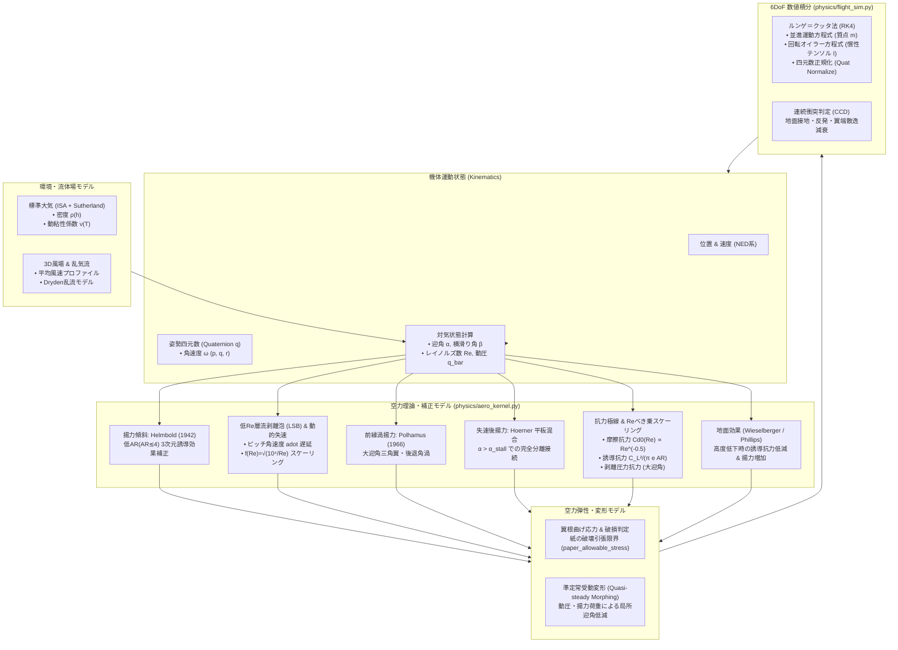

# 3D Paper Airplane Simulator

[](https://www.python.org/downloads/)
[](https://flask.palletsprojects.com/)
[](https://threejs.org/)
[]()
[]()

流体力学・飛行力学モデルに基づく、紙飛行機の 6自由度 (6DoF) 飛行シミュレータおよび自律設計最適化環境です。  
ブラウザ上でリアルタイムに飛行軌道・姿勢・気流を 3D 表示し、GPU を用いた並列アンサンブル計算や遺伝的アルゴリズム (GA) による機体探索を行えます。

---

## 主な特徴

- **6自由度 (6DoF) 飛行力学**: 四元数 (Quaternion) とルンゲ＝クッタ法 (RK4) による実時間数値積分
- **空力・環境モデル**: 揚力・抗力・地面効果・大気モデル・3D風場・乱気流を反映
- **3D インタラクティブ表示**: Three.js による 60FPS 計器盤、飛行軌道、気流・風洞可視化
- **GPU 並列計算 & GA 最適化**: CuPy による多機同時シミュレーション（CPU自動フォールバック対応）と進化型機体最適化

---

## 物理・理論アーキテクチャ (Physics & Theory Architecture)

本シミュレータは、紙飛行機の低レイノルズ数環境（$Re \sim 10^3 \sim 10^5$）特有の非線形現象と6自由度飛行力学を、学術的根拠に基づく数理モデルとして統合しています。



### 採用されている物理理論と適用
| 物理現象・理論 | 適用モデル / 方程式 | 文献根拠・学術的背景 | 正本モジュール |
|---|---|---|---|
| **低AR揚力傾斜** | Helmbold (1942) 3次元補正式 | Helmbold (1942), *Jahrbuch D. Luftfahrtforschung* | `physics/aero_kernel.py` |
| **失速後挙動** | Hoerner 平板完全分離混合式 | Hoerner (1965), *Fluid-Dynamic Drag* | `physics/aero_kernel.py` |
| **低Re層流剥離泡 (LSB)** | 動的失速ヒステリシス ($Re^{-0.5}$) | Pelletier & Mueller (2000), Sunada et al. (2002) | `physics/aero_kernel.py` |
| **前縁渦揚力** | Polhamus 先導縁吸い込みアナロジー | Polhamus (1966), NASA TN D-3767 | `physics/aero_kernel.py` |
| **6DoF実時間運動** | 四元数 + ルンゲ＝クッタ4段法 (RK4) | 剛体力学・オイラー回転方程式 | `physics/flight_sim.py` |
| **環境・乱気流** | ISA大気 + Sutherland粘性 + Dryden乱流 | US Standard Atmosphere 1976 / MIL-F-8785C | `physics/atmosphere_domain.py`, `physics/wind_domain.py` |
| **構造・空力弾性** | 翼根応力縮約 + 準定常変形 | 薄板曲げ理論 / 航空弾性一次縮約 | `physics/stress_domain.py`, `physics/aeroelastic_domain.py` |

---

## 画面イメージ

| メインコンソール | 3D 飛行軌道・姿勢追跡 |
| :---: | :---: |
|  |  |
| **風洞モード (気流解析)** | **Workbench (最適化)** |
|  |  |

---

## クイックスタート

### 動作要件
- Python 3.10 以上 (3.11 推奨)
- WebGL 2.0 対応ブラウザ (Chrome, Edge, Firefox 等)
- (任意) NVIDIA GPU / CUDA 12.x（GPUがない環境でも自動でCPU動作します）

### セットアップ

```bash
# リポジトリのクローン
git clone https://github.com/minetan1229/air_simulation.git
cd air_simulation

# 仮想環境の作成と有効化
python -m venv .venv
# Windows: .\.venv\Scripts\Activate.ps1
# Linux/macOS: source .venv/bin/activate

# 依存パッケージのインストール
pip install -e ".[dev]"
```
*(Windows では `.\setup.ps1`、Linux/macOS では `./setup.sh` による自動セットアップも利用可能です)*

### 起動方法

```bash
python app.py
```
起動後、ブラウザで [http://127.0.0.1:5000](http://127.0.0.1:5000) にアクセスしてください。

---

## ディレクトリ構成の概要

```text
├── app.py             # アプリケーション起動エントリーポイント
├── api/               # REST API エンドポイント
├── physics/           # 物理演算・空力モデル・最適化エンジン
├── static/            # フロントエンド (Three.js 描画、UI)
├── templates/         # UI テンプレート HTML
├── tests/             # 単体・統合テストスイート
└── docs/              # 詳細仕様・アーキテクチャ資料
```

---

## 詳細ドキュメント

詳しい数式や内部仕様、アーキテクチャについては `docs/` 配下をご参照ください。

- [docs/SPECIFICATION.md](docs/SPECIFICATION.md): 技術仕様・定数・物理法則（正本）
- [docs/architecture.md](docs/architecture.md): 全体アーキテクチャとデータフロー
- [docs/PHYSICS_MODELS.md](docs/PHYSICS_MODELS.md): 空力・運動方程式の数式詳解
- [docs/getting-started.md](docs/getting-started.md): 詳しい導入ガイド
- [docs/usage.md](docs/usage.md): 操作マニュアル・各画面の使い方
