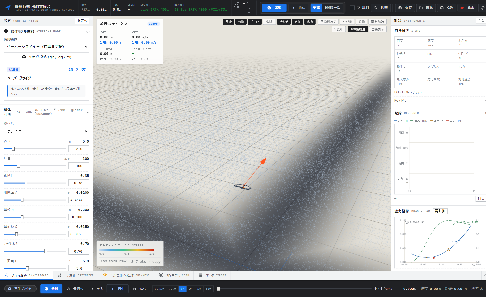
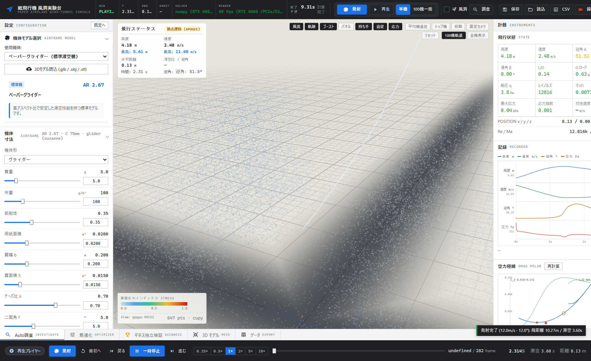
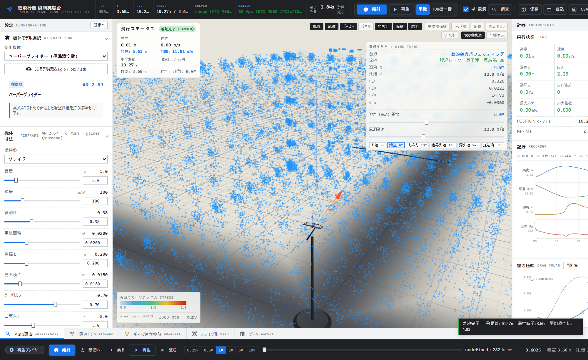
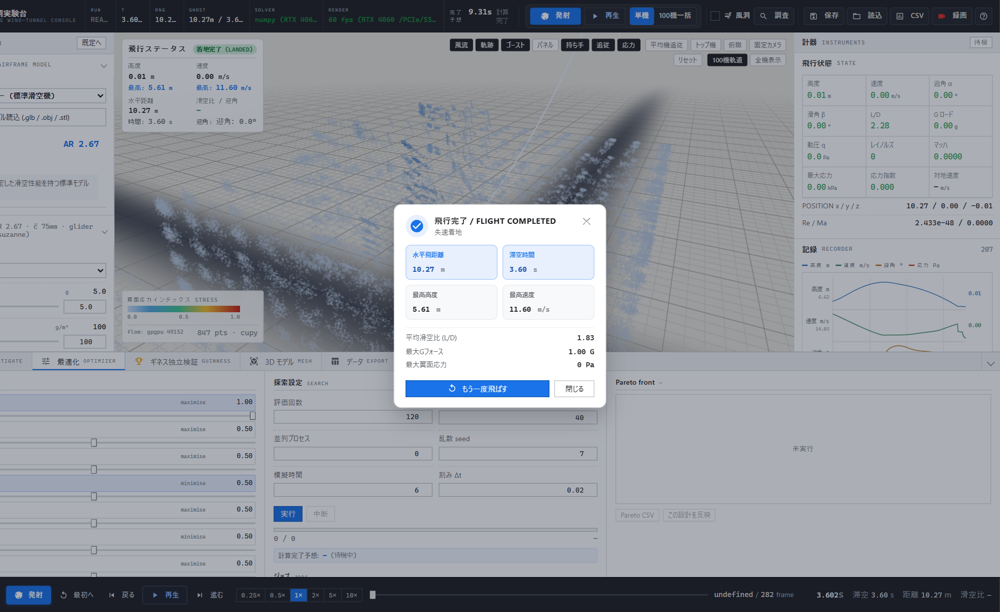
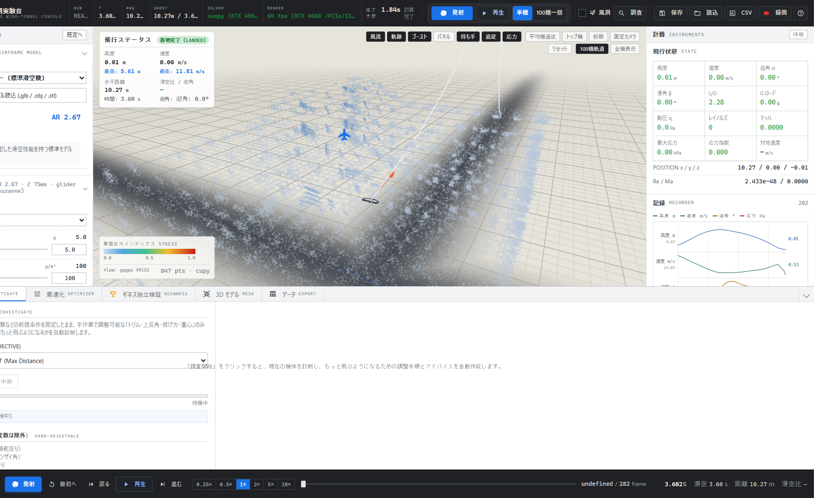
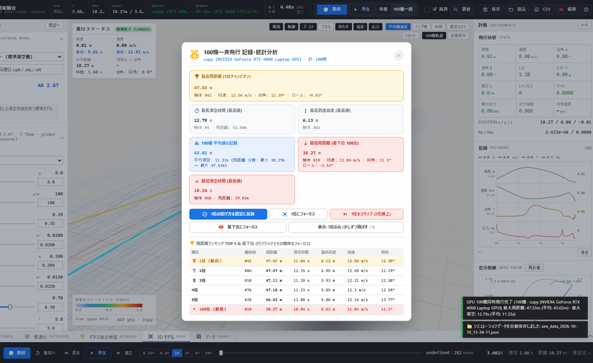

# 3D Paper Airplane High-Performance CFD Simulator

[](https://www.python.org/downloads/)
[](https://flask.palletsprojects.com/)
[](https://threejs.org/)
[]()
[]()
[]()

流体力学、航空力学、および飛行力学の理論モデルに基づく 3D 紙飛行機 6自由度 (6DoF) 数値シミュレーション・自律設計最適化環境。  
Flask REST API による物理演算バックエンドと、Three.js を用いた 3D 計器コンソールおよび気流可視化フロントエンド、さらに GPU 加速による大規模アンサンブル・多目的遺伝的アルゴリズム (NSGA-II)・折紙ゲノム探索エンジンを統合しています。

---

## 主な機能 (Key Features)

- **厳密な 6DoF 剛体飛行力学**: 四元数 (Quaternion) 姿勢表現と適応サブステップ付き 4次ルンゲ＝クッタ法 (RK4) による実時間数値積分
- **学術論文準拠の空力モデル**: Helmbold 揚力傾斜、Polhamus 先鋭渦揚力、Viterna-Corrigan 失速後特性、Hoerner 剥離抗力、地面効果、Sutherland 動粘性、ISA 1976 標準大気
- **折紙ゲノム & 構造監査**: 折り線・厚み・紙剛性テンソルを考慮した折紙機体パラメータ化と、翼根曲げ応力・フラッター限界の構造破綻判定
- **GPU バッチ / アンサンブル並列演算**: CuPy (CUDA 12.x) による 100機同時モンテカルロ飛行・感度解析（NumPy CPU フォールバック自動切替対応）
- **多目的自律進化探索 (GA / NSGA-II)**: 滞空時間・到達距離・滑空比・飛行安定性を同時最適化する多世代遺伝的アルゴリズム
- **インタラクティブ 3D コンソール**: Three.js による 60FPS 計器盤、流線・渦流可視化、風洞モード、リアルタイム姿勢角（オイラー角・四元数）表示

---

## ギャラリー & UI コンソール (UI Showcase)

| メインコンソール | 3D 飛行軌道・姿勢追跡 |
| :---: | :---: |
|  |  |
| **風洞モード (迎角・気流解析)** | **Workbench - 最適化 (Optimizer)** |
|  |  |
| **Workbench - 機体調査 (Investigate)** | **100機同時アンサンブル (GPU)** |
|  |  |

---

## 1. 物理・力学モデルおよび学術的根拠 (Physical Models & References)

本シミュレーターの物理演算コアは、以下の学術論文、NASA テクニカルレポート、および航空力学オープンソーススイート `AeroSandbox` の定式化に準拠します。

| 対象領域 | 物理モデル / 支配方程式 | 引用・学術的根拠 | 参照コード / スイート |
|:---|:---|:---|:---|
| **揚力傾斜** | $C_{L\alpha} = \frac{2\pi AR}{2 + \sqrt{AR^2(1 + \lambda) + \frac{4 AR}{\pi}}}$ | Helmbold, H. B. (1942). *Der unverwundene Dreiecksflügel als Trägerfläche höchsten Auftriebs*, Jahrbuch 1942 der deutschen Luftfahrtforschung, I, 111-113. | `aerosandbox.aerodynamics.buildup` |
| **渦揚力** | $C_L = K_p \sin\alpha \cos^2\alpha + K_v \sin^2\alpha \cos\alpha$ | Polhamus, E. C. (1966). *A Concept of the Vortex Lift of Sharp-Edge Delta Wings Based on a Leading-Edge-Suction Analogy*, NASA TN D-3767. | `aerosandbox.aerodynamics.buildup` |
| **失速後特性** | Viterna-Corrigan 非線形外挿法 ($C_L, C_D$) | Viterna, L. A., & Corrigan, R. D. (1982). *Fixed Pitch Rotor Performance of Large Horizontal Axis Wind Turbines*, NASA TM-83021. | `aerosandbox.aerodynamics.airfoil` |
| **直交剥離抗力** | $C_N = 2.0 \sin\alpha \cos^2\alpha$ | Hoerner, S. F. (1965). *Fluid-Dynamic Drag: Practical Information on Aerodynamic Drag and Hydrodynamic Resistance*, Hoerner Fluid Dynamics. | `aerosandbox.aerodynamics.buildup` |
| **地面効果** | $\phi_{GE} = \frac{16(h/b)^2}{1 + 16(h/b)^2}$ (誘導抗力低減係数) | Wieselsberger, C. (1922). *Wing Resistance Near the Ground*, ZFM, Vol. 12; translated in NACA TM 77. | `aerosandbox.aerodynamics.buildup` |
| **標準大気** | 気圧・気温・密度減率モデル (0〜84km) | NOAA, NASA, USAF (1976). *U.S. Standard Atmosphere, 1976*, NASA-TM-X-74335. | `aerosandbox.atmosphere.Atmosphere` |
| **動粘性係数** | $\mu = \mu_0 \left(\frac{T}{T_0}\right)^{1.5} \frac{T_0 + S}{T + S}$ | Sutherland, W. (1893). *The Viscosity of Gases and Molecular Force*, Philosophical Magazine, 5(36), 507-531. | `aerosandbox.atmosphere.Atmosphere` |
| **圧縮性補正** | $\beta = \sqrt{1 - M^2}, \quad C_p = \frac{C_{p0}}{\beta}$ | Glauert, H. (1928). *The Effect of Compressibility on the Lift of an Aerofoil*, Proc. R. Soc. Lond. A 118(779), 113-119. | `aerosandbox.aerodynamics.buildup` |

### 1.1 体積メッシュCFDソルバーとの明確な区別 (Model Architecture)
本シミュレーターは、空間体積メッシュ上で連続の式およびナビエ・ストークス方程式（Navier-Stokes, RANS/LES/DNS）を差分法・有限体積法で解く体積CFDソルバー（OpenFOAM等）ではなく、**空力係数理論（AeroSandbox準拠）・境界パネル法・統計的乱流モデルに基づくリアルタイム 6自由度 (6DoF) 剛体飛行力学シミュレーター**です。  
四元数 (Quaternion) および適応サブステップ付き4次ルンゲ＝クッタ法 (RK4) による数値積分を採用することで、ブラウザ上での 60FPS〜120FPS リアルタイム対話描画、GPU を用いた 100 機同時アンサンブルシミュレーション、および多目的遺伝的最適化（NSGA-II）の高速収束を実現しています。

---

## 2. システム要件および計算環境 (System Requirements)

- **OS**: Windows 10/11, Ubuntu 20.04+, macOS 12+
- **Python**: 3.10 以上 (3.11 推奨)
- **アクセラレータ (GPU)**: NVIDIA GPU (CUDA 12.x / Compute Capability 5.0 以上)
  - 演算バックエンドとして CuPy (`cupy-cuda12x`) を使用。
  - GPU が利用不能な場合は NumPy / `multiprocessing` による **CPU フォールバックへ自動移行**（返却スキーマは GPU 経路と同一）。CUDA 初期化に失敗してもシステムは停止しません。
  - **経路ごとの物理モデル**: GPU 最適化バッチ経路は正規経路と同一の 13 状態 RK4 剛体モデルをベクトル化して積分します（`model = "rigid_body_6dof"`）。一方、GPU モンテカルロ・アンサンブル経路と解析的滑翔サーホゲートは縮約モデル（`model = "reduced_surrogate"`）であり、各ペイロードの `model` / `model_detail` タグで判別可能です。
- **ブラウザ**: WebGL 2.0 対応ブラウザ (Google Chrome, Microsoft Edge, Firefox, Safari)

---

## 3. セットアップ手順 (Setup)

### 3.1 自動セットアップスクリプト

**Windows (PowerShell):**
```powershell
.\setup.ps1
```

**Linux / macOS (Bash):**
```bash
chmod +x setup.sh
./setup.sh
```

### 3.2 手動セットアップ (uv または pip)

**uv を使用する場合 (高速推奨):**
```bash
python -m venv .venv
# Windows: .\.venv\Scripts\Activate.ps1
# Linux/macOS: source .venv/bin/activate
uv pip install -e ".[dev]"
```

**pip を使用する場合:**
```bash
python -m venv .venv
# Windows: .\.venv\Scripts\Activate.ps1
# Linux/macOS: source .venv/bin/activate
pip install --upgrade pip setuptools wheel
pip install -e ".[dev]"
```

---

## 4. 実行手順 (Usage)

### 4.1 シミュレーションサーバーの起動
```bash
python app.py
```
起動完了後、ブラウザで [http://127.0.0.1:5000](http://127.0.0.1:5000) を開くと計器コンソールが表示されます。

- **GPU描画アクセラレーション起動 (Windows Chrome)**:
  ```powershell
  .\launch_gpu_render.bat
  ```
- **Discord 連携ブリッジ起動**:
  ```powershell
  .\start_discord_bridge.bat
  # または: python tools/discord_bridge.py
  ```

### 4.2 テストスイート & 静的解析の実行
```bash
# 構文・コンパイルチェック
python -m compileall physics api tools app.py smoke_test.py

# 静的解析 (Ruff / Mypy)
ruff check .
mypy physics app.py

# 単体テスト (pytest)
pytest tests -q

# 統合検証 (全 13 ステージ API / 物理 / E2E)
python smoke_test.py
```

---

## 5. リポジトリ構成 (Directory Structure)

```text
.
├── pyproject.toml             # 標準ビルド定義・依存関係・テスト/解析設定
├── requirements.txt           # 依存パッケージ一覧
├── app.py                     # Flask エントリーポイント
├── smoke_test.py              # 全 13 ステージ統合検証スクリプト
├── setup.ps1 / setup.sh       # 環境自動構築スクリプト
│
├── api/                       # REST API ルーティング層
│   ├── core.py                # 共通セッション・バリデーション・エラー処理
│   └── routes/                # 責務別エンドポイント (physics, simulation, mesh, jobs, meta, ga_research)
│
├── physics/                   # 物理演算・航空力学・最適化コア
│   ├── config_schema.py       # データクラス・単位系・機体パラメータ
│   ├── aero_domain.py         # 空力係数 (Helmbold, Polhamus, Viterna, Hoerner)
│   ├── aero_kernel.py         # 揚力・抗力・モーメント計算カーネル
│   ├── flight_sim.py          # 6DoF RK4 数値積分・四元数姿勢・地面接地
│   ├── parallel_engine.py     # GPU (CuPy) / CPU 並列 100機アンサンブル
│   ├── origami_genome.py      # 折紙ゲノム表現・折り線・幾何学的拘束
│   ├── stress_domain.py       # 翼面応力テンソル・曲げ破壊限界
│   ├── atmosphere_domain.py   # ISA 1976 標準大気・動粘性
│   ├── wind_domain.py         # 3D 風場・乱気流・サーマル上昇気流
│   ├── ga2/                   # 第2世代 多目的遺伝的アルゴリズム (NSGA-II / 段階的選別)
│   └── investigate/           # 飛行軌道・安定性自動診断エンジン
│
├── static/                    # フロントエンド静的アセット
│   ├── js/                    # Three.js 3D描画・計器盤・テレメトリ・通信
│   └── css/                   # コンソールスタイルシート
├── templates/                 # メイン計器コンソール HTML
│
├── tests/                     # pytest テストスイート (全 59 テストファイル, 675 テスト)
├── tools/                     # CI/CD・点検・パリティ検証・Discord ブリッジ等
├── search/                    # 400件以上の学術論文レジストリ・文献抽出ツール
├── archive/                   # 過去の設計・修復計画アーカイブ
└── docs/                      # 詳細仕様・アーキテクチャ・運用ドキュメント
```

---

## 6. ドキュメント体系 (Documentation Hub)

詳細な設計思想、API仕様、物理モデル、学術論文の追跡台帳は `docs/` およびリポジトリ内の各正本ドキュメントを参照してください。

### 技術仕様・アーキテクチャ
- [docs/SPECIFICATION.md](docs/SPECIFICATION.md): **詳細技術仕様・定数・物理法則・境界接地条件**（正本）
- [docs/architecture.md](docs/architecture.md): 全体アーキテクチャとデータフロー
- [docs/PHYSICS_MODELS.md](docs/PHYSICS_MODELS.md): 空力・運動方程式・大気・応力モデルの数式詳解
- [docs/GA_V2_ARCHITECTURE.md](docs/GA_V2_ARCHITECTURE.md): 折紙ゲノム探索と多目的 GA (v2) アーキテクチャ
- [docs/CFD_ROADMAP.md](docs/CFD_ROADMAP.md): CFD および物理ソルバーの改善ロードマップ
- [docs/api.md](docs/api.md): REST API エンドポイントリファレンス

### ガイド・運用
- [docs/getting-started.md](docs/getting-started.md): 環境構築・導入ガイド
- [docs/usage.md](docs/usage.md): ユーザーガイド・操作マニュアル
- [docs/development.md](docs/development.md): 開発・テスト・コントリビューション規約
- [docs/troubleshooting.md](docs/troubleshooting.md): トラブルシューティング & FAQ
- [docs/discord-bridge.md](docs/discord-bridge.md): Discord 監視・自律通知ブリッジの構成

### 論文監査・課題台帳 (Audit & Ledgers)
- [PHYSICS_PAPER_CONFORMANCE_AUDIT.md](PHYSICS_PAPER_CONFORMANCE_AUDIT.md): 学術論文・力学法則適合度監査（P0〜P3対応状況）
- [no-finish.md](no-finish.md): 未解決課題・次フェーズ繰延台帳（正本）
- [search/INDEX.md](search/INDEX.md): 400件の航空・物理学術論文データベース
