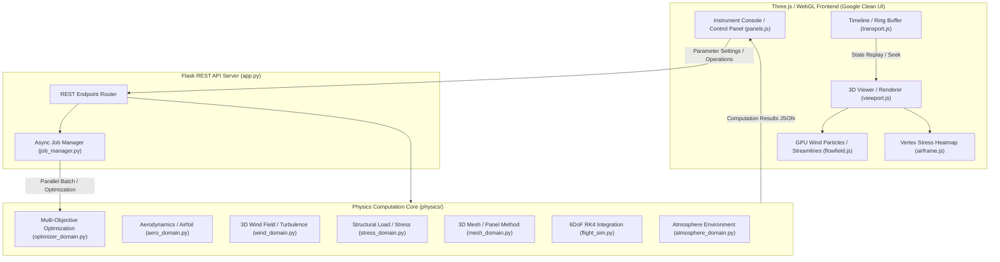

# System Architecture & Physical Models

This document defines the overall structure, physics engine design, governing equations adopted, and academic citation sources for this simulator.

---

## 1. System Overview

This system is a loosely coupled hybrid architecture consisting of a Python backend (Flask REST API) compliant with fluid dynamics and aerodynamic models, and a GPU rendering frontend using WebGL 2.0 / Three.js.

---

## 2. Aerodynamic & Physical Models (Governing Equations)

### 2.1 Lift Curve Slope & Wing Theory
- **Governing Equation**:
  $$C_{L\alpha} = \frac{2\pi AR}{2 + \sqrt{AR^2(1 + \lambda) + \frac{4 AR}{\pi}}}$$
- **Academic Source**: Helmbold, H. B. (1942). *Der unverwundene Dreiecksflügel als Trägerfläche höchsten Auftriebs*, Jahrbuch 1942 der deutschen Luftfahrtforschung, I, 111-113.
- **AeroSandbox Compliance**: Low aspect ratio and delta wing corrections in `aerosandbox.aerodynamics.buildup`.

### 2.2 Leading-Edge Vortex Suction Analogy (Polhamus)
- **Governing Equation**:
  $$C_L = K_p \sin\alpha \cos^2\alpha + K_v \sin^2\alpha \cos\alpha$$
- **Academic Source**: Polhamus, E. C. (1966). *A Concept of the Vortex Lift of Sharp-Edge Delta Wings Based on a Leading-Edge-Suction Analogy*, NASA TN D-3767.
- **AeroSandbox Compliance**: Nonlinear lift increase due to separated vortices on swept and delta wings.

### 2.3 Deep Stall & Post-Stall Characteristics (Viterna-Corrigan)
- **Governing Equation**:
  $$C_L = A_1 \sin(2\alpha) + A_2 \frac{\cos^2\alpha}{\sin\alpha}, \quad C_D = B_1 \sin\alpha + B_2 \cos\alpha$$
- **Academic Source**: Viterna, L. A., & Corrigan, R. D. (1982). *Fixed Pitch Rotor Performance of Large Horizontal Axis Wind Turbines*, NASA TM-83021.
- **AeroSandbox Compliance**: Post-stall full angle-of-attack ($\pm 180^\circ$) extrapolation in `aerosandbox.aerodynamics.airfoil`.

### 2.4 Fully Separated Flat Plate Drag (Hoerner Crossflow Drag)
- **Governing Equation**:
  $$C_N = 2.0 \sin\alpha \cos^2\alpha$$
- **Academic Source**: Hoerner, S. F. (1965). *Fluid-Dynamic Drag: Practical Information on Aerodynamic Drag and Hydrodynamic Resistance*, Hoerner Fluid Dynamics, Brick Town, NJ.

### 2.5 Ground Effect Induced Drag Reduction (Wieselsberger)
- **Governing Equation**:
  $$\phi_{GE} = \frac{16(h/b)^2}{1 + 16(h/b)^2}, \quad C_{Di}(h) = C_{Di0} \cdot \phi_{GE}$$
- **Academic Source**: Wieselsberger, C. (1922). *Wing Resistance Near the Ground*, ZFM, Vol. 12; translated in NACA TM 77.
- **AeroSandbox Compliance**: Induced drag correction by height above ground $h$ and span $b$.

### 2.6 Standard Atmosphere & Lapse Rate (U.S. Standard Atmosphere 1976)
- **Governing Equation**:
  $$T(h) = T_0 - L \cdot h, \quad p(h) = p_0 \left(\frac{T(h)}{T_0}\right)^{\frac{g}{L R_{air}}}, \quad \rho = \frac{p}{R_{air} T}$$
- **Academic Source**: NOAA, NASA, USAF (1976). *U.S. Standard Atmosphere, 1976*, NASA-TM-X-74335.
- **AeroSandbox Compliance**: `aerosandbox.atmosphere.Atmosphere`.

### 2.7 Sutherland's Law for Dynamic Viscosity
- **Governing Equation**:
  $$\mu = \mu_0 \left(\frac{T}{T_0}\right)^{1.5} \frac{T_0 + S_\mu}{T + S_\mu}, \quad \nu = \frac{\mu}{\rho}$$
- **Academic Source**: Sutherland, W. (1893). *The Viscosity of Gases and Molecular Force*, Philosophical Magazine, 5(36), 507-531.

### 2.8 Compressibility Correction (Prandtl-Glauert)
- **Governing Equation**:
  $$\beta = \sqrt{1 - M^2}, \quad C_p = \frac{C_{p0}}{\beta}$$
- **Academic Source**: Glauert, H. (1928). *The Effect of Compressibility on the Lift of an Aerofoil*, Proc. R. Soc. Lond. A 118(779), 113-119.

---

## 3. 6-DoF Equations of Motion & Integrator (`flight_sim.py`)

- **Equations of Motion**:
  $$m \left(\frac{d\mathbf{v}}{dt} + \boldsymbol{\omega} \times \mathbf{v}\right) = \mathbf{F}_{aero} + \mathbf{F}_{grav}$$
  $$\mathbf{I} \frac{d\boldsymbol{\omega}}{dt} + \boldsymbol{\omega} \times (\mathbf{I} \boldsymbol{\omega}) = \mathbf{M}_{aero}$$
- **Attitude Representation**: Singularity-free representation via quaternion $\mathbf{q} = (q_0, q_1, q_2, q_3)$.
- **Integration Method**: 4th-order Runge-Kutta (RK4) with adaptive sub-stepping (dynamic time step subdivision during sharp turns and high angular acceleration).

---

## 4. GPU Acceleration & Parallel Processing Architecture

1. **Automatic Fallback & Schema Equivalence**:
   - In environments with GPU (CUDA / CuPy) available, GPU vectorized computation is utilized; in environments where GPU is unavailable or CUDA initialization fails, the system automatically transitions to CPU parallel computation via NumPy / `multiprocessing`.
   - Response schema (`landed`, `crashed`, `status`, `horizontal_range_m`, etc.) maintains equivalence between GPU and CPU paths.
2. **Parallel Processing Architecture (`parallel_engine.py`)**:
   - Vectorized parallel execution via CuPy enables high-speed ensemble flight simulation and optimization batch evaluation on hardware such as NVIDIA RTX 4060.
   - GPU-optimized batch path (`model = "rigid_body_6dof"`) computes the 13-state RK4 rigid body model in vectorized form; GPU Monte Carlo ensemble path operates as a reduced model (`model = "reduced_surrogate"`).