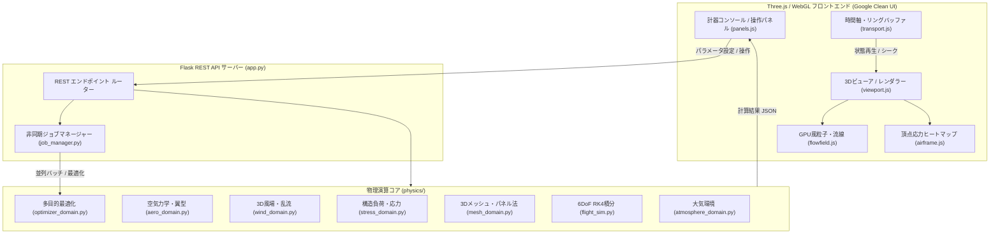

# システムアーキテクチャ & 物理理論モデル (Architecture & Theory)

本ドキュメントでは、本シミュレーターの全体構造、物理エンジン設計、および採用している理論モデルについて詳述します。

---

## 1. 全体アーキテクチャ概要

本システムは、流体力学・航空力学に準拠した高精度 Python バックエンド（Flask REST API）と、WebGL 2.0 / Three.js による GPU 描画フロントエンドで構成される疎結合なハイブリッドアーキテクチャです。



---

## 2. ディレクトリ構造とモジュール責務

```text
.
├── app.py                     # Flask REST API エンドポイント
├── requirements.txt           # 依存パッケージ定義
├── smoke_test.py              # API導通・最適化・メッシュ統合検証スクリプト
├── physics/                   # 物理・シミュレーション演算コア
│   ├── config_schema.py       # データクラス / パラメータ定義 / JSONスキーマ
│   ├── geometry_utils.py      # クォータニオン・回転・ベクトル計算ユーティリティ
│   ├── aero_domain.py         # 揚力・抗力・失速・Drag Polar・受動空力弾性
│   ├── atmosphere_domain.py   # ISA標準大気・Sutherland動粘性・局所大気
│   ├── wind_domain.py         # 3D風場・乱気流・GPU/NumPyハイブリッド生成
│   ├── stress_domain.py       # 翼根曲げモーメント・頂点応力テンソル
│   ├── mesh_domain.py         # STL/OBJ/GLB 解析・幾何特性・静的パネル法
│   ├── flight_sim.py          # 6DoF 運動方程式・RK4積分・リングバッファ
│   ├── parallel_engine.py     # multiprocessing / ThreadPool 並列バッチ評価
│   ├── optimizer_domain.py    # Nelder-Mead / DE / NSGA-II / Surrogate 最適化
│   ├── job_manager.py         # 非同期ジョブ進捗・EMA平滑化ETA算出
│   └── storage_domain.py      # CSV / JSON インポート・エクスポート
├── templates/
│   └── index.html             # 計器コンソールUIテンプレート
├── static/
│   ├── css/console.css        # スタイルシート（Google Clean Standard）
│   └── js/                    # Three.js 3D描画 & UI制御スクリプト群
├── tests/                     # pytest 単体・数値検証テスト群
├── docs/                      # プロジェクト詳細ドキュメント群
└── models/                    # インポートした3Dモデルのキャッシュ
```

---

## 3. 航空工学・物理理論モデル

### 3.1 大気・環境力学 (`atmosphere_domain.py`)
- **ISA 標準大気モデル**:
  $$T(h) = T_0 - L \cdot h, \quad p(h) = p_0 \left(\frac{T(h)}{T_0}\right)^{\frac{g}{L R_{air}}}$$
- **局所大気圧・湿度補正**:
  温度 $T$、気圧 $p$、相対湿度 $RH$ から水蒸気分圧を算出し、乾燥空気と水蒸気の混合気体定数を考慮した高精度空気密度 $\rho$ を導出。
- **Sutherland の動粘性式**:
  $$\mu = \mu_0 \left(\frac{T}{T_0}\right)^{1.5} \frac{T_0 + S_\mu}{T + S_\mu}, \quad \nu = \frac{\mu}{\rho}$$

### 3.2 空力翼型・受動空力弾性 (`aero_domain.py`)
- **揚力・抗力式**:
  $$L = \frac{1}{2}\rho V^2 S C_L(\alpha), \quad D = \frac{1}{2}\rho V^2 S C_D(\alpha)$$
- **Viterna 失速遷移モデル**:
  失速迎角以降の高迎角域（$\pm 90^\circ$、ディープストール）まで滑らかに遷移する非線形空力特性。
- **地面効果 (Ground Effect)**:
  対地高度 $h$ と全幅 $b$ による誘導抗力低減比率を補正：
  $$C_{Di}(h) = C_{Di0} \cdot \left[ \frac{16(h/b)^2}{1 + 16(h/b)^2} \right]$$
- **受動的空力弾性モーフィング (Passive Aeroelastic Morphing)**:
  紙の坪量（$g/m^2$）および剛性に基づき、高動圧 $q = \frac{1}{2}\rho V^2$ 投擲時のエレボン変形を非線形シグモイド減衰で再現：
  $$\delta_{eff}(q) = \delta_{trim} \cdot \left[ \frac{1}{1 + (q / q_{morph})^{n_{morph}}} \right]$$
- **頂点低速遷移力学 (Apex Low-Speed Pushover Dynamics)**:
  上昇端（$V < 2.0\text{ m/s}$）における風圧中心 $x_{cp}$ の移動と重心偏心により、特異点を回避しつつ自然な滑空移行（機首下げ）を再現。

### 3.3 6自由度 (6DoF) 飛行力学 (`flight_sim.py`)
- **状態ベクトル**: 位置 $\mathbf{r} = (x, y, z)$、速度 $\mathbf{v} = (u, v, w)$、姿勢クォータニオン $\mathbf{q} = (q_0, q_1, q_2, q_3)$、角速度 $\boldsymbol{\omega} = (p, q, r)$。
- **4次ルンゲ＝クッタ積分 (RK4)**:
  高精度かつ数値発散の少ない積分器。
- **適応サブステッピング (Adaptive Sub-stepping)**:
  高角加速度時や急加速時に動的に時間刻み $\Delta t$ を細分化し、紙飛行機特有の急激な姿勢変化でも安定動作を維持。

### 3.4 構造応力解析 (`stress_domain.py`)
- 動圧 $q$ と鉛直加速度（Gフォース）から翼根部（Wing Root）曲げモーメントを計算。
- 各翼面・頂点パネルにかかる局所力から応力値を正規化し、ヒートマップ（$0.0$: 青 〜 $1.0$: 赤）として出力。

### 3.5 3Dメッシュ解析・パネル法 (`mesh_domain.py`)
- STL, OBJ, glTF/GLB のポリゴンメッシュから表面積 $S$、スパン $b$、平均翼弦 $\bar{c}$、アスペクト比 $AR$、重心位置 $x_{cg}$、慣性テンソル $\mathbf{I}$ を自動計算。
- パネル分割により、局所風向に応じた静的空力係数を抽出。

---

## 4. 並列計算 & GPU 加速設計

1. **GPU 加速 (CuPy / PyTorch)**:
   - 3D 空間風場配列の一括ベクトル計算。
   - 大規模パラメータスイープ時の評価計算。
   - 非CUDA環境下では、NumPy による CPU 最適化コードへ透過的にフォールバック。
2. **マルチプロセス並列化 (`parallel_engine.py`)**:
   - `multiprocessing` による Windows `spawn` 方式対応の並列ジョブ実行。
   - NSGA-II 遺伝的アルゴリズムなどの大規模世代評価を高速化。

---

## 5. 関連ドキュメント

- [クイックスタート (docs/getting-started.md)](./getting-started.md)
- [ユーザーガイド・使い方 (docs/usage.md)](./usage.md)
- [REST API 仕様書 (docs/api.md)](./api.md)
- [開発・テストガイド (docs/development.md)](./development.md)

---

[README に戻る](../README.md)
