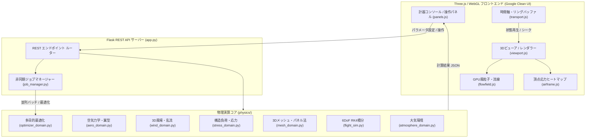

# システムアーキテクチャおよび物理理論モデル (Architecture & Physical Models)

本ドキュメントは、本シミュレーターの全体構造、物理エンジン設計、採用している支配方程式、および学術的引用ソースを規定する。

---

## 1. 全体アーキテクチャ概要 (System Overview)

本システムは、流体力学・航空力学モデルに準拠した Python バックエンド（Flask REST API）と、WebGL 2.0 / Three.js による GPU 描画フロントエンドで構成される疎結合なハイブリッドアーキテクチャである。

---

## 2. 航空力学および物理理論モデル (Physical Models & Governing Equations)

### 2.1 揚力傾斜および翼理論 (Lift Curve Slope & Wing Theory)
- **支配方程式**:
  $$C_{L\alpha} = \frac{2\pi AR}{2 + \sqrt{AR^2(1 + \lambda) + \frac{4 AR}{\pi}}}$$
- **学術的根拠**: Helmbold, H. B. (1942). *Der unverwundene Dreiecksflügel als Trägerfläche höchsten Auftriebs*, Jahrbuch 1942 der deutschen Luftfahrtforschung, I, 111-113.
- **AeroSandbox 準拠**: `aerosandbox.aerodynamics.buildup` における低アスペクト比・三角翼補正。

### 2.2 先端渦吸い込み渦揚力 (Polhamus Suction Analogy)
- **支配方程式**:
  $$C_L = K_p \sin\alpha \cos^2\alpha + K_v \sin^2\alpha \cos\alpha$$
- **学術的根拠**: Polhamus, E. C. (1966). *A Concept of the Vortex Lift of Sharp-Edge Delta Wings Based on a Leading-Edge-Suction Analogy*, NASA TN D-3767.
- **AeroSandbox 準拠**: 後退翼およびデルタ翼の剥離渦による非線形揚力増加。

### 2.3 ディープストールおよび失速後特性 (Viterna-Corrigan Post-Stall Model)
- **支配方程式**:
  $$C_L = A_1 \sin(2\alpha) + A_2 \frac{\cos^2\alpha}{\sin\alpha}, \quad C_D = B_1 \sin\alpha + B_2 \cos\alpha$$
- **学術的根拠**: Viterna, L. A., & Corrigan, R. D. (1982). *Fixed Pitch Rotor Performance of Large Horizontal Axis Wind Turbines*, NASA TM-83021.
- **AeroSandbox 準拠**: `aerosandbox.aerodynamics.airfoil` の失速後全迎角（$\pm 180^\circ$）外挿。

### 2.4 完全剥離平板抗力 (Hoerner Crossflow Drag)
- **支配方程式**:
  $$C_N = 2.0 \sin\alpha \cos^2\alpha$$
- **学術的根拠**: Hoerner, S. F. (1965). *Fluid-Dynamic Drag: Practical Information on Aerodynamic Drag and Hydrodynamic Resistance*, Hoerner Fluid Dynamics, Brick Town, NJ.

### 2.5 地面効果誘導抗力低減 (Wieselsberger Ground Effect)
- **支配方程式**:
  $$\phi_{GE} = \frac{16(h/b)^2}{1 + 16(h/b)^2}, \quad C_{Di}(h) = C_{Di0} \cdot \phi_{GE}$$
- **学術的根拠**: Wieselsberger, C. (1922). *Wing Resistance Near the Ground*, ZFM, Vol. 12; translated in NACA TM 77.
- **AeroSandbox 準拠**: 対地高度 $h$ およびスパン $b$ による誘導抗力補正。

### 2.6 標準大気および減率 (U.S. Standard Atmosphere 1976)
- **支配方程式**:
  $$T(h) = T_0 - L \cdot h, \quad p(h) = p_0 \left(\frac{T(h)}{T_0}\right)^{\frac{g}{L R_{air}}}, \quad \rho = \frac{p}{R_{air} T}$$
- **学術的根拠**: NOAA, NASA, USAF (1976). *U.S. Standard Atmosphere, 1976*, NASA-TM-X-74335.
- **AeroSandbox 準拠**: `aerosandbox.atmosphere.Atmosphere`。

### 2.7 Sutherland 動粘性係数 (Sutherland's Law)
- **支配方程式**:
  $$\mu = \mu_0 \left(\frac{T}{T_0}\right)^{1.5} \frac{T_0 + S_\mu}{T + S_\mu}, \quad \nu = \frac{\mu}{\rho}$$
- **学術的根拠**: Sutherland, W. (1893). *The Viscosity of Gases and Molecular Force*, Philosophical Magazine, 5(36), 507-531.

### 2.8 圧縮性補正 (Prandtl-Glauert Compressibility)
- **支配方程式**:
  $$\beta = \sqrt{1 - M^2}, \quad C_p = \frac{C_{p0}}{\beta}$$
- **学術的根拠**: Glauert, H. (1928). *The Effect of Compressibility on the Lift of an Aerofoil*, Proc. R. Soc. Lond. A 118(779), 113-119.

---

## 3. 6自由度 (6DoF) 運動方程式および積分器 (`flight_sim.py`)

- **運動方程式**:
  $$m \left(\frac{d\mathbf{v}}{dt} + \boldsymbol{\omega} \times \mathbf{v}\right) = \mathbf{F}_{aero} + \mathbf{F}_{grav}$$
  $$\mathbf{I} \frac{d\boldsymbol{\omega}}{dt} + \boldsymbol{\omega} \times (\mathbf{I} \boldsymbol{\omega}) = \mathbf{M}_{aero}$$
- **姿勢表現**: 四元数 $\mathbf{q} = (q_0, q_1, q_2, q_3)$ による特異点フリー表現。
- **積分手法**: 4次ルンゲ＝クッタ法 (RK4) および適応サブステッピング（急旋回・高角加速度時の動的時間刻み分割）。

---

## 4. GPU アクセラレーション原則 (Hardware Accelerator Protocol)

1. **GPU 必須化および Fail-Fast 原則**:
   - 空間風場演算およびバッチ並列フライト評価は、CUDA GPU (`cupy-cuda12x`) を必須とする。
   - GPU バックエンドが明示的に要求された場合、または GPU が利用できない構成である場合、CPU への暗黙的なフォールバックは厳禁とし、即座に `RuntimeError` を送出して処理を停止する。
2. **並列処理アーキテクチャ (`parallel_engine.py`)**:
   - CuPy によるベクトル化並列実行により、NVIDIA RTX 4060 等のハードウェア上で 100〜1,000 機以上のアンサンブル同時飛行シミュレーションを実行。
