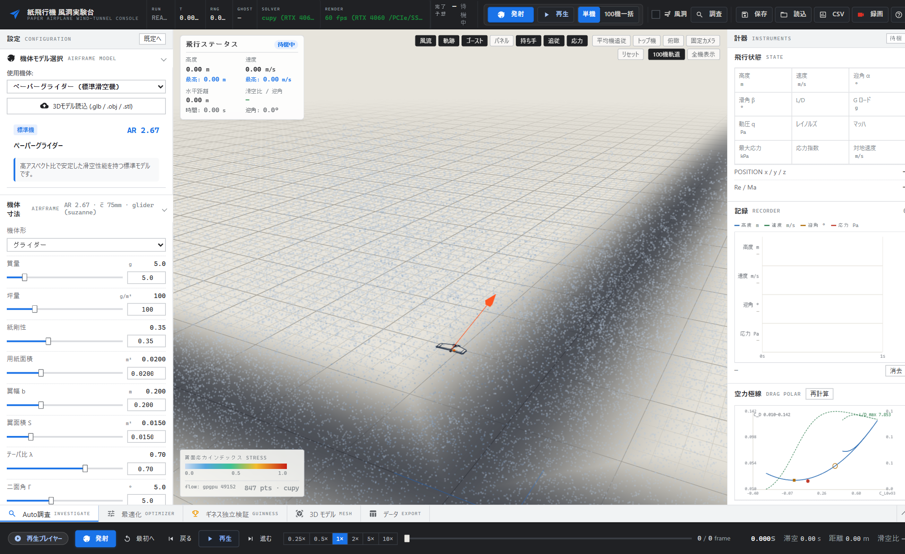
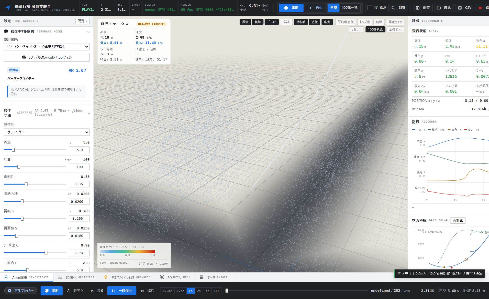
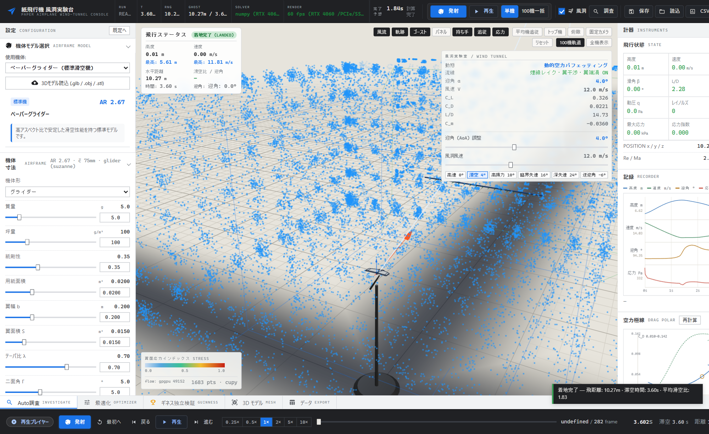
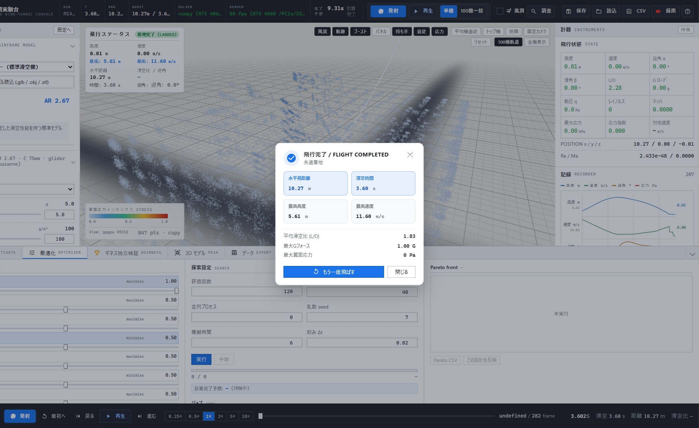

---
hide:
  - navigation
  - toc
---

# 3D Paper Airplane Simulator — Documentation

**6DoF RK4 flight dynamics × WebGL 3D × GPU parallel optimisation** — the official documentation for a paper-airplane simulation platform.

This site is built with [MkDocs Material](https://squidfunk.github.io/mkdocs-material/) and reuses the Markdown assets in `docs/` directly.

> **Japanese version**: [Japanese docs](/air_simulation/) · [README (JP)](https://github.com/minetan1229/air_simulation/blob/master/README.md)

## ⚡ Run in 30 seconds

=== "Docker (recommended)"

    ```bash
    git clone https://github.com/minetan1229/air_simulation.git
    cd air_simulation
    docker compose up --build
    # → http://127.0.0.1:5000
    ```

=== "Python venv (Windows / PowerShell)"

    ```powershell
    python -m venv .venv
    .\.venv\Scripts\Activate.ps1
    pip install -e ".[dev]"
    python app.py
    # → http://127.0.0.1:5000
    ```

=== "Python venv (Linux / macOS)"

    ```bash
    python3 -m venv .venv
    source .venv/bin/activate
    pip install -e ".[dev]"
    python app.py
    # → http://127.0.0.1:5000
    ```

**Smoke test**: `curl http://127.0.0.1:5000/api/v1/meta/health` / Swagger UI at `http://127.0.0.1:5000/docs`

## ✨ Feature Matrix

<div class="grid cards" markdown>

- 🚀 **6DoF flight dynamics** — Quaternion + RK4 + adaptive sub-stepping. CCD ground contact included.

    ---

    `physics/flight_sim.py` — 13-state integration

- 🌬️ **Aero & environment models** — Helmbold / Polhamus / Hoerner / LSB / ISA + Sutherland / Dryden.

    ---

    `physics/aero_kernel.py` — low-Re nonlinear aero

- 🎛️ **3D interactive view** — 60 FPS instrument panel, path tracking, stress heatmaps, virtual wind tunnel.

    ---

    Three.js WebGL + GPU particles

- ⚡ **GPU parallel & optimisation** — CuPy vectorisation + CPU fallback. NSGA-II / DE / CMA / Surrogate.

    ---

    100-plane ensemble, Pareto search, ETA-tracked jobs

- 🔌 **REST API + OpenAPI** — Swagger UI (`/docs`) / `openapi.json` / single-source `meta/schemas`.

    ---

    Headless runs via `examples/quick_simulation.py`

- 🧪 **Verification (V&V)** — closed-form tests and parity checks. CI: Linux / Windows × 3.10–3.12.

    ---

    See [VALIDATION.md](./VALIDATION.md)

</div>

## 🖥️ Screenshots

<div class="screenshots" markdown>

<figure markdown>

<figcaption>Main console — instruments, parameters, 3D viewport</figcaption>
</figure>

<figure markdown>

<figcaption>3D flight path & attitude tracking</figcaption>
</figure>

<figure markdown>

<figcaption>Virtual wind tunnel — flow analysis</figcaption>
</figure>

<figure markdown>

<figcaption>Workbench — optimisation panel</figcaption>
</figure>

</div>

## 📚 Documentation map

- **Getting Started**: [Quickstart](./getting-started.md) → [User Guide](./usage.md) → [Troubleshooting](./troubleshooting.md)
- **Physics & Theory**: [Specification (canonical)](./SPECIFICATION.md) → [Physics Models](./PHYSICS_MODELS.md) → [V&V](./VALIDATION.md) → [Architecture](./architecture.md)
- **API**: [REST API](./api.md) + runtime `GET /api/openapi.json` / `GET /docs` (Swagger UI)
- **Development & Ops**: [Development](./development.md) / [GA V2](./GA_V2_ARCHITECTURE.md) / [CFD Roadmap](./CFD_ROADMAP.md) / [Paper Registry](./PAPER_REGISTRY_PIPELINE.md) / [Discord Bridge](./discord-bridge.md) / [Remote Compute](./REMOTE_COMPUTE_ENVIRONMENT.md)

## 🚀 Developing the docs site

```bash
pip install mkdocs-material pymdown-extensions "mkdocstrings[python]"
mkdocs serve      # → http://127.0.0.1:8000
mkdocs build
```

Pushes to `docs/` trigger `.github/workflows/docs.yml`, which auto-publishes to GitHub Pages (https://minetan1229.github.io/air_simulation/).
