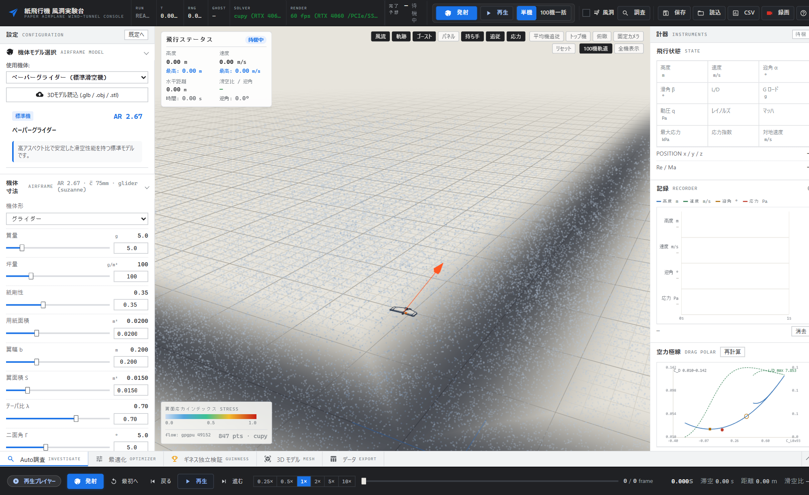
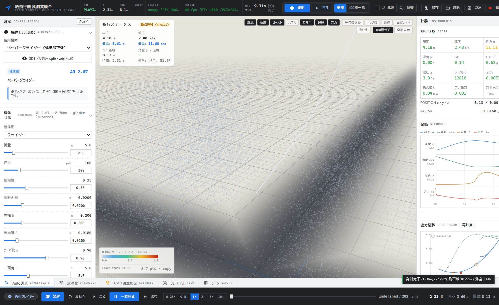
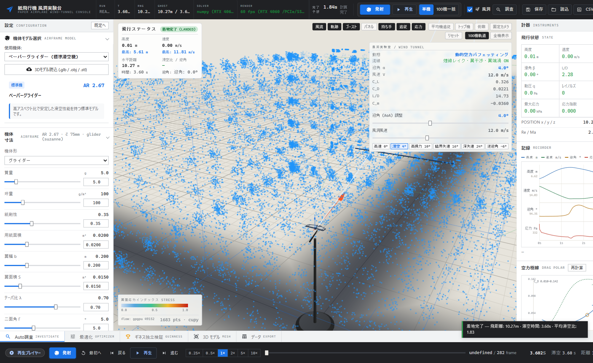
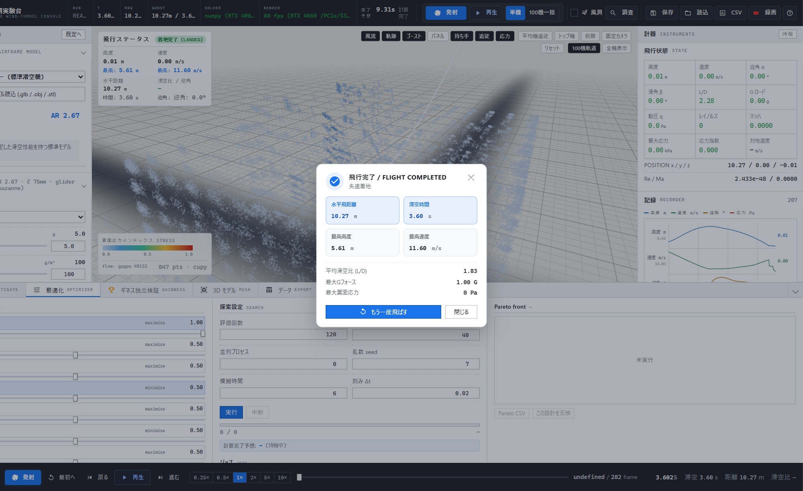

---
hide:
  - navigation
  - toc
---

# 3D Paper Airplane Simulator — ドキュメントサイト

**6DoF RK4 飛行力学 × WebGL 3D × GPU 並列最適化** の紙飛行機シミュレーション基盤の公式ドキュメントです。

本サイトは [MkDocs Material](https://squidfunk.github.io/mkdocs-material/) でビルドされ、`docs/` 配下の Markdown 資産をそのまま参照します。

## ⚡ 30 秒で動かす

=== "Docker (推奨)"

    ```bash
    git clone https://github.com/minetan1229/air_simulation.git
    cd air_simulation
    docker compose up --build
    # → http://127.0.0.1:5000
    ```

=== "Python venv (Windows / PowerShell)"

    ```powershell
    python -m venv .venv
    .\.venv\Scripts\Activate.ps1
    pip install -e ".[dev]"
    python app.py
    # → http://127.0.0.1:5000
    ```

=== "Python venv (Linux / macOS)"

    ```bash
    python3 -m venv .venv
    source .venv/bin/activate
    pip install -e ".[dev]"
    python app.py
    # → http://127.0.0.1:5000
    ```

**疎通確認**: `curl http://127.0.0.1:5000/api/v1/meta/health` / Swagger UI は `http://127.0.0.1:5000/docs`

## ✨ 機能ハイライト

<div class="grid cards" markdown>

- 🚀 **6DoF 飛行力学** — Quaternion + RK4 + 適応サブステッピング。CCD 地面接地まで一貫処理。

    ---

    `physics/flight_sim.py` — 13 状態積分

- 🌬️ **空力・環境モデル** — Helmbold / Polhamus / Hoerner / LSB / ISA + Sutherland / Dryden。

    ---

    `physics/aero_kernel.py` — 低 Re 非線形空力

- 🎛️ **3D インタラクティブ表示** — 60 FPS 計器盤、軌道追跡、応力ヒートマップ、仮想風洞。

    ---

    Three.js WebGL + GPU パーティクル

- ⚡ **GPU 並列 & 最適化** — CuPy ベクトル化 + CPU フォールバック。NSGA-II / DE / CMA / Surrogate。

    ---

    100 機アンサンブル、パレート探索、ETA 付きジョブ

- 🔌 **REST API + OpenAPI** — Swagger UI（`/docs`）/ `openapi.json` / `meta/schemas` 単一正本。

    ---

    ヘッドレス実行は `examples/quick_simulation.py`

- 🧪 **検証 (V&V)** — 閉形式テストとパリティ検査。CI で Linux / Windows × 3.10–3.12。

    ---

    [VALIDATION.md](./VALIDATION.md) 参照

</div>

## 🖥️ スクリーンショット

<div class="screenshots" markdown>

<figure markdown>

<figcaption>メインコンソール — 計器盤・パラメータ・3D ビューア</figcaption>
</figure>

<figure markdown>

<figcaption>3D 飛行軌道・姿勢追跡</figcaption>
</figure>

<figure markdown>

<figcaption>仮想風洞 — 気流解析</figcaption>
</figure>

<figure markdown>

<figcaption>Workbench — 最適化パネル</figcaption>
</figure>

</div>

## 📚 ドキュメント構成

- **導入ガイド**: [クイックスタート](./getting-started.md) → [操作マニュアル](./usage.md) → [トラブルシューティング](./troubleshooting.md)
- **物理・理論**: [技術仕様（正本）](./SPECIFICATION.md) → [物理モデル正本](./PHYSICS_MODELS.md) → [V&V](./VALIDATION.md) → [アーキテクチャ](./architecture.md)
- **API**: [REST API 仕様](./api.md) + ランタイム `GET /api/openapi.json` / `GET /docs`（Swagger UI）
- **開発・運用**: [開発ガイド](./development.md) / [GA V2](./GA_V2_ARCHITECTURE.md) / [CFD ロードマップ](./CFD_ROADMAP.md) / [紙レジストリ](./PAPER_REGISTRY_PIPELINE.md) / [Discord ブリッジ](./discord-bridge.md) / [リモート計算環境](./REMOTE_COMPUTE_ENVIRONMENT.md)

## 🚀 ドキュメントサイトの開発

```bash
pip install mkdocs-material pymdown-extensions "mkdocstrings[python]"
mkdocs serve      # → http://127.0.0.1:8000
mkdocs build
```

`docs/` への push で `.github/workflows/docs.yml` が GitHub Pages（https://minetan1229.github.io/air_simulation/）へ自動公開します。
