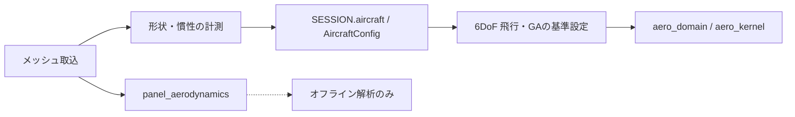

# メッシュ面局所空力と飛行・GA経路の接続監査

## 調査結論

`physics/mesh_domain.py::panel_aerodynamics()` は、メッシュ面ごとの局所荷重を合算するオフライン関数であり、通常の飛行・GAの空力評価からは呼ばれない。ソース全体の呼び出し検索では、定義・テスト以外に実行時の呼び出し元は見つからなかった。追加した `tests/test_mesh_panel_integration.py` は実際の6DoF右辺評価で `aero_domain.evaluate_aero()` が呼ばれ、`panel_aerodynamics()` が呼ばれないことを実行時に確認する。

メッシュ取込自体は飛行設定に影響する。`api/routes/mesh.py` は取込・選択時に `MeshLibrary.to_aircraft_config()` が算出した面積、翼幅、テーパー、アスペクト比、質量、慣性を `SESSION.aircraft` へ反映する。通常飛行はその設定を使って `flight_sim.py` から `aero_domain.evaluate_aero()` / `aero_kernel` の係数ベースモデルで力を計算する。ジョブ経路も `SESSION.aircraft` を基準設定として読み込む。つまり、**メッシュ由来の形状・慣性値は伝播するが、メッシュ面局所空力は伝播しない**。

API はメッシュの取込・選択・計測値取得・上書きを提供する。UI のモデル欄は形状と派生計測値を表示する。どちらもパネル空力を計算して飛行力やGA適応度へ適用する入口は持たない。UIにこの境界を明記した。

## 検証範囲

- 静的検索: `panel_aerodynamics` の本番呼び出し元はなし。メッシュAPIとGA/飛行の設定経路を個別に追跡。
- 実行時回帰: `tests/test_mesh_panel_integration.py` で6DoF右辺評価を呼び、係数ベース空力呼び出しを記録しつつ、メッシュ面空力への呼び出しを失敗として監視。
- この監査は、面積・翼幅・質量・慣性のメッシュ由来設定が飛行条件やGA初期設定へ影響することを否定しない。パネル空力関数の未接続だけを確認する。
- `panel_aerodynamics()` の有限翼効果・抗力モデルの物理妥当性は別途検証が必要であり、関数が存在することをCFD相当または実験検証済みとは扱わない。
