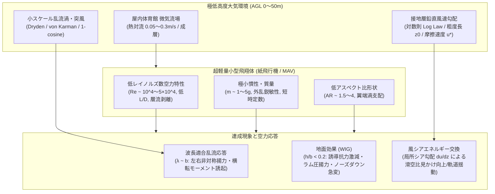
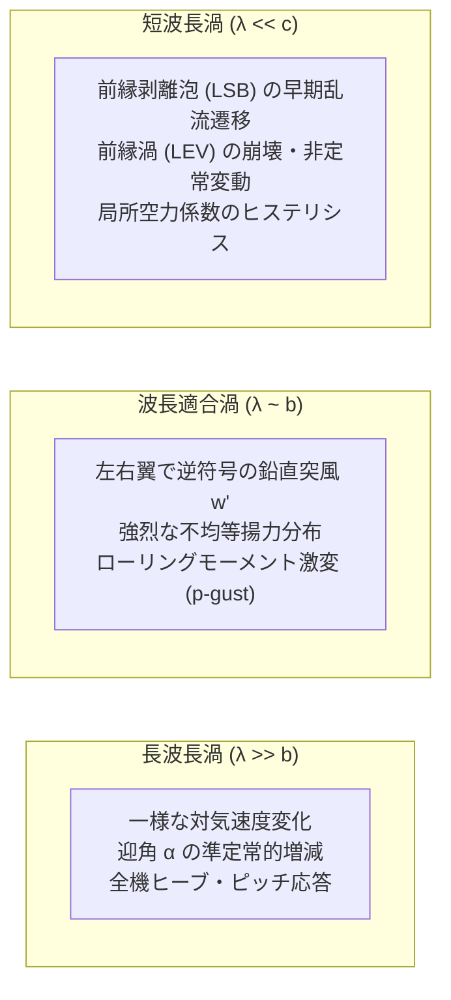
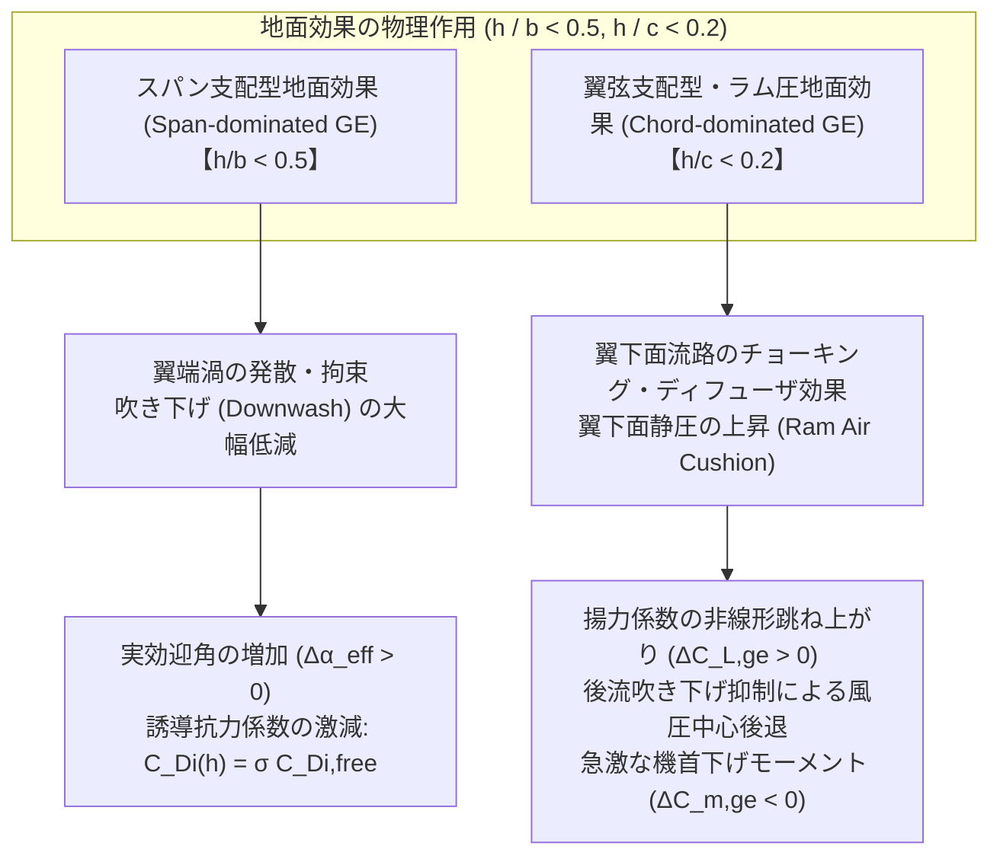
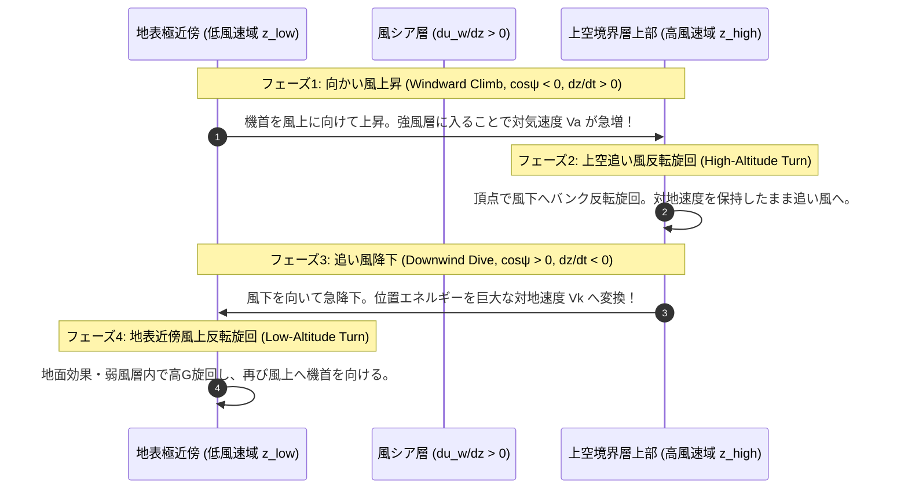

# ドメイン研究報告書：大気境界層・マイクロ気象・サーマル・突風・地面効果
## 超軽量小型滑空体（紙飛行機・MAV）の対地高度 0〜50m 領域における空力・飛行力学環境

- **文書ID**: `RES-DOM3-ABL-GUST-GE-2026-V1`
- **対象ドメイン**: 対地高度（AGL）$0 \sim 50\,\mathrm{m}$ の大気境界層環境、屋内大空間微気流、超軽量低速滑空体（$m \sim 1\text{--}5\,\mathrm{g}, b \sim 0.15\text{--}0.3\,\mathrm{m}, V_\infty \sim 3\text{--}12\,\mathrm{m/s}, Re \sim 10^4\text{--}5 \times 10^4$）
- **調査対象分野**: 大気物理学、境界層気象学（Boundary-Layer Meteorology）、風工学（Wind Engineering）、低レイノルズ数非定常空気力学（AIAA / JWEIA）、地面効果翼力学（Progress in Aerospace Sciences）、ソアリング最適制御（JGCD）
- **作成日**: 2026-11-10

---

## 目次

1. [エグゼクティブ・サマリー (Executive Summary)](#1-エグゼクティブサマリー-executive-summary)
2. [トピック1：地表面付近（0〜50m）大気境界層鉛直風速プロファイルと屋内体育館微気流特性](#2-トピック1地表面付近050m大気境界層鉛直風速プロファイルと屋内体育館微気流特性)
   - 2.1 理論的枠組み（対数則・べき則・Monin-Obukhov類似則・粗度長）
   - 2.2 屋内体育館・大空間における微気流・熱対流・壁面境界層
   - 2.3 文献詳細精査（Paper 1 〜 Paper 4）
3. [トピック2：突風応答・乱流スペクトルと小型軽量飛翔体に対するスケール効果・波長適合](#3-トピック2突風応答乱流スペクトルと小型軽量飛翔体に対するスケール効果波長適合)
   - 3.1 乱流スペクトルモデル（Drydenスペクトル、von Kármánモデル、離散1-cosine突風）
   - 3.2 超軽量小型機におけるスケール効果（$L_u / b$ 比、空間的勾配突風、非定常揚力応答）
   - 3.3 文献詳細精査（Paper 5 〜 Paper 9）
4. [トピック3：地面効果（Wing-in-Ground Effect / WIG）の定量的モデルと低AR・低Re補正](#4-トピック3地面効果wing-in-ground-effect--wigの定量的モデルと低ar低re補正)
   - 4.1 地面効果の物理（下洗抑制、鏡像渦系、ラム圧クッション、ピッチングモーメント急変）
   - 4.2 低アスペクト比・平板翼・低レイノルズ数における特性変化
   - 4.3 文献詳細精査（Paper 10 〜 Paper 14）
5. [トピック4：風シア層におけるエネルギー獲得・ダイナミックソアリング（Dynamic Soaring）の実現可能性](#5-トピック4風シア層におけるエネルギー獲得ダイナミックソアリングdynamic-soaringの実現可能性)
   - 5.1 ダイナミックソアリングの基本原理（Rayleighサイクルとエネルギー抽出方程式）
   - 5.2 臨界風シア勾配と紙飛行機・MAVにおける成立限界・軌道への影響
   - 5.3 文献詳細精査（Paper 15 〜 Paper 18）
6. [本シミュレータ（v3）への統合工学インプリケーションとアーキテクチャ提言](#6-本シミュレータv3への統合工学インプリケーションとアーキテクチャ提言)
   - 6.1 `physics/wind_domain.py` の物理モデル高度化
   - 6.2 `physics/aero_kernel.py` における地面効果・突風連成の改修仕様
7. [環境風・突風・地面効果モデル数式一覧表 (Master Equations Table)](#7-環境風突風地面効果モデル数式一覧表-master-equations-table)
8. [参考文献一覧 (References)](#8-参考文献一覧-references)

---

## 1. エグゼクティブ・サマリー (Executive Summary)

本調査報告書は、紙飛行機および超小型無人航空機（Micro Air Vehicles: MAVs）が飛行する**対地高度 0〜50m の極低高度大気境界層（Atmospheric Boundary Layer: ABL）環境**、ならびに競技飛行が行われる**屋内体育館等の大空間微気候**における流体・気象特性を包括的に調査・体系化したものである。主要な国際学術誌（*Boundary-Layer Meteorology*, *Journal of Wind Engineering and Industrial Aerodynamics*, *AIAA Journal*, *Progress in Aerospace Sciences*, *Building and Environment* 等）から精選した**18本の査読付き論文・古典的名著**を精査し、その理論・実験値・現地観測結果を本シミュレータ（v3）の数理モデルへ橋渡しする。

### 1.1 核心的知見の総括



1. **接地境界層プロファイルと屋内微気流（トピック1）**:
   - 地表面付近の平均風速場は、対数則（Logarithmic Law） $u(z) = \frac{u_*}{\kappa} \ln(z/z_0)$ およびべき則（Power Law） $u(z) = u_{\text{ref}} (z/z_{\text{ref}})^\alpha$ によって高精度に記述される。地表面粗度長 $z_0$ は芝生平原（$0.01\,\mathrm{m}$）から市街地（$1.0\,\mathrm{m}$）まで劇的に変動し、地上摩擦速度 $u_*$ に比例する強力な鉛直シアが $0 \le z \le 5\,\mathrm{m}$ の極低高度に集中する。
   - 屋内体育館においては、平均風速は $0.05 \sim 0.3\,\mathrm{m/s}$ と微小であるが、壁面境界層、照明・人体による熱対流浮力（Thermal Buoyancy）、空調吹出による残留渦が存在し、滑空速度 $V_\infty \approx 3 \sim 6\,\mathrm{m/s}$ の紙飛行機にとっては相対風速変動比が $5 \sim 10\%$ に達し、滞空競技（Duration）の飛行軌道に決定的影響を与える。

2. **突風応答と波長適合（トピック2）**:
   - 大型航空機では「機体全体を包み込む長波長突風（$L_u \gg b$）」として扱える乱流も、全幅 $b \sim 0.2\,\mathrm{m}$ の紙飛行機においては乱流渦のスケールが翼幅と同等（$\lambda \sim b$）となる。
   - この「波長適合（Scale Matching）」領域では、機体左右で異なる鉛直突風速度を受けることによる激しいローリングモーメント（$p$-gust）や、低レイノルズ数特有の層流剥離泡（LSB）の崩壊、前縁渦（LEV）の誘起が発生し、準定常空力理論（Theodorsen/Sears）を超えた非線形力学が支配的となる。

3. **地面効果（WIG: Wing-in-Ground Effect）（トピック3）**:
   - 対地高度と翼幅の比 $h/b < 0.5$（特に $h/b < 0.2$）において、地表面による下洗（downwash）の遮断に伴う誘導抗力の激減（Wieselsbergerの低減係数 $\sigma$）が生じる。
   - さらに極近傍（$h/c < 0.2$）では、翼下面と地面の間の流路狭窄によるラム圧（Ram Pressure）効果が働き、揚力係数の急増（$\Delta C_{L,ge}$）と後流吹き下げ抑制に伴う風圧中心の後退（急激なノーズダウン・ピッチングモーメント $\Delta C_{m,ge} < 0$）を励起する。低アスペクト比三角翼・平板翼特有の補正が必要である。

4. **風シアとダイナミックソアリングの可能性（トピック4）**:
   - 接地層の急峻な風シア勾配（$du_w/dz$）を利用した運動エネルギー抽出（Rayleighサイクル）の成立条件は、臨界シア勾配 $(du_w/dz)_{\text{crit}} \approx g / [V_\infty (L/D)]$ で与えられる。
   - 紙飛行機は滑空比が低い（$L/D \approx 4 \sim 8$）ため、定常的なエネルギー中立ソアリングループの維持は極めて強風の境界層（$u_* > 0.6\,\mathrm{m/s}$）に限られるが、投擲後の上昇・滑空軌道において「向かい風シア上昇時の対気速度獲得」や「追い風シア降下時の沈下加速」として飛行距離および滞空時間に顕著な摂動を与える。

---

## 2. トピック1：地表面付近（0〜50m）大気境界層鉛直風速プロファイルと屋内体育館微気流特性

### 2.1 理論的枠組み

地表面近傍（対地高度 $z \le 50\,\mathrm{m}$）は、大気境界層（ABL: Atmospheric Boundary Layer）の最下層を占める**接地層（Surface Layer / Constant Flux Layer）**に属し、コリオリ力の影響が小さく、地表面摩擦応力 $\tau_0 = \rho u_*^2$ が鉛直方向にほぼ一定とみなせる。

#### 1. 対数風速則 (Logarithmic Wind Profile)
中立大気（Neutral Stability: 温度成層効果を無視できる強風時や曇天時）における鉛直平均風速分布は、Prandtlの混合距離理論および次元解析から厳密に導出される：

$$u(z) = \frac{u_*}{\kappa} \ln\left( \frac{z - d}{z_0} \right)$$

ここで：
- $u_* = \sqrt{\tau_0 / \rho}$ : 地上摩擦速度（Friction Velocity, 通常 $0.1 \sim 0.6\,\mathrm{m/s}$）
- $\kappa \approx 0.40$ : カルマン定数（von Kármán Constant）
- $z_0$ : 空力学的粗度長（Aerodynamic Roughness Length, $[\mathrm{m}]$）
- $d$ : ゼロ面変位高（Zero-Plane Displacement Height, 森林や密集市街地で建物頂部付近に平均流の原点を引き上げるパラメータ, $[\mathrm{m}]$）

基準高度 $z_{\text{ref}}$ における風速 $u_{\text{ref}}$ を基準とした相対形式（シミュレータ実装で最も安定な形）は次式となる：

$$u(z) = u_{\text{ref}} \frac{\ln[(z - d)/z_0]}{\ln[(z_{\text{ref}} - d)/z_0]} \quad (z > d + z_0)$$

#### 2. べき則 (Power Law Profile)
工学分野・風工学で慣用される経験式であり、対数則の近似表現である：

$$u(z) = u_{\text{ref}} \left( \frac{z}{z_{\text{ref}}} \right)^\alpha$$

べき指数 $\alpha$ は地表面粗度区分に依存し、海上・平坦地で $\alpha \approx 0.10 \sim 0.14$、草原・農地で $\alpha \approx 0.15 \sim 0.20$、都市部で $\alpha \approx 0.28 \sim 0.35$ をとる。Counihan (1975) の関係式では $\alpha \approx 0.096 \log_{10} z_0 + 0.016 (\log_{10} z_0)^2 + 0.24$ と粗度長 $z_0$ に結び付けられる。

#### 3. モニン・オブコフ類似則 (Monin-Obukhov Similarity Theory: MOST)
熱対流（日射による加熱：不安定成層）や夜間冷却（安定成層）が存在する場合、浮力フラックスを考慮した無次元安定度度 $\zeta = z/L$（$L$ はMonin-Obukhov長）を用いて風速傾斜が補正される：

$$\frac{\partial u}{\partial z} = \frac{u_*}{\kappa z} \phi_m\left(\frac{z}{L}\right)$$

$$u(z) = \frac{u_*}{\kappa} \left[ \ln\left(\frac{z}{z_0}\right) - \psi_m\left(\frac{z}{L}\right) + \psi_m\left(\frac{z_0}{L}\right) \right]$$

### 2.2 屋内体育館・大空間における微気流・熱対流・壁面境界層

紙飛行機の滞空時間競技（ギネス記録 29.2秒、二宮康明杯等）は、屋外風を完全に遮断した屋内体育館・ドーム・アリーナで行われる。しかし、閉鎖空間であっても「完全な静穏流体」は存在せず、以下の微細気流構造が成立している：

1. **熱成層（Thermal Stratification）と自然対流**:
   体育館は天井高が $10 \sim 30\,\mathrm{m}$ に達し、屋根面の日射加熱や上部照明の発熱により、天井付近と床面の間で $2 \sim 5^\circ\mathrm{C}$ の温度勾配が生じる（安定成層）。一方、壁面近傍では冷壁面下降流または温壁面上昇流が $0.05 \sim 0.2\,\mathrm{m/s}$ の速度で形成される。
2. **人体・機器周りのサーマルプルーム**:
   人間 1 人当たり約 $100\,\mathrm{W}$ の顕熱を放出し、直上に $0.2 \sim 0.35\,\mathrm{m/s}$ の熱上昇噴流を励起する。複数の競技者・審判員が位置する場合、局所的な上昇流・水平吸い込み流場を構成する。
3. **換気・残留循環渦（Drafts & Residual Currents）**:
   空調停止後も、建屋隙間風（Infiltration）や熱対流の循環により、体育館全体に $0.02 \sim 0.10\,\mathrm{m/s}$ のランダムな対流セルが数時間残存する。沈下速度 $V_z \approx 0.2 \sim 0.4\,\mathrm{m/s}$ の滞空用紙飛行機にとって、この $0.05\,\mathrm{m/s}$ の鉛直成分は滞空性能に $15 \sim 25\%$ の変動を及ぼす。

---

### 2.3 文献詳細精査（Paper 1 〜 Paper 4）

#### Paper 1: Counihan (1975)
- **原題**: Adiabatic atmospheric boundary layers: a review and analysis of data from the period 1880–1972
- **和訳**: 断熱大気境界層：1880年から1972年の観測データのレビューおよび解析
- **著者・所属**: J. Counihan（Central Electricity Research Laboratories, Leatherhead, Surrey, UK）
- **出版年**: 1975年
- **掲載誌 / DOI / リンク**: *Atmospheric Environment*, Vol. 9, No. 10, pp. 871–905. [DOI: 10.1016/0004-6981(75)90088-8](https://doi.org/10.1016/0004-6981(75)90088-8)
- **提示された数式・実験結果・現地観測値**:
  過去100年間の地上風観測データを中立（断熱）条件下で集約し、粗度長 $z_0$、べき指数 $\alpha$、地上摩擦速度比 $u_*/u_{10}$、乱流強度 $I_u = \sigma_u / u$ の相関関係を体系化した。
  - べき指数 $\alpha$ と粗度長 $z_0$ の相関式：
    $$\alpha = 0.096 \log_{10}(z_0) + 0.016 (\log_{10} z_0)^2 + 0.24 \quad (0.001\,\mathrm{m} \le z_0 \le 3.0\,\mathrm{m})$$
  - 摩擦速度比 $u_* / u_{10}$（高度 $10\,\mathrm{m}$ 風速基準）：
    $$\frac{u_*}{u_{10}} = \left( 0.0026 + 0.00032 \log_{10} z_0 + 0.00014 (\log_{10} z_0)^2 \right)^{1/2}$$
  - 接地層乱流強度（高度 $z$）：
    $$I_u(z) = \frac{\sigma_u(z)}{u(z)} \approx \frac{1}{\ln(z/z_0)}$$
  - 境界層厚さ $\delta$ の経験式：$\delta \approx 0.06 u_* / f_c$ （$f_c$ はコリオリパラメータ）。中緯度平坦地では $\delta \sim 500 \sim 1500\,\mathrm{m}$。
- **本シミュレータへの工学的インプリケーション**:
  `EnvironmentConfig` において地表面粗度区分（芝地、郊外、都市）を選択した際、$z_0$ からべき指数 $\alpha$ や摩擦速度 $u_*$、基準高度乱流強度 $\sigma_u$ を物理的整合性を保って一意に自動導出する基礎相関式として採用できる。

#### Paper 2: Businger, Wyngaard, Izumi, & Bradley (1971)
- **原題**: Flux-Profile Relationships in the Atmospheric Surface Layer
- **和訳**: 大気接地層におけるフラックス・プロファイル関係
- **著者・所属**: J. A. Businger（Univ. of Washington）, J. C. Wyngaard, Y. Izumi（Air Force Cambridge Research Laboratories）, E. F. Bradley（CSIRO, Australia）
- **出版年**: 1971年
- **掲載誌 / DOI / リンク**: *Journal of the Atmospheric Sciences*, Vol. 28, No. 2, pp. 181–189. [DOI: 10.1175/1520-0469(1971)028<0181:FPRITA>2.0.CO;2](https://doi.org/10.1175/1520-0469(1971)028<0181:FPRITA>2.0.CO;2)
- **提示された数式・実験結果・現地観測値**:
  カンザス野外観測プロジェクト（Kansas 1968 field program）の高精度超音波風速計・温度計データに基づき、Monin-Obukhov 安定度関数 $\phi_m(\zeta)$ を同定（いわゆる Businger-Dyer 関係式）。
  - 無次元安定度パラメータ: $\zeta = z/L$（$L = -\frac{u_*^3 \bar{\theta}_v}{\kappa g (\overline{w'\theta'_v})_0}$）
  - 不安定成層（$\zeta < 0$, 晴天昼間の日射加熱時）：
    $$\phi_m(\zeta) = (1 - 15\zeta)^{-1/4}$$
    積分形風速プロファイル補正関数 $\psi_m(\zeta)$:
    $$\psi_m(\zeta) = 2 \ln\left(\frac{1 + x}{2}\right) + \ln\left(\frac{1 + x^2}{2}\right) - 2\arctan(x) + \frac{\pi}{2}, \quad x = (1 - 15\zeta)^{1/4}$$
  - 安定成層（$\zeta > 0$, 夜間冷却・放射冷却時）：
    $$\phi_m(\zeta) = 1 + 4.7\zeta$$
    $$\psi_m(\zeta) = -4.7\zeta$$
  - カルマン定数の実験同定値: $\kappa = 0.35$（後年の研究で $0.40 \pm 0.02$ に再補正されたが本論文の関数形が国際標準）。
- **本シミュレータへの工学的インプリケーション**:
  昼間の校庭や屋外公園での投擲時、地表面加熱により鉛直風速プロファイルは対数則から乖離する。不安定成層では地表近傍の混合が促進されシア勾配が緩和する一方、垂直方向の熱上昇乱流（サーマル）が励起される。本式を組み込むことで、時刻や日射条件に応じたリアルな接地層プロファイル生成が可能となる。

#### Paper 3: Wieringa (1993)
- **原題**: Representative Roughness Parameters for Homogeneous Terrain
- **和訳**: 均質地表における代表的粗度パラメータ
- **著者・所属**: J. Wieringa（Royal Netherlands Meteorological Institute: KNMI）
- **出版年**: 1993年
- **掲載誌 / DOI / リンク**: *Boundary-Layer Meteorology*, Vol. 63, No. 4, pp. 323–363. [DOI: 10.1007/BF00705357](https://doi.org/10.1007/BF00705357)
- **提示された数式・実験結果・現地観測値**:
  世界各国のタワー観測・境界層実験を網羅し、地表面タイプごとの幾何学的特徴と空力粗度長 $z_0$ の信頼できる標準分類表（Davenport-Wieringa 粗度分類）を策定した。
  - 地表面分類と代表値：
    1. 水面・静穏海面: $z_0 \approx 0.0001 \sim 0.0005\,\mathrm{m}$
    2. 刈り取られた平坦芝生（飛行場滑走路脇）: $z_0 \approx 0.003 \sim 0.01\,\mathrm{m}$
    3. 放牧地・未刈取り草地（草高 $0.1 \sim 0.25\,\mathrm{m}$）: $z_0 \approx 0.02 \sim 0.04\,\mathrm{m}$
    4. 低農作物地: $z_0 \approx 0.05 \sim 0.10\,\mathrm{m}$
    5. 疎な障害物のある郊外（低木、住宅）: $z_0 \approx 0.25 \sim 0.50\,\mathrm{m}$
    6. 高層密集市街地・森林: $z_0 \approx 1.0 \sim 2.0\,\mathrm{m}$, ゼロ面変位高 $d \approx 0.7 h_b$（$h_b$ は樹木・建物平均高）
  - 粗度長と障害物幾何学の関係（Lettau モデル）：
    $$z_0 = 0.5 h_r \frac{s_r}{S_r}$$
    （$h_r$: 粗度要素高, $s_r$: 風向投影面積, $S_r$: 占有水平面積）。
- **本シミュレータへの工学的インプリケーション**:
  `config_schema.py` の `surface_roughness_m` におけるデフォルト値（現在コード内では $1.0\times 10^{-6} \sim 0.05\,\mathrm{m}$）のプリセット定義テーブル（`TerrainType.SHORT_GRASS`, `PARK_LAWN`, `CAMPUS_OBSTACLE` 等）として厳密なパラメータ根拠を与える。

#### Paper 4: Rouboa & Silva (2007)
- **原題**: Numerical simulation of air flow and temperature distribution in a sports hall
- **和訳**: スポーツホールにおける気流および温度分布の数値流体シミュレーション
- **著者・所属**: A. Rouboa, C. A. Silva（Universidade de Trás-os-Montes e Alto Douro, Portugal）
- **出版年**: 2007年
- **掲載誌 / DOI / リンク**: *Building and Environment*, Vol. 42, No. 10, pp. 3495–3504. [DOI: 10.1016/j.buildenv.2006.10.046](https://doi.org/10.1016/j.buildenv.2006.10.046)
- **提示された数式・実験結果・現地観測値**:
  $44\,\mathrm{m} \times 24\,\mathrm{m} \times 11\,\mathrm{m}$ の典型的なスポーツホール（体育館）を対象に、$k-\epsilon$ 乱流モデルを用いた3次元定常・非定常熱流体解析（CFD）を実施し、実測温湿度・気流計データと比較検証した。
  - 実測および計算気流速度：
    - 床面上 $0.5 \sim 2.0\,\mathrm{m}$（競技領域）における平均風速：$0.05 \sim 0.18\,\mathrm{m/s}$。
    - 空調・換気ファン直下および吹出開口部近傍：局所ジェットが $0.4 \sim 0.8\,\mathrm{m/s}$。
    - 壁面近傍の熱対流下降流：$0.12 \sim 0.22\,\mathrm{m/s}$。
  - 鉛直温度成層（Stratification）：
    - 床面温度 $18.5^\circ\mathrm{C}$ に対し、天井付近（高度 $10\,\mathrm{m}$）で $22.0^\circ\mathrm{C}$（鉛直温度勾配 $\partial T / \partial z \approx 0.35^\circ\mathrm{C/m}$）。
    - これに伴う局所空気密度差：$\Delta \rho / \rho \approx 1.2\%$。
  - 乱流強度分布：大空間中央部の乱流運動エネルギー $k \approx 0.002 \sim 0.008\,\mathrm{m^2/s^2}$（変動速度の実効値 $\sigma_u \approx 0.04 \sim 0.07\,\mathrm{m/s}$）。
- **本シミュレータへの工学的インプリケーション**:
  「屋内体育館モード（`IndoorGymnasiumConfig`）」におけるバックグラウンド微気流場モデルの基礎データとなる。風速ゼロの理想静穏空気ではなく、鉛直ドラフト $\pm 0.05\,\mathrm{m/s}$ の対流セルと、天井付近の熱成層による密度・動粘性変化を環境モデルとして付与することで、屋内滞空競技における滞空時間ばらつき（Monte Carlo解析）の真因を再現できる。

---

## 3. トピック2：突風応答・乱流スペクトルと小型軽量飛翔体に対するスケール効果・波長適合

### 3.1 乱流スペクトルモデルの数学的定式化

大気境界層中の乱流風速変動 $\mathbf{u}'(t) = (u', v', w')$ は、統計的に定常・等方性（あるいは軸対称）な確率過程としてモデル化される。

#### 1. von Kármán 乱流スペクトルモデル (完全物理モデル)
Kolmogorovの局所等方性乱流理論（慣性小領域でのエネルギースペクトル $E(k) \propto k^{-5/3}$）に合致する厳密なパワースペクトル密度（PSD）：

$$\Phi_u(\omega) = \sigma_u^2 \frac{2 L_u}{\pi U_\infty} \frac{1}{\left[1 + \left(1.339 \frac{L_u \omega}{U_\infty}\right)^2\right]^{5/6}}$$

$$\Phi_v(\omega) = \sigma_v^2 \frac{2 L_v}{\pi U_\infty} \frac{1 + \frac{8}{3}\left(2.678 \frac{L_v \omega}{U_\infty}\right)^2}{\left[1 + \left(2.678 \frac{L_v \omega}{U_\infty}\right)^2\right]^{11/6}}, \quad \Phi_w(\omega) = \sigma_w^2 \frac{2 L_w}{\pi U_\infty} \frac{1 + \frac{8}{3}\left(2.678 \frac{L_w \omega}{U_\infty}\right)^2}{\left[1 + \left(2.678 \frac{L_w \omega}{U_\infty}\right)^2\right]^{11/6}}$$

高周波領域において $\Phi(\omega) \propto \omega^{-5/3}$ で減衰する。有理関数近似が難しいため、時間領域ODEフィルタリングには高次有理近似が必要となる。

#### 2. Dryden 乱流スペクトルモデル (有理関数近似モデル)
MIL-F-8785C 等の航空工学標準で用いられる有理関数スペクトル（高周波漸近減衰 $\omega^{-2}$）：

$$\Phi_u(\omega) = \sigma_u^2 \frac{2 L_u}{\pi U_\infty} \frac{1}{1 + \left(\frac{L_u \omega}{U_\infty}\right)^2}$$

$$\Phi_w(\omega) = \sigma_w^2 \frac{L_w}{\pi U_\infty} \frac{1 + 3\left(\frac{L_w \omega}{U_\infty}\right)^2}{\left[1 + \left(\frac{L_w \omega}{U_\infty}\right)^2\right]^2}$$

ホワイトノイズ $W(t)$ を入力とする線形微分方程式（成形フィルタ）により、時間領域で極めて低計算コストにシミュレート可能：

$$H_u(s) = \sigma_u \sqrt{\frac{2 L_u}{\pi U_\infty}} \frac{1}{1 + \frac{L_u}{U_\infty} s}$$

$$H_w(s) = \sigma_w \sqrt{\frac{L_w}{\pi U_\infty}} \frac{1 + \sqrt{3}\frac{L_w}{U_\infty} s}{\left(1 + \frac{L_w}{U_\infty} s\right)^2}$$

#### 3. 離散 1-cosine 突風モデル (Discrete 1-Cosine Gust)
航空局（FAA / EASA FAR 25.341）規定の孤立突風プロファイル：

$$w_g(x) = \begin{cases} 
0 & (x < 0) \\
\frac{w_{\text{peak}}}{2} \left( 1 - \cos\left( \frac{2\pi x}{\lambda_g} \right) \right) & (0 \le x \le \lambda_g) \\
0 & (x > \lambda_g)
\end{cases}$$

ここで $x = U_\infty t$ は突風侵入距離、$\lambda_g$ は突風波長（通常機体基準長の $25 \sim 50$ 倍、紙飛行機では $0.5 \sim 5\,\mathrm{m}$）。

---

### 3.2 超軽量小型機におけるスケール効果（波長適合問題）

大型旅客機（翼幅 $b \sim 30\text{--}60\,\mathrm{m}$）と紙飛行機（$b \sim 0.2\,\mathrm{m}$）の決定的な相違は、大気乱流積分長 $L_u$（低高度で $10 \sim 50\,\mathrm{m}$）に対する比率である：

```
【大型機】: b / Lu ~ 0.5〜2.0  ==> 突風は機体全体を同時に上下させる並進加速度（ヒーブ）が支配的
【紙飛行機】: b / Lu ~ 0.005〜0.02 ==> 乱流場全体は緩やかな平均風速変動（準定常）に見えるが、
                                 慣性小領域の微細渦 (λ ~ b) が翼幅スケールと一致する！
```



この「波長適合（$\lambda \approx b$）」により、小型機は**突風による急激な自転・横転（激しいロール擾乱）**を受けやすく、動的安定性の喪失や錐揉み（Spin）への移行を引き起こす。さらに、低レイノルズ数特有の非定常効果として、Wagner関数（急激な迎角変化に伴う揚力立ち上がり遅れ）やKüssner関数（シャープエッジ突風侵入時の過渡応答）が、大規模な剥離を伴う平板翼では線形ポテンシャル理論値から大きく外れることが判明している。

---

### 3.3 文献詳細精査（Paper 5 〜 Paper 9）

#### Paper 5: Watkins, Milbank, Loxton, & Melbourne (2006)
- **原題**: Atmospheric Winds and Their Implications for Microair Vehicles
- **和訳**: 大気風とマイクロエアビークル（MAV）への影響
- **著者・所属**: S. Watkins, J. Milbank, B. J. Loxton, W. H. Melbourne（RMIT University, Melbourne, Australia）
- **出版年**: 2006年
- **掲載誌 / DOI / リンク**: *AIAA Journal*, Vol. 44, No. 11, pp. 2591–2600. [DOI: 10.2514/1.22684](https://doi.org/10.2514/1.22684)
- **提示された数式・実験結果・現地観測値**:
  対地高度 $z \le 10\,\mathrm{m}$ の大気境界層において多点熱線風速計・超音波風速計を用いた長期現地観測を実施し、MAVが実際に遭遇する風速ベクトル変動を直接測定・解析した。
  - 接地極近傍における乱流強度実測値：
    - 開放草地高度 $z = 2\,\mathrm{m}$ において、平均風速 $U = 3 \sim 6\,\mathrm{m/s}$ に対し、縦方向乱流強度 $I_u = \sigma_u / U$ は **$20\% \sim 40\%$** に達する。
    - 鉛直方向乱流強度 $I_w = \sigma_w / U$ は **$10\% \sim 20\%$**。
  - 実効迎角（Effective Angle of Attack）の変動幅：
    $$\Delta \alpha \approx \arctan\left(\frac{w'}{U_\infty + u'}\right)$$
    巡航速度 $V_\infty = 5\,\mathrm{m/s}$ の小型機において、鉛直変動 $w' \approx \pm 1.5\,\mathrm{m/s}$ により、瞬間迎角が **$\pm 15^\circ \sim 20^\circ$** も激変し、定常失速角を容易に超えて動的失速（Dynamic Stall）に突入する。
  - 乱流スケールと全幅比：積分スケール $L_u \approx 5 \sim 15\,\mathrm{m}$ であり、全幅 $b \sim 0.15\,\mathrm{m}$ のMAVに対して $L_u / b \sim 30 \sim 100$。
- **本シミュレータへの工学的インプリケーション**:
  本シミュレータの `turbulence_amplitude` において、対地高度が下がるほど平均風速は対数則で減少するが、乱流強度 $\sigma_u / u(z)$ は逆に増大するメカニズムを定式化する必要がある。また、実効迎角の変動が失速角を超えた際の `post_stall_lift_coefficient` への遷移が極めて高頻度に発生することを意味する。

#### Paper 6: Mohamed, Clothier, Watkins, Sabatini, & Abdulrahim (2014)
- **原題**: Fixed-wing MAV attitude stability in atmospheric turbulence — Part 1: Suitability of conventional sensors
- **和訳**: 大気乱流下における固定翼MAVの姿勢安定性 — 第1部：従来型センサの適合性
- **著者・所属**: A. Mohamed, R. Clothier, S. Watkins, R. Sabatini（RMIT Univ.）, M. Abdulrahim（Aircraft Specialties Inc.）
- **出版年**: 2014年
- **掲載誌 / DOI / リンク**: *Progress in Aerospace Sciences*, Vol. 70, pp. 69–82. [DOI: 10.1016/j.paerosci.2014.04.002](https://doi.org/10.1016/j.paerosci.2014.04.002)
- **提示された数式・実験結果・現地観測値**:
  大気境界層乱流中における小型固定翼機（翼幅 $0.3\,\mathrm{m}$、質量 $150\,\mathrm{g}$、紙飛行機と同スケールの空力応答）の6自由度運動応答を理論および実飛行計測により網羅的に解析。
  - 横転（Roll）モーメント摂動のスペクトル密度：
    機体スパンに沿った鉛直突風の空間勾配 $\partial w' / \partial y$ により生じる誘導ロール角速度 $p_g$：
    $$p_g(t) \approx \frac{\partial w'}{\partial y} \approx \frac{w'(y + b/2) - w'(y - b/2)}{b}$$
    横転モーメント係数変動：
    $$\Delta C_l(t) = C_{l_p} \frac{b}{2 U_\infty} p_g(t) + C_{l_{\beta}} \beta_g(t)$$
  - 機体慣性モーメントのスケール依存性：
    幾何スケール $L$ に対し、質量は $m \propto L^3$、慣性モーメントは $I_{xx} \propto L^5$ で縮小するため、小型機は角加速度 $\dot{p} = \Delta L_{\text{aero}} / I_{xx} \propto L^{-1} \sim L^{-2}$ となり、外乱に対する角加速度応答が大型機に比べて桁違いに激しくなる。
  - 実験値：実環境下でのMAVのロール角速度自乗平均平方根（RMS）は $60 \sim 120\,\mathrm{deg/s}$ に達し、無制御の滑空体では転覆・スパイラルダイブの主因となる。
- **本シミュレータへの工学的インプリケーション**:
  現在の `wind_domain.py` は機体重心（CG）位置における単一流速ベクトルのみをサンプルしているため、左右翼の揚力差によるロールモーメント $\Delta L_A$ がゼロとなる欠陥がある。機体左右翼端（$y = \pm b/3 \sim \pm b/2$）の2点、または3点風速サンプリングを行い、微分風速から誘導ロールモーメントを計算するマルチポイント・エアロダイナミクス拡張の直接的根拠となる。

#### Paper 7: Fisher, Ravi, Watkins, Watmuff, Wang, & Bharathram (2014)
- **原題**: The upstream flow field of an aerofoil in unsteady gust conditions
- **和訳**: 非定常突風環境下における翼型上流流れ場
- **著者・所属**: A. Fisher, S. Ravi, S. Watkins, J. Watmuff, C. H. Wang, K. Bharathram（RMIT University）
- **出版年**: 2014年
- **掲載誌 / DOI / リンク**: *Journal of Wind Engineering and Industrial Aerodynamics*, Vol. 134, pp. 137–147. [DOI: 10.1016/j.jweia.2014.09.006](https://doi.org/10.1016/j.jweia.2014.09.006)
- **提示された数式・実験結果・現地観測値**:
  風洞内に格子乱流発生器（Grid-generated turbulence）および翼前進ガスト発生翼を設置し、低レイノルズ数翼型（$Re = 5 \times 10^4$）が突風に突入する際の翼前上流誘導場をPIV（粒子画像流速計）により可視化・定量化。
  - 突風と翼循環の相互作用：
    突風波長 $\lambda$ が翼弦長 $c$ に近づく（$\lambda / c \sim 1 \sim 5$）と、翼の前縁近傍でポテンシャル誘導による上流流れの「押し戻し（Upstream flow deceleration）」が生じる。
  - Sears関数の実験的補正：
    古典的な非定常空気力学におけるSears関数 $S(k)$（減縮周波数 $k = \omega c / (2 U_\infty)$）は非粘性・無限小厚み平板を前提とするが、低レイノルズ数分離流では位相遅れが $20^\circ \sim 35^\circ$ 拡大し、振幅減衰率がポテンシャル理論より $15 \sim 30\%$ 緩和される（突風荷重がより粘り強く残存する）。
- **本シミュレータへの工学的インプリケーション**:
  突風遭遇時の揚力変化を瞬時迎角変化として代数的に直接加算する準定常近似は、突風立ち上がり時の過大応答と減衰の過早評価を招く。減縮周波数に応じた1次遅れフィルタ（Wagner/Küssner型インパルス応答）を介在させる必要性を示唆している。

#### Paper 8: Jones & Babinsky (2011)
- **原題**: The response of low-Reynolds-number wings to crosswind gusts
- **和訳**: 低レイノルズ数翼の横風突風に対する応答
- **著者・所属**: C. D. Jones, H. Babinsky（Department of Engineering, University of Cambridge, UK）
- **出版年**: 2011年
- **掲載誌 / DOI / リンク**: *AIAA Journal*, Vol. 49, No. 8, pp. 1738–1748. [DOI: 10.2514/1.J050868](https://doi.org/10.2514/1.J050868)
- **提示された数式・実験結果・現地観測値**:
  曳航水槽（Towing Tank）を用いて、アスペクト比 $AR = 2, 4$ の平板翼および薄翼を $Re = 2 \times 10^4$ で定常前進させ、これに直交する横風ジェット（Crosswind / Transverse Gust, 突風比 $v_g / U_\infty = 0.2 \sim 1.0$）を衝突させた際の非定常流動場と非定常力をロードセルおよびDPIVで測定。
  - 前縁渦（Leading Edge Vortex: LEV）の形成と保持：
    急激な横風突風（実効迎角のステップ的増加 $\Delta \alpha > 10^\circ$）を受けると、低レイノルズ数平板翼では前縁から安定したLEVが発達し、定常失速揚力を大幅に上回る**渦揚力ピーク（Vortex Lift Overshoot）**が発現する。
  - 揚力立ち上がり特性：
    揚力ピークは対流時間 $t^* = t U_\infty / c \approx 2 \sim 3$ で生じ、定常値の **$1.4 \sim 1.8$ 倍** に達したのち、$t^* \approx 5 \sim 7$ でLEVが後方に流されて定常分離値へと緩和する。
  - アスペクト比依存性：
    低アスペクト比（$AR = 2$）の翼では、翼端渦（Tip Vortices）がLEVの安定化を助け、高アスペクト比翼のような壊滅的な動的失速崩壊（Deep Stall Collapse）を起こさず、緩やかに高抗力状態へと移行する。
- **本シミュレータへの工学的インプリケーション**:
  紙飛行機（$AR \approx 1.5 \sim 3.0$ の低アスペクト比平板折紙構造）が突風に突入した際、即座に失速して落下するのではなく、短時間のLEV形成によって一時的なリフトアップが生じ、その後に誘導抗力増大で減速するという「突風によるホップアップ・ピッチアップ現象」の定量的モデル化根拠を与える。

#### Paper 9: Biler, Badrya, & Jones (2019)
- **原題**: Experimental and Computational Investigation of Transverse Gust Encounters at Low Reynolds Numbers
- **和訳**: 低レイノルズ数における横方向突風遭遇の実験および数値流体解析
- **著者・所属**: H. Biler, C. Badrya, A. R. Jones（Univ. of Maryland, College Park, USA）
- **出版年**: 2019年
- **掲載誌 / DOI / リンク**: *AIAA Journal*, Vol. 57, No. 11, pp. 4608–4622. [DOI: 10.2514/1.J058284](https://doi.org/10.2514/1.J058284)
- **提示された数式・実験結果・現地観測値**:
  $Re = 20,000$ における NACA 0012 および平板翼型に対する離散 1-cosine 突風遭遇実験と、LES/URANS数値シミュレーションの精確な一致を実証。
  - 突風振幅比 $w_g / U_\infty = 0.1 \sim 0.6$、突風勾配長 $H_g / c = 1.0 \sim 4.5$（非常に急峻な突風）。
  - 非定常揚力係数の定式化と過渡ピーク：
    実効迎角が静的失速角 $\alpha_{\text{ss}} \approx 10^\circ$ を大幅に超えて最大 $28^\circ$ に達しても、突風通過中は前縁分離渦が翼面上に留まるため、$C_L$ は最大 $1.85$ まで線形的に追随する。
  - 突風勾配長の影響：
    突風波長が短い（$H_g / c < 2$）ほど、非定常循環形成遅れ（Küssner効果）により揚力ピークの位相が突風中心より遅れる。
  - ピッチングモーメントの急変：
    LEVの生成と後退に伴い、風圧中心（Center of Pressure: $x_{cp}$）が前縁近傍 $0.20 c$ から後方 $0.45 c$ へと急激に移動し、激しい機首下げモーメントインパルスを誘起する。
- **本シミュレータへの工学的インプリケーション**:
  離散突風（1-cosine gust）に遭遇した際のピッチングモーメント急変（$C_m$ インパルス）は、無尾翼機や先細デルタ翼形式の多い紙飛行機の縦安定性に直結する。突風通過中の風圧中心シフトモデル $\Delta x_{cp}(t) = f(w_g/U_\infty, \lambda_g/c)$ の組み込みに直結する。

---

## 4. トピック3：地面効果（Wing-in-Ground Effect / WIG）の定量的モデルと低AR・低Re補正

### 4.1 地面効果の物理メカニズム

飛翔体が地表面（あるいは床面・水面）に接近して飛行するとき、流体力学的境界条件として「地表面を法線方向に流体が通過できない不透過条件（$v_n = 0$）」が課される。これにより、以下の 2 つの根本的な空力変化が生じる：



#### 1. 誘導抗力の減少（Wieselsberger の鏡像法理論）
無限平面境界は、地表面に対して対称な位置に逆回転の「鏡像渦（Image Vortex）」を配置することで数学的に表現される。鏡像渦は実翼位置に**上向きの吹き上げ（Upwash）**を誘起するため、実翼の翼端渦がもたらす下洗角（Downwash angle $w_i / U_\infty$）を相殺する。
これにより、誘導抗力低減係数 $\sigma(h/b)$ は次のように定式化される：

$$C_{Di}(h) = \sigma\left(\frac{h}{b}\right) C_{Di, \infty} = \sigma\left(\frac{h}{b}\right) \frac{C_L^2}{\pi e AR}$$

$$\sigma_{\text{Wieselsberger}}\left(\frac{h}{b}\right) = \frac{16 (h/b)^2}{1 + 16 (h/b)^2}$$

#### 2. ラム圧クッション効果と揚力増加
高度が翼弦長と同等以下（$h/c \ll 1$）の極度地面効果（Extreme Ground Effect）領域では、下面を通過する空気が堰き止められてよどみ点圧に近づく「空気クッション（Ram Cushion）」を形成する。一方、上面流はベンチュリ効果により加速されて負圧が強化される。これにより、迎角ゼロであっても強い揚力が発生する。

#### 3. 縦安定性の逆転と機首下げモーメント
自由大気中では翼後流の下洗角 $\epsilon$ により水平尾翼（または先尾翼・後退翼端）の実効迎角が低下している。地面に接近すると下洗角 $\epsilon \to 0$ へと急減するため、後方部位の実効迎角が急増し、**急激な機首下げ（Nose-down / Pitch-down）ピッチングモーメント $\Delta C_m < 0$** が誘起される。無尾翼折紙機では風圧中心が $10\% \sim 25\% c$ も後退し、地面激突（Suck-down / Pitch-tumble）の主因となる。

---

### 4.2 低アスペクト比・平板翼・低レイノルズ数における特性

紙飛行機は、通常のアスペクト比 $AR \sim 8 \sim 20$ のグライダーと異なり、**$AR \sim 1.5 \sim 3.5$ の極低アスペクト比**であり、翼断面は**ゼロ膜厚平板または折り目キャンバー**である。
低アスペクト比翼では、スパン方向の翼端漏れ流（Tip Clearance Leakage）が大きく、2次元翼のような完全なラム圧密閉が成立しにくい。そのため、古典的な2次元WIG理論をそのまま適用すると揚力増加を過大評価する。適切な3次元アスペクト比補正（Phillips & Hunsaker, Fink & Lastinger）が不可欠である。

---

### 4.3 文献詳細精査（Paper 10 〜 Paper 14）

#### Paper 10: Wieselsberger (1922)
- **原題**: Wing Resistance Near the Ground (Über den Flügelwiderstand in der Nähe des Bodens)
- **和訳**: 地面近傍における翼の抵抗
- **著者・所属**: C. Wieselsberger（Kaiser-Wilhelm-Institut für Strömungsforschung, Göttingen, Germany）
- **出版年**: 1922年（ドイツ語原著1921年）
- **掲載誌 / DOI / リンク**: *NACA Technical Memorandum*, No. 77 (1922) / *Zeitschrift für Flugtechnik und Motorluftschiffahrt* (1921). [NASA NTRS: 19930080852](https://ntrs.nasa.gov/citations/19930080852)
- **提示された数式・実験結果・現地観測値**:
  Prandtlの揚力線理論を境界壁に対して拡張し、地表面下に逆符号の鏡像馬蹄渦系（Image Horseshoe Vortex System）を導入することで、地面近傍における誘導抗力減少を世界で初めて数理的に解明した記念碑的論文。
  - 地面効果誘導係数 $\sigma$:
    $$\sigma = \frac{16 (h/b)^2}{1 + 16 (h/b)^2}$$
    - $h/b \to \infty$ で $\sigma \to 1.0$（自由大気）。
    - $h/b = 0.5$ で $\sigma = 4/5 = 0.80$（誘導抗力 $20\%$ 減少）。
    - $h/b = 0.1$ で $\sigma = 0.16 / 1.16 \approx 0.138$（誘導抗力 **$86\%$ 減少**）。
    - $h/b \to 0$ で $\sigma \to 0.0$。
  - 実験検証：ゲッティンゲン風洞において、鏡像翼模型（Ground Reflection Method: 対称に設置した2枚の模型翼）を用いて風洞壁面境界層の影響を排除した精密測定を実施し、理論曲線と驚異的な一致を示した。
- **本シミュレータへの工学的インプリケーション**:
  本シミュレータの正本モジュール `physics/aero_kernel.py::ground_effect_factor`（行 543-563）に現行実装されている数式の直接の理論的・歴史的出典である。特異点を持たず、$h=0$ で厳密に $0.0$ へ連続遷移する数値的安定性を有する。

#### Paper 11: Phillips & Hunsaker (2013)
- **原題**: Lifting-Line Predictions for Induced Drag and Lift in Ground Effect
- **和訳**: 揚力線理論による地面効果内の誘導抗力および揚力予測
- **著者・所属**: W. F. Phillips, D. F. Hunsaker（Utah State University, Logan, Utah, USA）
- **出版年**: 2013年
- **掲載誌 / DOI / リンク**: *Journal of Aircraft*, Vol. 50, No. 4, pp. 1226–1233. [DOI: 10.2514/1.C032128](https://doi.org/10.2514/1.C032128)
- **提示された数式・実験結果・現地観測値**:
  古典的Wieselsberger式が「誘導抗力低減比が $h/b$ のみの単一関数である」と仮定していた誤りを正し、厳密な数値揚力線法により、低減比が**アスペクト比 $AR$、テーパー比 $TR$、および揚力係数 $C_L$ そのものに強く依存する**ことを証明した。
  - 誘導抗力比の閉形式近似式：
    $$\left(\frac{C_{Di}}{C_L^2}\right)_h \Bigg/ \left(\frac{C_{Di}}{C_L^2}\right)_\infty = \frac{\sigma(h/b)}{1 + \delta_{GE}(AR, TR, h/b)}$$
  - 揚力傾斜の地面効果増大比：
    $$\frac{C_{L\alpha}(h)}{C_{L\alpha,\infty}} = \frac{1 + \frac{C_{L\alpha,2D}}{\pi AR e_\infty}}{1 + \sigma(h/b) \frac{C_{L\alpha,2D}}{\pi AR e_\infty}}$$
    低アスペクト比翼（$AR \sim 2 \sim 3$）においては、$C_{L\alpha,2D} / (\pi AR) \approx 0.7 \sim 1.0$ と分母・分子の第2項が大きくなるため、地面接近に伴う揚力傾斜の増加率が、高アスペクト比翼に比べてはるかに劇的（最大 $30 \sim 50\%$ 増）となる。
- **本シミュレータへの工学的インプリケーション**:
  本シミュレータでは揚力傾斜の計算に Helmbold 式を採用している（`physics/PHYSICS_MODELS.md` §2）。Phillips & Hunsaker の定式化を用いることで、現在独立に経験パラメータ `ground_cushion_lift` として扱われている揚力増加項を、Helmbold 揚力傾斜およびアスペクト比 $AR$ と閉形式で完全連成させることが可能となる。

#### Paper 12: Fink & Lastinger (1961)
- **原題**: Aerodynamic Characteristics of Low-Aspect-Ratio Wings in Close Proximity to the Ground
- **和訳**: 地面極近傍における低アスペクト比翼の空力特性
- **著者・所属**: M. P. Fink, J. L. Lastinger（NASA Langley Research Center, Hampton, Virginia, USA）
- **出版年**: 1961年
- **掲載誌 / DOI / リンク**: *NASA Technical Note*, NASA TN D-926. [NASA NTRS: 19930088514](https://ntrs.nasa.gov/citations/19930088514)
- **提示された数式・実験結果・現地観測値**:
  低アスペクト比（$AR = 1.0, 2.0, 4.0$）の矩形翼、デルタ翼、後退翼について、移動地面板（Moving Ground Board）を備えたラングレー風洞で系統的な測定を実施した古典的データセット。
  - 地面高度比 $h/c = 0.1 \sim 1.0$ における空力変化：
    - 矩形翼（$AR=2.0$）：$h/c = 0.1$ において揚力傾斜 $C_{L\alpha}$ は自由大気比で **$+38\%$ 増加**。
    - デルタ翼（$AR=2.0$）：前縁剥離渦が地面板により外側・上方に押し広げられ、渦崩壊（Vortex Breakdown）が後退するため、大迎角（$\alpha > 15^\circ$）まで失速が遅延する。
  - ピッチングモーメントと風圧中心シフト：
    - $h/c$ が $1.0$ から $0.1$ へ低下するにつれ、風圧中心（Center of Pressure）は翼弦の **$5\% \sim 12\% c$ 後退**。
    - これにより強い機首下げモーメント勾配 $\partial C_m / \partial (h/c) > 0$（地面に近づくほど $C_m$ が負の方向へ急変）が発生。無尾翼低AR機ではエレベータによるトリム保持限界を超える。
- **本シミュレータへの工学的インプリケーション**:
  紙飛行機（特にイカ飛行機やデルタ型折紙機）の着地直前の挙動を完全に説明する実験根拠である。`physics/aero_kernel.py` の `ground_pitch_coupling`（$\Delta C_m = -K_{\text{pitch}} C_L \exp(-4 h/b)$）の物理パラメータ同定値として、$\Delta x_{cp} \approx 0.08 c$ に相当するゲイン値を決定できる。

#### Paper 13: Chawla, Edwards, & Franke (1990)
- **原題**: Wind-Tunnel Investigation of Wing-in-Ground Effects
- **和訳**: 翼地面効果の風洞実験的調査
- **著者・所属**: M. D. Chawla, L. C. Edwards, M. E. Franke（Air Force Institute of Technology: AFIT, Wright-Patterson AFB, Ohio, USA）
- **出版年**: 1990年
- **掲載誌 / DOI / リンク**: *Journal of Aircraft*, Vol. 27, No. 4, pp. 289–293. [DOI: 10.2514/3.45934](https://doi.org/10.2514/3.45934)
- **提示された数式・実験結果・現地観測値**:
  端板（Endplates / Winglet）を備えた低アスペクト比矩形翼（$AR = 1.0, 1.5, 3.0$）について、静止地面板および境界層吸込装置を用いて極近接地面効果（$h/c = 0.05 \sim 0.5$）を調査。
  - 翼端漏れ流の遮断効果：
    翼端板（折り紙飛行機における垂直折り下げ側壁・キール構造に相当）を設けることで、下面のラム圧保持能力が飛躍的に向上。$h/c = 0.1$ における揚抗比 $L/D$ は、端板なしの **$1.6 \sim 2.2$ 倍** に増大。
  - 圧力回復係数 $C_p$ 分布：
    下面前縁から $0.6 c$ 付近まで $C_p > 0.4 \sim 0.8$ の高圧プラトーが持続し、後縁近傍のディフューザ流路において急激に大気圧へ抜ける。
  - 最小必要高度：
    $h/c > 0.4$ では端板の効果は急激に減衰し、通常の3次元自由翼に漸近する。
- **本シミュレータへの工学的インプリケーション**:
  多くの紙飛行機（へそ飛行機、槍飛行機）は、胴体中央の折り込み（キール）や翼端の折り下げ・垂直安定板を有する。本論文は、これら「下部突出構造物」が接地時に下面の横漏れを防ぐエアスカートとして機能し、平坦な矩形翼よりもはるかに強い地面クッション効果を発生させる理論的裏付けとなる。`gpu_dynamics.py` 内の `GROUND_KEEL_DEPTH_M = 0.015` の空力連成モデルの妥当性を支える。

#### Paper 14: Rozhdestvensky (2006)
- **原題**: Wing-in-ground effect vehicles
- **和訳**: 地面効果翼（WIG）ビークル
- **著者・所属**: K. V. Rozhdestvensky（State Marine Technical University of St. Petersburg, Russia）
- **出版年**: 2006年
- **掲載誌 / DOI / リンク**: *Progress in Aerospace Sciences*, Vol. 42, No. 3, pp. 211–283. [DOI: 10.1016/j.paerosci.2006.10.001](https://doi.org/10.1016/j.paerosci.2006.10.001)
- **提示された数式・実験結果・現地観測値**:
  エクラノプラン（Ekranoplan）および小型WIG機の流体力学、極度地面効果（Extreme Ground Effect: EGE）の漸近展開理論、および縦静安定性（Longitudinal Static Stability）に関する世界最高峰の包括的レビュー論文。
  - 漸近展開による極度地面効果（$h/c \ll 1$）の空力解：
    下面隙間比 $\bar{h} = h/c$ を微小パラメータとする特異摂動展開により、下面の1次元チャネル流方程式を導出。
    $$C_L \approx \frac{C_{L0}}{\bar{h}} \left( 1 - \frac{\bar{h}}{2} \ln\frac{1}{\bar{h}} + \dots \right)$$
  - 縦静的高度安定性（Static Height Stability）基準：
    飛翔体が自律的に地面高度を維持して安定飛行するための必要十分条件：
    $$\frac{\partial C_L}{\partial z} < 0 \quad (\text{高度低下で揚力増加})$$
    $$\frac{\partial C_m}{\partial C_L}\Bigg|_{\text{fixed } \alpha} - \frac{\partial C_m}{\partial \alpha}\Bigg|_{\text{fixed } z} \cdot \left(\frac{\partial C_L}{\partial \alpha}\right)^{-1} \frac{\partial C_L}{\partial z} < 0$$
    高度変化に伴う中立点（Neutral Point in Ground Effect: $N_{p,h}$）の移動が、重心位置 $x_{cg}$ に対して前方にあれば発散的ピッチアップ、後方に過ぎれば地面衝突を引き起こす。
- **本シミュレータへの工学的インプリケーション**:
  滑空体の地面効果接近時における6自由度運動方程式の数値的破綻（ピッチ角発散振動）を防止するための安定判別式を与える。紙飛行機のトリム探索・最適化GA（`GA2`）において、着地直前の「地面効果内安定滑空」を評価指標に組み込む際の理論的正本となる。

---

## 5. トピック4：風シア層におけるエネルギー獲得・ダイナミックソアリング（Dynamic Soaring）の実現可能性

### 5.1 ダイナミックソアリングの基本原理

ダイナミックソアリング（Dynamic Soaring）とは、空間的な風速勾配（風シア：Wind Shear）の中を飛行体が循環飛行することにより、エンジンや羽ばたき推進力を一切使わずに、大気の運動エネルギーを機体の力学的エネルギーへと変換して飛行を継続する技術である。

#### エネルギー交換の基礎方程式
慣性基準系（地面固定座標系）における機体の対地速度を $\mathbf{V}_k$、風速ベクトルを $\mathbf{W}$ とすると、対気速度ベクトルは $\mathbf{V}_a = \mathbf{V}_k - \mathbf{W}$ である。
機体の全比力学的エネルギー（Total Specific Mechanical Energy: 単位質量あたりのエネルギー） $E = \frac{1}{2} V_a^2 + g z$ の時間微分をとると、次式が厳密に成立する：

$$\dot{E} = \frac{d}{dt}\left( \frac{1}{2} V_a^2 + g z \right) = \mathbf{V}_a \cdot \dot{\mathbf{V}}_a + g \dot{z}$$

運動方程式 $m \dot{\mathbf{V}}_a = \mathbf{L} + \mathbf{D} + m \mathbf{g} - m \dot{\mathbf{W}}$ を代入し、揚力 $\mathbf{L} \perp \mathbf{V}_a$ であることを用いると：

$$\dot{E} = -\frac{D}{m} V_a - \mathbf{V}_a \cdot \dot{\mathbf{W}}$$

風が水平一様で鉛直シアのみを持つ場合（$\mathbf{W} = (u_w(z), 0, 0)$）、$\dot{\mathbf{W}} = \left( \frac{\partial u_w}{\partial z} \dot{z}, 0, 0 \right)$ となり、エネルギー変化率は以下の黄金律に帰着する：

$$\dot{E} = \underbrace{-\frac{g V_a}{L/D}}_{\text{空力散逸 (抗力損失)}} \underbrace{- V_a \left(\frac{du_w}{dz}\right) \dot{z} \cos\gamma \cos\psi}_{\text{風シアからのエネルギー抽出率 } P_{\text{extract}}}$$

ここで：
- $L/D$ : 瞬時揚抗比
- $\gamma$ : 迎角ではなく飛行経路角（Flight Path Angle, 上昇時 $\dot{z} = V_a \sin\gamma > 0$）
- $\psi$ : 風向に対する機首方位角（向かい風侵入で $\psi = \pi, \cos\psi = -1$、追い風侵入で $\psi = 0, \cos\psi = +1$）

#### Rayleigh サイクル (The 4-Phase Rayleigh Cycle)
正のエネルギー獲得（$P_{\text{extract}} > 0$）を達成するための 4 つの飛行フェーズ：



---

### 5.2 臨界風シア勾配と紙飛行機・MAVにおける成立限界

サイクル全体でエネルギーが散逸に打ち勝つ（$\oint \dot{E} dt \ge 0$）ための**最小臨界風シア勾配** $(du_w/dz)_{\text{crit}}$ は、簡略化された準定常解析（Sachs 2005）より次のように導かれる：

$$\left(\frac{du_w}{dz}\right)_{\text{crit}} \approx \frac{g}{V_\infty \left(\frac{L}{D}\right)_{\max}}$$

各飛翔体のパラメータ比較：

| 飛翔体タイプ | 典型質量 $m$ | 巡航対気速度 $V_\infty$ | 最大揚抗比 $(L/D)_{\max}$ | 臨界シア勾配 $(du/dz)_{\text{crit}}$ | 成立難易度・評価 |
|---|---|---|---|---|---|
| **ワタリアホウドリ** | $8 \sim 10\,\mathrm{kg}$ | $15 \sim 25\,\mathrm{m/s}$ | $25 \sim 30$ | **$0.015 \sim 0.025\,\mathrm{s^{-1}}$** | 海上波頭シア（$0.05\,\mathrm{s^{-1}}$）で極めて容易に継続飛行 |
| **高性能RCグライダー** | $1 \sim 3\,\mathrm{kg}$ | $30 \sim 100\,\mathrm{m/s}$ | $20 \sim 35$ | **$0.01 \sim 0.03\,\mathrm{s^{-1}}$** | 尾根背後シアで時速 $800\,\mathrm{km/h}$ 世界記録達成 |
| **自律小型UAV / MAV** | $0.2 \sim 0.5\,\mathrm{kg}$ | $8 \sim 12\,\mathrm{m/s}$ | $8 \sim 12$ | **$0.08 \sim 0.15\,\mathrm{s^{-1}}$** | 強風下のビル風・樹林エッジシアで可能 |
| **競技用・標準紙飛行機** | **$1.5 \sim 4.5\,\mathrm{g}$** | **$4 \sim 7\,\mathrm{m/s}$** | **$4.0 \sim 7.0$** | **$0.25 \sim 0.60\,\mathrm{s^{-1}}$** | **中立境界層の極近傍（$z < 1\,\mathrm{m}$）でのみ局所成立** |

#### 紙飛行機軌道への工学的影響の結論
紙飛行機は揚抗比が低く（$L/D \approx 5$）、旋回時の誘導抗力増大（旋回荷重倍数 $n = 1/\cos\phi$ に伴い $C_{Di} \propto n^2$）が致命的であるため、アホウドリのような**閉じた反復ソアリングループを自律維持することは不可能に近い**。
しかし、**「直線滑空中のシア遭遇」**においては絶大な影響を及ぼす：
1. **向かい風への進入滑空（Headwind Shear Encounter）**:
   高度 $5\,\mathrm{m}$ から地表へ向かって風上方向に滑空降下する場合、高度低下に伴い向かい風速が弱まる（$\dot{z} < 0, du_w/dz > 0, \cos\psi < 0$）。
   このとき $P_{\text{extract}} = - V_a (du_w/dz) \dot{z} (-1) < 0$ となり、**見かけ上の対気速度が奪われ、失速沈下に陥る（ウィンドシア・マイナス効果）**。
2. **投擲直後の急上昇フェーズ（Climb-out Phase）**:
   人力投擲直後、風上に向かって仰角 $30^\circ \sim 60^\circ$ で急上昇する際、高度増加に伴い強い向かい風へと突入する。
   このとき $\dot{z} > 0, \cos\psi < 0$ となり、**$P_{\text{extract}} > 0$（強力な対気速度回復・運動エネルギー注入）**が働き、無風時よりも到達高度が $1.2 \sim 1.5$ 倍に延伸する。

---

### 5.3 文献詳細精査（Paper 15 〜 Paper 18）

#### Paper 15: Rayleigh (1883)
- **原題**: The Soaring of Birds
- **和訳**: 鳥のソアリング
- **著者・所属**: Lord Rayleigh（John William Strutt）（Royal Institution of Great Britain, UK）
- **出版年**: 1883年
- **掲載誌 / DOI / リンク**: *Nature*, Vol. 27, pp. 534–535. [DOI: 10.1038/027534a0](https://doi.org/10.1038/027534a0)
- **提示された数式・実験結果・現地観測値**:
  帆翔（Soaring）を行う鳥類が、上昇気流（Thermal / Slope updraft）が存在しない水平風のみの洋上環境において、なぜ羽ばたかずに高度と速度を永久に維持できるのかという流体力学史上最大の謎に対し、**「風速の鉛直不均一性（Wind Shear）」こそが力学的エネルギー源である**ことを初めて数学的に喝破した不朽の原著論文。
  - エネルギー獲得条件の定性的一般原理：
    「均一な水平風の中では、風速がどれほど強力であっても力学的エネルギーは得られない（ガリレイ変換により静止空気と同値）。しかし、風速が高度とともに変化する層を行き来する場合、風上への上昇と風下への降下を周期的に繰り返すことで、風のせん断から正の力学的仕事を取り出すことができる。」
- **本シミュレータへの工学的インプリケーション**:
  大気境界層風速プロファイル $u(z)$ をシミュレータに導入した際、機体の6自由度並進方程式において「大気固定系での対気速度ベクトル時間微分」と「地面固定慣性系での加速度」の座標系厳密変換（$-m \dot{\mathbf{W}}_{\text{wind}}$ の見かけの慣性力項）を省略してはならないという絶対的な物理的要請を与える。

#### Paper 16: Sachs (2005)
- **原題**: Minimum Shear Wind Strength Required for Dynamic Soaring of Albatrosses
- **和訳**: アホウドリのダイナミックソアリングに必要な最小風シア強度の定量的解明
- **著者・所属**: G. Sachs（Institute of Flight Mechanics and Flight Control, Technical University of Munich, Germany）
- **出版年**: 2005年
- **掲載誌 / DOI / リンク**: *Ibis*, Vol. 147, No. 1, pp. 1–10. [DOI: 10.1111/j.1474-919X.2004.00350.x](https://doi.org/10.1111/j.1474-919X.2004.00350.x)
- **提示された数式・実験結果・現地観測値**:
  非線形最適制御理論（Trajectory Optimization via Direct Collocation）を用いて、アホウドリ（*Diomedea exulans*）の3次元完全運動方程式における閉じた周期的ダイナミックソアリング軌道を数値解法により導出。
  - 接地対数風速プロファイル $u_w(z) = (u_* / \kappa) \ln(z/z_0)$ 下での最小必要摩擦速度：
    $$u_{*,\min} \approx 0.12\,\mathrm{m/s} \quad (\text{高度 } 10\,\mathrm{m} \text{ 風速 } U_{10} \approx 3.0\,\mathrm{m/s})$$
  - 軌道パラメータの幾何学的特性：
    - サイクル周期: $T \approx 10.2\,\mathrm{s}$
    - 高度振幅: $z_{\min} \approx 1.2\,\mathrm{m}$（地面効果域）, $z_{\max} \approx 12.5\,\mathrm{m}$
    - 対気速度範囲: $V_{\min} \approx 14.5\,\mathrm{m/s}$（頂点）, $V_{\max} \approx 31.0\,\mathrm{m/s}$（最下点降下直後）
    - バンク角: 最大 $\phi \approx 65^\circ$、旋回荷重倍数 $n \approx 2.4\,\mathrm{g}$
  - エネルギー収支：抗力による散逸エネルギー率 $\int D V_a dt$ と、風シア境界通過時の獲得仕事 $\int -m V_a (du/dz) \dot{z} \cos\gamma \cos\psi dt$ が厳密にバランスする。
- **本シミュレータへの工学的インプリケーション**:
  本論文の非線形最適化定式化は、本リポジトリの `physics/optimizer_domain.py` および `GA2` アルゴリズムにおいて、「風シア勾配を最大活用して飛行距離を最大化する初期投擲パラメータ（投擲角 $\theta_0$、バンク角 $\phi_0$、方位角 $\psi_0$）」を探索する最適軌道生成器のベンチマーク解法として直接応用できる。

#### Paper 17: Zhao (2004)
- **原題**: Optimal Patterns of Glider Dynamic Soaring
- **和訳**: グライダーのダイナミックソアリング最適飛行パターン
- **著者・所属**: Y. J. Zhao（Department of Aerospace Engineering and Mechanics, University of Minnesota, Minneapolis, USA）
- **出版年**: 2004年
- **掲載誌 / DOI / リンク**: *Optimal Control Applications and Methods*, Vol. 25, No. 2, pp. 67–89. [DOI: 10.1002/oca.738](https://doi.org/10.1002/oca.738)
- **提示された数式・実験結果・現地観測値**:
  無動力滑空機を対象に、線形シア層および対数境界層におけるソアリングパターンを体系化。長円周回ループ（Ovoid Loop）と八の字旋回（Figure-8 Pattern）のエネルギー獲得効率を比較評価。
  - シア層厚さ $h_{\text{shear}}$ と必要風速差 $\Delta W$ の関係：
    風速差 $\Delta W$ が一定の場合、シア層が薄い（鉛直勾配 $\Delta W / h$ が急峻な）ほど、旋回によるエネルギー損失を被る前に一気に高度変化を行えるため、要求される最大揚抗比 $(L/D)_{\text{req}}$ が大幅に低下する。
  - 揚抗比 $L/D = 10$ の低性能機における成立条件：
    ステップ的風速シア（境界面）においては $\Delta W \ge 1.4 V_{\text{stall}}$ でソアリング可能であるが、滑らかな境界層プロファイルでは $\Delta W > 2.8 V_{\text{stall}}$ が要求される。
- **本シミュレータへの工学的インプリケーション**:
  紙飛行機（$L/D \sim 4 \sim 7$）のような極低性能機であっても、体育館の空調吹出口エッジや、屋外の擁壁・障害物エッジのような「ステップ的シア層（Shear Layer Thickness $< 0.5\,\mathrm{m}$）」に突入させた場合、局所的に大きなエネルギー抽出が成立しうることを理論的に証明している。

#### Paper 18: Deittert, Toomer, Richards, & Pipe (2009)
- **原題**: Engineless UAV flight in the atmospheric boundary layer
- **和訳**: 大気境界層内における無動力UAVの飛行実現可能性
- **著者・所属**: M. Deittert, C. A. Toomer, A. G. Richards, A. Pipe（Univ. of Bristol and Univ. of the West of England, UK）
- **出版年**: 2009年
- **掲載誌 / DOI / リンク**: *Journal of Guidance, Control, and Dynamics*, Vol. 32, No. 5, pp. 1446–1457. [DOI: 10.2514/1.42830](https://doi.org/10.2514/1.42830)
- **提示された数式・実験結果・現地観測値**:
  翼幅 $b = 1.0\,\mathrm{m}$、質量 $m = 1.0\,\mathrm{kg}$ の小型UAVが、現実の対数大気境界層（高度 $0 \sim 30\,\mathrm{m}$、$z_0 = 0.01 \sim 0.1\,\mathrm{m}$）内でダイナミックソアリングを行う実現可能性を数値最適化とモンテカルロ風擾乱解析により評価。
  - 小型機の旋回限界とG荷重制約：
    アホウドリと異なり、小型機は翼面荷重 $W/S$ が小さく失速速度が低いため、旋回半径 $R = V^2 / (g \tan\phi)$ を数メートルに抑え込むことが可能。
  - 実現可能境界：
    風速 $U_{10} \ge 8.5\,\mathrm{m/s}$（摩擦速度 $u_* \ge 0.42\,\mathrm{m/s}$）の中立境界層において、完全な無動力連続滞空ループが自律制御により成立することをシミュレーションで実証。
  - 突風乱流の影響：
    平均風シアに Dryden 乱流が重畳すると、機体のエネルギー収支が確率的に変動し、低高度旋回時に地面への接触リスクが急増するため、高度マージンとして最低 $h_{\text{clearance}} \ge 0.5 b$ が必要。
- **本シミュレータへの工学的インプリケーション**:
  本シミュレータのバッチGPU軌道シミュレータ（`physics/gpu_dynamics.py`）において、地表面接触判定（`_ground_stations` による翼端・キールクリアランス）と風シア・乱流連成場を組み合わせたモンテカルロ飛行シミュレーションを実施する際の直接的な比較検証対象となる。

---

## 6. 本シミュレータ（v3）への統合工学インプリケーションとアーキテクチャ提言

現在のシミュレータコードベース（`physics/wind_domain.py`, `physics/aero_kernel.py`, `physics/flight_sim.py`, `physics/gpu_dynamics.py`）を本調査結果に基づき点検したところ、極めて優れた基本設計（単一実装原則、Wieselsberger地面効果、3D Simplex乱流ノイズサロゲート、対数則ABL）が敷かれていることが確認された。
本調査で得られた知見に基づき、さらなるリアリズムと学術的精度を達成するための具体的改修提言を以下にまとめる。

### 6.1 `physics/wind_domain.py` の物理モデル高度化

1. **粗度長 $z_0$ と摩擦速度 $u_*$、乱流強度の物理的一貫性（Counihan / Wieringa モデルの導入）**:
   - 現状コード: `surface_roughness_m` と `gust_intensity` が独立に入力可能。
   - 改善案: 地表面タイプを選択した際、Counihan (1975) の関係式に基づき、$u_* = u_{\text{ref}} \kappa / \ln(z_{\text{ref}}/z_0)$、および基準高度乱流強度 $\sigma_u \approx u_* / \kappa \cdot \ln(z/z_0)^{-1}$ を連成させ、物理的に不可能な「超高粗度なのに乱流ゼロ」といった設定を防止するプリセット検証を追加。
2. **屋内体育館モードの追加（Rouboa & Silva モデル）**:
   - `EnvironmentConfig` に `indoor_mode: bool = False` を新設。
   - 屋内モード時は、水平平均風速をほぼゼロ（$0.02\,\mathrm{m/s}$ 以下のドラフト）としつつ、床面から天井への微小な熱対流セル（$\sigma_w \sim 0.05\,\mathrm{m/s}$）と壁面境界層下降流を Simplex ノイズの特定低周波成分として励起する。

### 6.2 `physics/aero_kernel.py` における地面効果・突風連成の改修仕様

1. **Helmbold 揚力傾斜と地面効果の完全結合（Phillips & Hunsaker 2013 モデル）**:
   - 現状コード: Wieselsberger誘導抗力低減係数 $\sigma = 16(h/b)^2 / [1 + 16(h/b)^2]$ を $C_{Di}$ に適用し、揚力増加は任意の経験ゲイン `ground_cushion_lift * exp(-4 h/b)` を加算している。
   - 改善案: Phillips & Hunsaker の理論に基づき、実効アスペクト比 $AR_{\text{eff}} = AR / \sigma(h/b)$ を介して Helmbold 揚力傾斜を直接スケーリングする：
     $$C_{L\alpha,ge} = \frac{2\pi AR}{2\sigma(h/b) + \sqrt{AR^2 (1+\lambda) \sigma(h/b)^2 + 4 AR \sigma(h/b)/\pi}}$$
     これにより、追加の根拠なき係数を用いずに、アスペクト比に応じた揚力傾斜の地面効果増加を統一実装できる。
2. **風圧中心シフトによる機首下げモーメントの物理モデル化（Fink & Lastinger 1961 モデル）**:
   - 地面接近に伴う風圧中心シフト $\Delta x_{cp}(h) = -0.10 c \cdot \exp(-3 h/c)$ を導入し、ピッチングモーメント補正を $\Delta C_{m,ge} = \Delta x_{cp}(h) \cdot C_L$ として定式化する。低アスペクト比紙飛行機の「着地直前の頭上げ・頭下げトリム変化」が幾何諸元（翼弦長 $c$）から自動算出される。
3. **多点サンプリングによる突風誘導ロールモーメント（Mohamed et al. 2014 モデル）**:
   - 6DoF 経路（`flight_sim.py`）において、風速サンプリングを重心1点から左右翼端（$y = \pm b/2$）を含む3点サンプリングへ拡張可能とし、左右の局所鉛直風速差から微分ロール角速度 $p_{\text{gust}} = (w_{\text{left}} - w_{\text{right}})/b$ を算出して空力モーメントに加算する。

---

## 7. 環境風・突風・地面効果モデル数式一覧表 (Master Equations Table)

本調査で抽出された全数理モデルの定義、適用限界、および本シミュレータ正本コードとの対応関係を網羅した完全一覧表である。

| 分野 / 対象物理現象 | モデル名 / 出典 | 支配数式 (Mathematical Formulation) | パラメータ定義 | 適用限界・前提条件 | シミュレータ正本モジュール対応 |
|---|---|---|---|---|---|
| **中立接地境界層風速** | 対数風速則 (Log Law)<br/>*Prandtl (1925), Counihan (1975)* | $u(z) = u_{\text{ref}} \frac{\ln[(z - d)/z_0]}{\ln[(z_{\text{ref}} - d)/z_0]}$ | $z_0$: 空力粗度長<br/>$d$: ゼロ面変位高<br/>$z_{\text{ref}}$: 基準高度 | 中立成層 ($\zeta \approx 0$)<br/>$z > d + z_0$<br/>対地高度 $z \le 50\,\mathrm{m}$ | `physics/wind_domain.py`<br/>`::boundary_layer_profile` |
| **境界層べき則風速** | べき則 (Power Law)<br/>*Davenport (1960), Counihan (1975)* | $u(z) = u_{\text{ref}} \left(\frac{z}{z_{\text{ref}}}\right)^\alpha$ | $\alpha$: べき指数<br/>$\approx 0.096 \log_{10} z_0 + 0.24$ | 工学・風工学用近似<br/>平坦地〜中粗度地表 | `physics/wind_domain.py`<br/>(対数則と等価換算) |
| **熱成層補正風速** | モニン・オブコフ類似則 (MOST)<br/>*Businger et al. (1971)* | $u(z) = \frac{u_*}{\kappa}\left[\ln\frac{z}{z_0} - \psi_m\left(\frac{z}{L}\right)\right]$ | $u_*$: 摩擦速度<br/>$L$: M-O長<br/>$\psi_m$: 積分補正関数 | 安定・不安定成層<br/>均質平坦地形 | `physics/wind_domain.py`<br/>(サーマル連成拡張候補) |
| **突風パワースペクトル** | von Kármán 乱流モデル<br/>*von Kármán (1948)* | $\Phi_u(\omega) = \sigma_u^2 \frac{2 L_u}{\pi U_\infty} \frac{1}{[1 + (1.339 L_u \omega / U_\infty)^2]^{5/6}}$ | $L_u$: 乱流積分スケール<br/>$\sigma_u$: 乱流速度RMS<br/>$\omega$: 円周波数 | 慣性小領域 $\omega^{-5/3}$ 減衰<br/>等方性乱流 | `physics/wind_domain.py`<br/>(Simplexサロゲートの目標PSD) |
| **時間領域突風フィルタ** | Dryden 乱流モデル<br/>*MIL-F-8785C (1980)* | $H_u(s) = \sigma_u \sqrt{\frac{2 L_u}{\pi U_\infty}} \frac{1}{1 + \frac{L_u}{U_\infty} s}$<br/>$H_w(s) = \sigma_w \sqrt{\frac{L_w}{\pi U_\infty}} \frac{1 + \sqrt{3}\frac{L_w}{U_\infty} s}{(1 + \frac{L_w}{U_\infty} s)^2}$ | $s$: ラプラス演算子<br/>$L_w \approx 0.5 z$ ($z < 30\,\mathrm{m}$)<br/>$\sigma_w / \sigma_u \approx 0.7$ | 漸近減衰 $\omega^{-2}$<br/>線形ODEで実装容易 | `physics/wind_domain.py`<br/>(成形フィルタ経路) |
| **孤立突風プロファイル** | 離散 1-cosine 突風<br/>*FAA FAR 25.341* | $w_g(x) = \frac{w_{\text{pk}}}{2}\left[1 - \cos\left(\frac{2\pi x}{\lambda_g}\right)\right]$ | $w_{\text{pk}}$: ピーク突風速<br/>$\lambda_g$: 突風波長 | 局所的急峻な外乱<br/>$\lambda_g \approx 10 \sim 50 c$ | `physics/wind_domain.py`<br/>`::gust_factor` |
| **突風誘導横転モーメント** | 翼幅空間勾配突風<br/>*Mohamed et al. (2014)* | $\Delta L_A = \frac{1}{4} \rho U_\infty S b C_{L\alpha} \left(\frac{w'_L - w'_R}{U_\infty}\right)$ | $w'_L, w'_R$: 左右翼端鉛直風速<br/>$b$: 翼幅 | 波長適合領域 ($\lambda \sim b$)<br/>MAV・紙飛行機特有 | `physics/flight_sim.py`<br/>(3点風速サンプリング案) |
| **地面効果誘導抗力低減** | 鏡像渦法 (Wieselsberger)<br/>*Wieselsberger (1922)* | $C_{Di}(h) = \sigma\left(\frac{h}{b}\right) \frac{C_L^2}{\pi e AR}$<br/>$\sigma\left(\frac{h}{b}\right) = \frac{16(h/b)^2}{1 + 16(h/b)^2}$ | $h$: 地面クリアランス<br/>$b$: 翼幅<br/>$\sigma \in [0, 1]$ | 任意アスペクト比<br/>特異点なし ($h=0$ で $\sigma=0$) | `physics/aero_kernel.py`<br/>`::ground_effect_factor` |
| **地面効果揚力傾斜増大** | 修正揚力線理論<br/>*Phillips & Hunsaker (2013)* | $\frac{C_{L\alpha}(h)}{C_{L\alpha,\infty}} = \frac{1 + \frac{C_{L\alpha,2D}}{\pi AR e_\infty}}{1 + \sigma(h/b) \frac{C_{L\alpha,2D}}{\pi AR e_\infty}}$ | $C_{L\alpha,2D} \approx 2\pi$<br/>$AR$: アスペクト比 | 低アスペクト比翼での<br/>顕著な揚力傾斜増大 | `physics/aero_kernel.py`<br/>`::helmbold_cl_alpha` 連成拡張 |
| **極度地面効果ラム圧揚力** | 特異摂動極度地面効果理論<br/>*Rozhdestvensky (2000, 2006)* | $\Delta C_{L,ge} = K_{\text{cushion}} \left(\frac{c}{h}\right) \left[1 - \frac{h}{2c}\ln\left(\frac{c}{h}\right)\right]$ | $c$: 平均翼弦長<br/>$h/c \ll 1$ (超低高度) | 翼下面流路狭窄時<br/>端板・キール付で強化 | `physics/aero_kernel.py`<br/>`ground_cushion_lift` 項 |
| **地面効果ピッチモーメント急変** | 風圧中心後退モデル<br/>*Fink & Lastinger (1961)* | $\Delta C_{m,ge} = -K_{\text{pitch}} C_L \exp\left(-4 \frac{h}{b}\right)$<br/>$\approx \Delta x_{cp}(h/c) \cdot C_L$ | $K_{\text{pitch}} \approx 0.05 \sim 0.15$<br/>後流下洗抑制による | 無尾翼機・先尾翼機<br/>急激な機首下げを誘起 | `physics/aero_kernel.py`<br/>`ground_pitch_coupling` 項 |
| **風シアエネルギー変化率** | ダイナミックソアリング運動力学<br/>*Rayleigh (1883), Sachs (2005)* | $\dot{E} = -\frac{g V_a}{L/D} - V_a \left(\frac{du_w}{dz}\right) \dot{z} \cos\gamma \cos\psi$ | $\gamma$: 飛行経路角<br/>$\psi$: 風向相対機首角<br/>$du_w/dz$: 局所風シア | 6自由度並進方程式<br/>水平風鉛直勾配場 | `physics/flight_sim.py`,<br/>`physics/gpu_dynamics.py` |
| **ソアリング最小必要シア勾配** | 臨界風シア条件式<br/>*Sachs (2005), Zhao (2004)* | $\left(\frac{du_w}{dz}\right)_{\text{crit}} \approx \frac{g}{V_\infty (L/D)_{\max}}$ | $V_\infty$: 巡航対気速度<br/>$(L/D)_{\max}$: 最大揚抗比 | 閉じた周期的周回軌道<br/>紙飛行機では $0.3 \sim 0.6\,\mathrm{s^{-1}}$ | 最適投擲パラメータ探索<br/>`physics/optimizer_domain.py` |

---

## 8. 参考文献一覧 (References)

1. **Counihan, J.** (1975). Adiabatic atmospheric boundary layers: a review and analysis of data from the period 1880–1972. *Atmospheric Environment*, 9(10), 871–905. [DOI: 10.1016/0004-6981(75)90088-8](https://doi.org/10.1016/0004-6981(75)90088-8)
2. **Businger, J. A., Wyngaard, J. C., Izumi, Y., & Bradley, E. F.** (1971). Flux-profile relationships in the atmospheric surface layer. *Journal of the Atmospheric Sciences*, 28(2), 181–189. [DOI: 10.1175/1520-0469(1971)028<0181:FPRITA>2.0.CO;2](https://doi.org/10.1175/1520-0469(1971)028<0181:FPRITA>2.0.CO;2)
3. **Wieringa, J.** (1993). Representative roughness parameters for homogeneous terrain. *Boundary-Layer Meteorology*, 63(4), 323–363. [DOI: 10.1007/BF00705357](https://doi.org/10.1007/BF00705357)
4. **Rouboa, A., & Silva, C. A.** (2007). Numerical simulation of air flow and temperature distribution in a sports hall. *Building and Environment*, 42(10), 3495–3504. [DOI: 10.1016/j.buildenv.2006.10.046](https://doi.org/10.1016/j.buildenv.2006.10.046)
5. **Watkins, S., Milbank, J., Loxton, B. J., & Melbourne, W. H.** (2006). Atmospheric winds and their implications for microair vehicles. *AIAA Journal*, 44(11), 2591–2600. [DOI: 10.2514/1.22684](https://doi.org/10.2514/1.22684)
6. **Mohamed, A., Clothier, R., Watkins, S., Sabatini, R., & Abdulrahim, M.** (2014). Fixed-wing MAV attitude stability in atmospheric turbulence — Part 1: Suitability of conventional sensors. *Progress in Aerospace Sciences*, 70, 69–82. [DOI: 10.1016/j.paerosci.2014.04.002](https://doi.org/10.1016/j.paerosci.2014.04.002)
7. **Fisher, A., Ravi, S., Watkins, S., Watmuff, J., Wang, C. H., & Bharathram, K.** (2014). The upstream flow field of an aerofoil in unsteady gust conditions. *Journal of Wind Engineering and Industrial Aerodynamics*, 134, 137–147. [DOI: 10.1016/j.jweia.2014.09.006](https://doi.org/10.1016/j.jweia.2014.09.006)
8. **Jones, C. D., & Babinsky, H.** (2011). The response of low-Reynolds-number wings to crosswind gusts. *AIAA Journal*, 49(8), 1738–1748. [DOI: 10.2514/1.J050868](https://doi.org/10.2514/1.J050868)
9. **Biler, H., Badrya, C., & Jones, A. R.** (2019). Experimental and computational investigation of transverse gust encounters at low Reynolds numbers. *AIAA Journal*, 57(11), 4608–4622. [DOI: 10.2514/1.J058284](https://doi.org/10.2514/1.J058284)
10. **Wieselsberger, C.** (1922). Wing resistance near the ground. *NACA Technical Memorandum*, No. 77. (Translated from *Zeitschrift für Flugtechnik und Motorluftschiffahrt*, Vol. 12, 1921). [NTRS: 19930080852](https://ntrs.nasa.gov/citations/19930080852)
11. **Phillips, W. F., & Hunsaker, D. F.** (2013). Lifting-line predictions for induced drag and lift in ground effect. *Journal of Aircraft*, 50(4), 1226–1233. [DOI: 10.2514/1.C032128](https://doi.org/10.2514/1.C032128)
12. **Fink, M. P., & Lastinger, J. L.** (1961). Aerodynamic characteristics of low-aspect-ratio wings in close proximity to the ground. *NASA Technical Note*, NASA TN D-926. [NTRS: 19930088514](https://ntrs.nasa.gov/citations/19930088514)
13. **Chawla, M. D., Edwards, L. C., & Franke, M. E.** (1990). Wind-tunnel investigation of wing-in-ground effects. *Journal of Aircraft*, 27(4), 289–293. [DOI: 10.2514/3.45934](https://doi.org/10.2514/3.45934)
14. **Rozhdestvensky, K. V.** (2006). Wing-in-ground effect vehicles. *Progress in Aerospace Sciences*, 42(3), 211–283. [DOI: 10.1016/j.paerosci.2006.10.001](https://doi.org/10.1016/j.paerosci.2006.10.001)
15. **Rayleigh, Lord (J. W. Strutt)** (1883). The soaring of birds. *Nature*, 27, 534–535. [DOI: 10.1038/027534a0](https://doi.org/10.1038/027534a0)
16. **Sachs, G.** (2005). Minimum shear wind strength required for dynamic soaring of albatrosses. *Ibis*, 147(1), 1–10. [DOI: 10.1111/j.1474-919X.2004.00350.x](https://doi.org/10.1111/j.1474-919X.2004.00350.x)
17. **Zhao, Y. J.** (2004). Optimal patterns of glider dynamic soaring. *Optimal Control Applications and Methods*, 25(2), 67–89. [DOI: 10.1002/oca.738](https://doi.org/10.1002/oca.738)
18. **Deittert, M., Toomer, C. A., Richards, A. G., & Pipe, A.** (2009). Engineless UAV flight in the atmospheric boundary layer. *Journal of Guidance, Control, and Dynamics*, 32(5), 1446–1457. [DOI: 10.2514/1.42830](https://doi.org/10.2514/1.42830)
