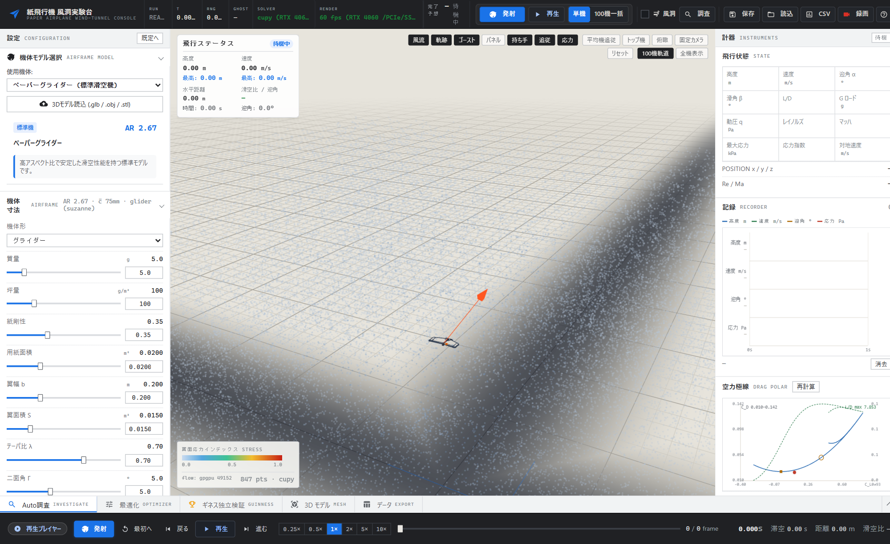
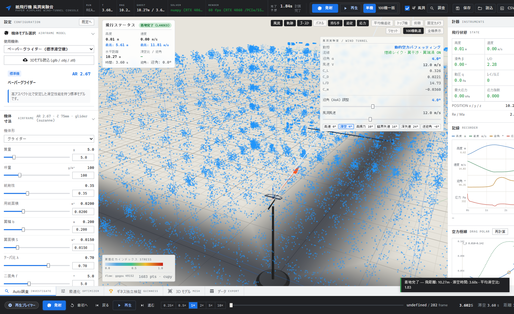
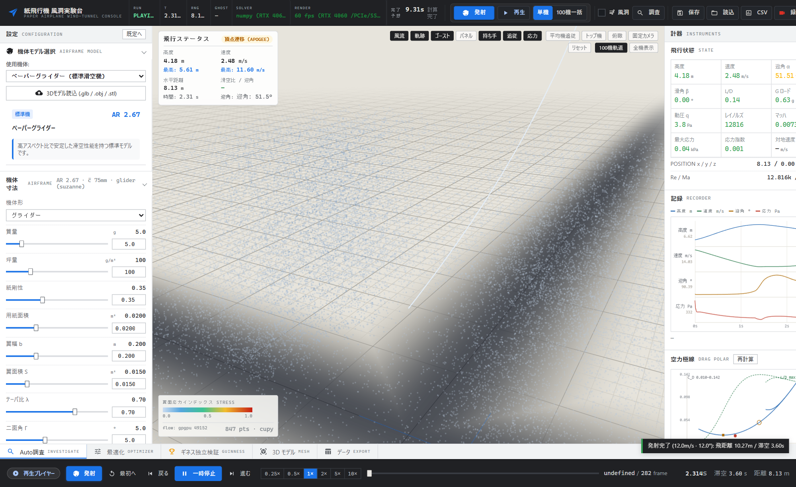

# User Guide & Operation Manual

This document explains simulation operation using the web browser console, parameter configuration, optimization engine execution procedures, and data I/O.

---

## 1. Screen Layout (Google Clean Standard)

The screen consists of the following areas:

- **Header Bar (Top Header)**: Title, wind tunnel mode toggle, data save/load/CSV export buttons
- **Left Panel (Left Control Panel)**: Sliders for aircraft geometry, paper properties, launch conditions, atmosphere environment
- **Center 3D Viewer (3D Viewport)**: Three.js aircraft mesh rendering, real-time stress heatmap, GPU airflow particles
- **Bottom Time Control (Bottom Dock)**: Play/pause, speed switching, frame stepping, timeline seek bar
- **Right Panel (Right Telemetry & Analytics)**: Flight instrument status (altitude, velocity, AoA, G-force, etc.), real-time graphs, optimization panel, 3D model management

| Virtual Wind Tunnel | 6DoF Flight Trajectory |
| :---: | :---: |
|  |  |

---

## 2. Flight Simulation Execution

### 2.1 Parameter Adjustment
Customize flight conditions intuitively from the left panel:

- **Aircraft Parameters**:
  - Gross mass ($g$)
  - Wingspan ($m$) / Wing area ($m^2$)
  - Paper areal density ($g/m^2$) and paper bending stiffness
  - Elevon / trim fold angle ($^\circ$)
  - Dihedral angle ($^\circ$)
- **Launch Conditions (Launch Config)**:
  - Initial velocity ($m/s$)
  - Launch elevation & azimuth angles ($^\circ$)
  - Initial roll angle ($^\circ$)
- **Environment & Atmosphere**:
  - Temperature ($^\circ\text{C}$ / $\text{K}$), local pressure ($\text{hPa}$), relative humidity ($\%$)
  - Mean wind speed ($m/s$), wind direction ($^\circ$)
  - Turbulence intensity, thermal updrafts

### 2.2 Time Axis Control (Time Control)
Freely manipulate the flight timeline using bottom dock controls:

- **Play / Pause**: Toggle instantly with `Space` key or button
- **Playback Speed**: `0.25x`, `0.5x`, `1.0x`, `2.0x`, `5.0x`, `10.0x`
- **Step Forward / Backward**: Frame-by-frame ($\Delta t$) behavior verification
- **Timeline Seek**: Drag seek bar slider to rewind/fast-forward through past~current flight states

---

## 3. 3D Aircraft Model Import

Import pre-made 3D paper airplane models for aerodynamic analysis.

### 3.1 Supported File Formats
- **STL** (binary / ASCII)
- **OBJ** (Wavefront OBJ)
- **glTF 2.0 / GLB**

### 3.2 Upload Procedure
1. Select "**3D Models**" tab on the right.
2. Click file selector or drag & drop 3D file into drop zone.
3. After upload completes, the server automatically computes and reflects the following physical properties:
   - Surface area $S$, wingspan $b$, mean chord $\bar{c}$
   - Aspect ratio $AR$, center of gravity $x_{cg}$, inertia tensor $\mathbf{I}$
   - Angle-of-attack characteristics via static aerodynamic panel method

---

## 4. Multi-Objective Optimization Engine Execution

Automatically search aircraft geometry and launch conditions to derive designs that fly farther and more stably.

### 4.1 Algorithm Selection
- **Nelder-Mead**: Unimodal local optimization (fast)
- **Differential Evolution (DE)**: Global search
- **NSGA-II**: Pareto optimal set search for multiple objectives (e.g., maximize flight distance AND minimize max stress)
- **Surrogate**: High-speed optimization via surrogate models

### 4.2 Objectives
- `max_distance`: Maximize flight distance
- `max_flight_time`: Maximize flight time
- `max_ld_ratio`: Maximize lift-to-drag ratio ($L/D$)
- `min_max_stress`: Minimize max generated stress (prevent paper bending failure)
- `max_stability`: Maximize flight stability

### 4.3 Optimization Job Monitoring & ETA
- Starting optimization immediately creates a background job.
- **Progress bar**, **evaluation rate (evals/s)**, and exponentially smoothed **estimated completion time (ETA)** displayed in real-time on panel.
- On job completion, apply obtained optimal parameters to simulator with one click.

---

## 5. Data Save & Export

- **CSV Export**:
  Click "Export CSV" button in header to immediately download flight log (time, position $X, Y, Z$, velocity, AoA, altitude, G-force, max stress).
- **JSON Preset**:
  Save/restore aircraft settings and environment settings in JSON format.

---

## 6. Related Documents

- [Quick Start (docs/getting-started.md)](./getting-started.md)
- [System Architecture (docs/architecture.md)](./architecture.md)
- [REST API Specifications (docs/api.md)](./api.md)
- [Troubleshooting (docs/troubleshooting.md)](./troubleshooting.md)

---

[Back to README](https://github.com/minetan1229/air_simulation/blob/master/README.md)