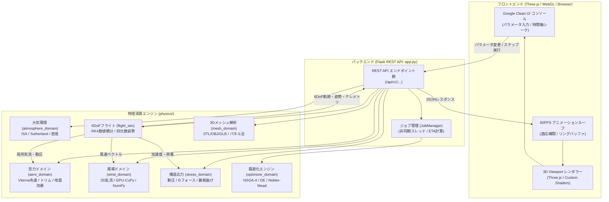
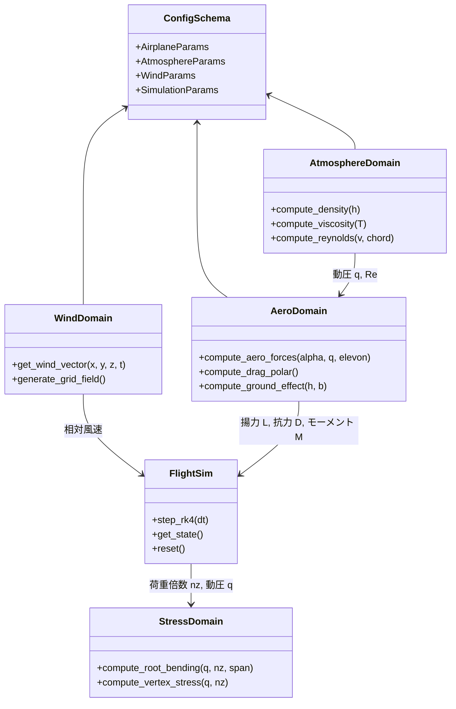

# アーキテクチャ設計 (Architecture)

本シミュレーターは、ドメイン駆動設計（DDD）の思想に基づき、物理モデル・風場・構造解析・飛行力学・最適化の責務をモジュール分割した Flask REST API バックエンドと、WebGL / Three.js を用いた高パフォーマンスなフロントエンドで構成されています。

---

## 1. システム全体データフロー

ユーザーが計器コンソールでパラメータを操作、または再生ボタンを押下した際のリクエスト・演算・レンダリングの流れです。



---

## 2. ディレクトリ構成の解説

```text
paper_airplanes/simulation/v3/
├── app.py                      # Flask REST API エントリポイント (全20種のエンドポイント統合)
├── requirements.txt            # 必須・任意パッケージ依存関係定義
├── smoke_test.py               # E2E・API疎通・物理演算・最適化検証用テストスクリプト
├── conftest.py / pytest.ini    # pytest 設定ファイル
├── ruff.toml / mypy.ini        # 静的解析・型検査設定
├── .env.example                # 環境変数テンプレート
├── physics/                    # 物理演算コアライブラリ (ドメイン別)
│   ├── __init__.py
│   ├── config_schema.py        # 物理パラメータの dataclass 定義・バリデーション
│   ├── geometry_utils.py       # 四元数・オイラー角・座標変換ユーティリティ
│   ├── aero_domain.py          # 揚力・抗力・失速遷移・トリム・空力弾性モーフィング
│   ├── atmosphere_domain.py    # ISA標準大気・Sutherland動粘性・局所大気圧計算
│   ├── wind_domain.py          # 3D風場・Simplex/Perlin乱流・GPU (CuPy) / CPU並列
│   ├── stress_domain.py        # 動圧・Gフォース・翼根曲げモーメント・頂点応力分布
│   ├── flight_sim.py           # 6自由度 RK4 積分・適応サブステップ・リングバッファ
│   ├── mesh_domain.py          # STL/OBJ/GLBインポート・重心/慣性テンソル算出・パネル法
│   ├── optimizer_domain.py     # NSGA-II・差分進化・Nelder-Mead・Surrogate 最適化
│   ├── parallel_engine.py      # マルチプロセッシング・パラメータスイープ実行基盤
│   ├── job_manager.py          # 長時間最適化ジョブ管理・進捗率・ETA平滑化
│   └── storage_domain.py       # CSV / JSON テレメトリ出力・設定シリアライズ
├── static/                     # クライアントサイド Three.js & UI スクリプト
│   ├── css/console.css         # Google Clean スタイルシート
│   └── js/
│       ├── app.js              # フロントエンド統合エントリ
│       ├── api.js              # Flask API 通信ラッパー
│       ├── viewport.js         # Three.js シーン・カメラ・レンダラー制御
│       ├── airframe.js         # 機体 3D モデル描画・応力ヒートマップシェーダー
│       ├── flowfield.js        # GPGPU / InstancedMesh 風流線パーティクル
│       ├── transport.js        # 再生・一時停止・巻き戻しシーク制御
│       ├── telemetry.js        # 計器・HUD・リアルタイムグラフ表示
│       ├── panels.js           # パラメータ調整 UI パネル制御
│       ├── optimizer.js        # 最適化ジョブ設定・リアルタイム ETA 表示
│       ├── meshpanel.js        # 3Dモデルファイルドラッグ＆ドロップ取込
│       └── datapanel.js        # CSV/JSON エクスポート・インポート
├── templates/
│   └── index.html              # 計器コンソール HTML テンプレート
├── tests/                      # pytest ユニットテスト群 (700+ テストケース)
│   ├── test_aero.py            # 空力・失速・Drag Polar 検証
│   ├── test_atmo_wind.py       # 大気・粘性・風場・GPUフォールバック検証
│   ├── test_stress.py          # 動圧・翼根応力計算検証
│   ├── test_mesh.py            # 3Dモデル幾何抽出・パネル法検証
│   ├── test_flight.py          # 6DoF RK4・四元数・エネルギー保存検証
│   ├── test_optimizer.py       # 最適化アルゴリズム・パレート解検証
│   └── test_jobs.py            # ジョブマネージャー・ETA 計算式検証
└── models/                     # アップロードされた 3D モデルキャッシュ (キャッシュ用)
```

---

## 3. 技術スタック一覧

### バックエンド (Backend)
- **言語**: Python 3.10+
- **Web フレームワーク**: Flask 3.1+ (RESTful API 設計)
- **数値計算 & 物理演算**:
  - `numpy`: ベクトル演算、配列処理、行列計算
  - `scipy`: 空間補間（RBF）、Nelder-Mead、Differential Evolution
- **3D 幾何解析 (Mesh)**:
  - `trimesh` (任意): 高度なメッシュ解析。非導入時は純 NumPy 実装への自動フォールバックが機能
- **GPU アクセラレーション**:
  - `cupy` / `torch` (任意): 3D 風場グリッドのベクトル計算を CUDA GPU へオフロード (非搭載環境は CPU/NumPy へ自動フォールバック)

### フロントエンド (Frontend)
- **3D レンダリング**: Three.js (WebGL 2.0)
  - Custom GLSL Shaders: 頂点ごとの動的応力ヒートマップ変形
  - InstancedMesh / Particle System: 数万〜数十万点の風流線パーティクルリアルタイム描画
- **UI デザイン**: Google Clean / Material Design スタイル
  - 白基調 (`#F8F9FA` / `#FFFFFF`)、角丸カード型浮遊パネル、Google Blue (`#1A73E8`)
- **グラフ・計器**: Chart.js によるリアルタイムテレメトリグラフ表示

### 開発・品質保証ツール (DevOps & Testing)
- **テストフレームワーク**: `pytest` (700+ テストケース)
- **コードリンター & フォーマッター**: `ruff`
- **静的型検査**: `mypy` (厳格な型アノテーション検査)
- **CI/CD**: GitHub Actions (Ubuntu 24.04 / Python 3.11 環境での自動テスト・静的解析)

---

## 4. 物理モジュール間の関係性



次ページ: [[開発・運用ガイド|Development-Guide]]
