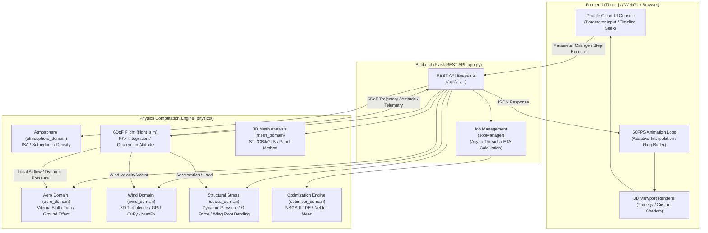
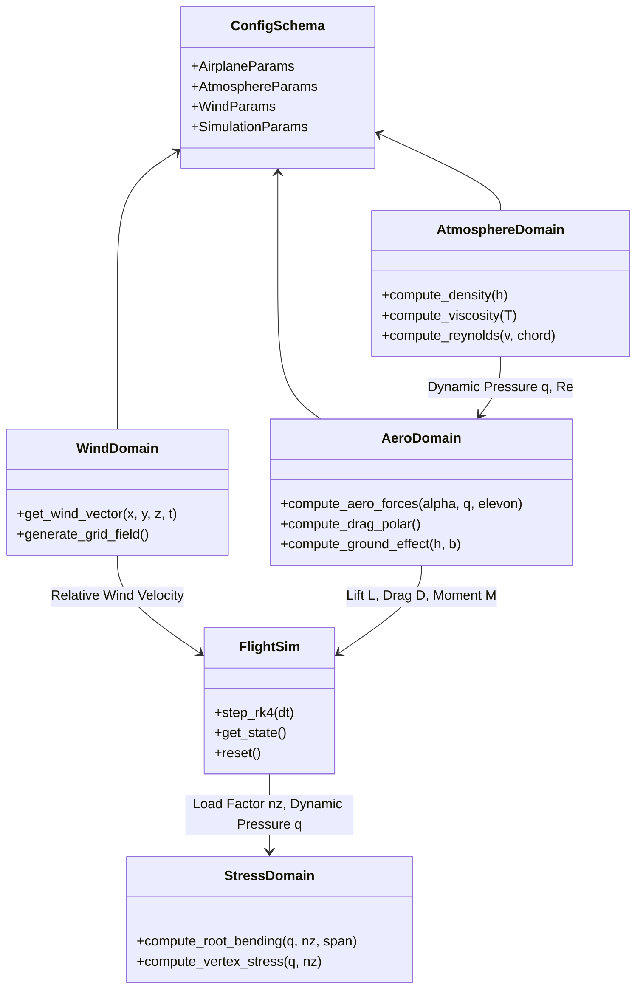

# Architecture Design

This simulator is built on Domain-Driven Design (DDD) principles, with responsibilities for physics models, wind fields, structural analysis, flight dynamics, and optimization split into modules. It consists of a Flask REST API backend and a high-performance WebGL / Three.js frontend.

---

## 1. System-Wide Data Flow

Flow of requests, computation, and rendering when user manipulates parameters on the instrument console or presses play:



---

## 2. Directory Structure Explanation

```text
paper_airplanes/simulation/v3/
├── app.py                      # Flask REST API entry point (integrates 20 endpoints)
├── requirements.txt            # Required & optional package dependencies
├── smoke_test.py               # E2E, API connectivity, physics, optimization verification script
├── conftest.py / pytest.ini    # pytest configuration
├── ruff.toml / mypy.ini        # Static analysis & type checking config
├── .env.example                # Environment variable template
├── physics/                    # Physics computation core library (per domain)
│   ├── __init__.py
│   ├── config_schema.py        # Physics parameter dataclass definitions & validation
│   ├── geometry_utils.py       # Quaternion, Euler angle, coordinate transform utilities
│   ├── aero_domain.py          # Lift, drag, stall transition, trim, aeroelastic morphing
│   ├── atmosphere_domain.py    # ISA standard atmosphere, Sutherland viscosity, local atmosphere
│   ├── wind_domain.py          # 3D wind field, Simplex/Perlin turbulence, GPU (CuPy) / CPU parallel
│   ├── stress_domain.py        # Dynamic pressure, G-force, wing root bending, vertex stress dist.
│   ├── flight_sim.py           # 6DoF RK4 integration, adaptive sub-step, ring buffer
│   ├── mesh_domain.py          # STL/OBJ/GLB import, CG/inertia tensor, panel method
│   ├── optimizer_domain.py     # NSGA-II, Differential Evolution, Nelder-Mead, Surrogate
│   ├── parallel_engine.py      # Multiprocessing, parameter sweep execution foundation
│   ├── job_manager.py          # Long-running optimization job mgmt, progress, ETA smoothing
│   └── storage_domain.py       # CSV/JSON telemetry output, config serialization
├── static/                     # Client-side Three.js & UI scripts
│   ├── css/console.css         # Google Clean stylesheet
│   └── js/
│       ├── app.js              # Frontend integration entry
│       ├── api.js              # Flask API communication wrapper
│       ├── viewport.js         # Three.js scene, camera, renderer control
│       ├── airframe.js         # Aircraft 3D model rendering, stress heatmap shaders
│       ├── flowfield.js        # GPGPU / InstancedMesh wind streamline particles
│       ├── transport.js        # Play/pause/rewind seek control
│       ├── telemetry.js        # Instruments, HUD, real-time graph display
│       ├── panels.js           # Parameter adjustment UI panel control
│       ├── optimizer.js        # Optimization job config, real-time ETA display
│       ├── meshpanel.js        # 3D model file drag & drop import
│       └── datapanel.js        # CSV/JSON export/import
├── templates/
│   └── index.html              # Instrument console HTML template
├── tests/                      # pytest unit test suite (700+ test cases)
│   ├── test_aero.py            # Aero, stall, Drag Polar verification
│   ├── test_atmo_wind.py       # Atmosphere, viscosity, wind, GPU fallback verification
│   ├── test_stress.py          # Dynamic pressure, wing root stress verification
│   ├── test_mesh.py            # 3D model geometry extraction, panel method verification
│   ├── test_flight.py          # 6DoF RK4, quaternion, energy conservation verification
│   ├── test_optimizer.py       # Optimization algorithms, Pareto solution verification
│   └── test_jobs.py            # Job manager, ETA calculation verification
└── models/                     # Uploaded 3D model cache (for caching)
```

---

## 3. Technology Stack

### Backend
- **Language**: Python 3.10+
- **Web Framework**: Flask 3.1+ (RESTful API design)
- **Numerical Computation & Physics**:
  - `numpy`: Vector ops, array processing, matrix computation
  - `scipy`: Spatial interpolation (RBF), Nelder-Mead, Differential Evolution
- **3D Geometry Analysis (Mesh)**:
  - `trimesh` (optional): Advanced mesh analysis. Auto-fallback to pure NumPy implementation if not installed.
- **GPU Acceleration**:
  - `cupy` / `torch` (optional): Offload 3D wind field grid vector computation to CUDA GPU (auto-fallback to CPU/NumPy if unavailable)

### Frontend
- **3D Rendering**: Three.js (WebGL 2.0)
  - Custom GLSL Shaders: Per-vertex dynamic stress heatmap deformation
  - InstancedMesh / Particle System: Tens to hundreds of thousands of wind streamline particles real-time
- **UI Design**: Google Clean / Material Design Style
  - White base (`#F8F9FA` / `#FFFFFF`), rounded floating card panels, Google Blue (`#1A73E8`)
- **Graphs & Instruments**: Chart.js real-time telemetry graphs

### DevOps & Testing
- **Test Framework**: `pytest` (700+ test cases)
- **Code Linter & Formatter**: `ruff`
- **Static Type Checking**: `mypy` (strict type annotation checking)
- **CI/CD**: GitHub Actions (Ubuntu 24.04 / Python 3.11 auto-test & static analysis)

---

## 4. Physics Module Relationships



Next: [[Development & Operations Guide|Development-Guide]]