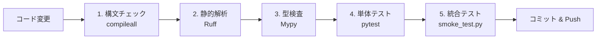

# 開発・運用ガイド (Development Guide)

本ドキュメントでは、本プロジェクトの開発フロー、ブランチ運用ルール、テスト実行手順、および CI/CD（GitHub Actions）の仕様を解説します。

---

## 1. 開発フローとブランチ戦略

本プロジェクトでは、コードの品質と安定稼働を担保するため、以下の運用規約を定めています。

### ブランチ運用
1. **master への直接コミット禁止**:
   - すべての機能追加・バグ修正は必ず作業用トピックブランチ（`feat/...`、`fix/...`、`refactor/...`）を作成して作業を行います。
2. **ローカル検証の通過**:
   - ローカル環境で構文チェック、静的型検査、pytest が 100% 成功した実動コードのみを Git コミット対象とします。
3. **Pull Request と CI 検証**:
   - master への統合は GitHub の Pull Request を通じて行い、CI（GitHub Actions）のすべてのチェックが Green（通過）であることを確認した上でマージします。

### コミットメッセージ規約 (Conventional Commits)
コミットメッセージは以下の接頭辞（Prefix）を付与して記述します。

- `feat(scope): message` : 新機能の追加
- `fix(scope): message` : バグや不具合の修正
- `refactor(scope): message` : 動作を変えないコード整理・リファクタリング
- `test(scope): message` : テストコードの追加・修正
- `docs(scope): message` : ドキュメントの作成・更新

---

## 2. 実装原則 (Zero-Placeholder Policy)

開発時には以下の「ゼロ・プレースホルダー方針」を徹底しています。
- **未実装コードの禁止**: `TODO` コメントや `...` による関数の実装省略、空のスケルトンコードの配置は一切禁止。
- **完全実動の保証**: 数式、シェーダー、並列処理、API、UI をすべて実際に計算・動作するコードとして記述する。
- **フォールバック設計**: GPU 演算（CuPy/PyTorch）や拡張ライブラリ（trimesh）を導入していない環境でも、CPU/NumPy で同一の計算結果が得られるフォールバック処理を必ず実装する。

---

## 3. テストと検証手順

コードを変更した後は、以下の検証コマンドを順番に実行してください。



### 1. 構文チェック (Syntax Verification)
Python ファイルのコンパイルエラーを検出します。
```powershell
python -m compileall physics app.py
```

### 2. リンター & コードフォーマット検証 (Ruff)
```powershell
ruff check .
```

### 3. 静的型検査 (Mypy)
厳格な型安全性を確認します。
```powershell
mypy --config-file mypy.ini physics app.py
```

### 4. 物理・単体テスト (pytest)
空力モデル、大気粘性、6DoF 積分、最適化、メッシュ幾何の数値整合性を検証します（全 700 以上のテストケース）。
```powershell
python -m pytest tests -q
```

### 5. 統合スモークテスト (smoke_test.py)
Flask API の疎通、非同期最適化ジョブ、ETA 計算、3D メッシュ解析の E2E 導通を検証します。
```powershell
python smoke_test.py
```

---

## 4. CI/CD パイプライン (GitHub Actions)

本リポジトリでは、`.github/workflows/verify.yml` により、master への Push および Pull Request 発行時に自動検証が実行されます。

### CI ワークフローステップ
1. **リポジトリの取得** (`actions/checkout@v4`)
2. **Python 3.11 環境のセットアップ** (`actions/setup-python@v5`, pip キャッシュ有効)
3. **依存ライブラリのインストール** (`requirements.txt`, `ruff`, `mypy`, `pytest`)
4. **構文・スタイル検証** (`ruff check .`)
5. **静的型検査** (`mypy --config-file mypy.ini physics app.py`)
6. **自動テストの実行** (`python tools/run_ci_tests.py`)
7. **失敗時の自動通知 & Issue 起票** (`tools/create_failure_issue.py` により、テスト失敗時に詳細トレースを含む Issue が自動作成されます)

---

## 5. デプロイと本番運用

本シミュレーターは Web 標準技術のみで構成されており、以下の形態で容易に稼働・ホスティングが可能です。

### ローカル / イントラネット運用
```powershell
python app.py
```
- デフォルトでポート `5000` でリッスンします。

### WSGI / 本番サーバー運用 (Gunicorn / Waitress)
本番環境で運用する場合は、WSGI サーバー経由での起動を推奨します。

```bash
# Linux / macOS (Gunicorn)
pip install gunicorn
gunicorn -w 4 -b 0.0.0.0:5000 app:app

# Windows (Waitress)
pip install waitress
waitress-serve --port=5000 app:app
```

---

## 6. ドキュメント一覧

- [[ドキュメント ホーム|Home]]
- [[環境構築と起動手順|Getting-Started]]
- [[アーキテクチャ設計|Architecture]]
