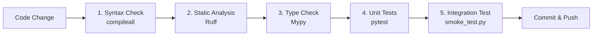

# Development & Operations Guide

This document explains the project's development flow, branch management rules, test execution procedures, and CI/CD (GitHub Actions) specifications.

---

## 1. Development Flow & Branch Strategy

To ensure code quality and stable operation, the following operational conventions are established.

### Branch Management
1. **No Direct Commits to master**:
   - All feature additions and bug fixes must be done on dedicated topic branches (`feat/...`, `fix/...`, `refactor/...`).
2. **Local Verification Must Pass**:
   - Only fully working code that passes syntax check, static type checking, and pytest 100% locally may be committed.
3. **Pull Request & CI Verification**:
   - Integration to master goes through GitHub Pull Request; merge only after all CI (GitHub Actions) checks are Green (pass).

### Commit Message Convention (Conventional Commits)
Commit messages must use the following prefixes:

- `feat(scope): message` : New feature addition
- `fix(scope): message` : Bug/defect fix
- `refactor(scope): message` : Refactoring without behavior change
- `test(scope): message` : Test code addition/modification
- `docs(scope): message` : Documentation creation/update

---

## 2. Implementation Principles (Zero-Placeholder Policy)

The following "Zero-Placeholder Policy" is strictly enforced during development:
- **No Unimplemented Code**: `TODO` comments, `...` function body omissions, empty skeleton code are completely prohibited.
- **Full Working Guarantee**: Formulas, shaders, parallel processing, APIs, UI all written as actually computing/operating code.
- **Fallback Design**: Must implement fallback processing that yields identical computational results on CPU/NumPy even in environments without GPU (CuPy/PyTorch) or extended libraries (trimesh).

---

## 3. Test & Verification Procedures

After code changes, execute the following verification commands in order:



### 1. Syntax Check (Syntax Verification)
Detect Python file compilation errors.
```powershell
python -m compileall physics app.py
```

### 2. Linter & Code Format Verification (Ruff)
```powershell
ruff check .
```

### 3. Static Type Check (Mypy)
Verify strict type safety.
```powershell
mypy --config-file mypy.ini physics app.py
```

### 4. Physics & Unit Tests (pytest)
Verify numerical integrity of aero model, atmospheric viscosity, 6DoF integration, optimization, mesh geometry (700+ test cases).
```powershell
python -m pytest tests -q
```

### 5. Integration Smoke Test (smoke_test.py)
Verify Flask API connectivity, async optimization jobs, ETA calculation, 3D mesh analysis E2E connectivity.
```powershell
python smoke_test.py
```

---

## 4. CI/CD Pipeline (GitHub Actions)

This repository runs auto-verification on master push and Pull Request creation via `.github/workflows/verify.yml`.

### CI Workflow Steps
1. **Repository Checkout** (`actions/checkout@v4`)
2. **Python 3.11 Environment Setup** (`actions/setup-python@v5`, pip cache enabled)
3. **Dependency Installation** (`requirements.txt`, `ruff`, `mypy`, `pytest`)
4. **Syntax & Style Verification** (`ruff check .`)
5. **Static Type Check** (`mypy --config-file mypy.ini physics app.py`)
6. **Automated Test Execution** (`python tools/run_ci_tests.py`)
7. **Failure Auto-Notification & Issue Creation** (`tools/create_failure_issue.py` auto-creates Issue with detailed trace on test failure)

---

## 5. Deployment & Production Operations

This simulator is built entirely on web standard technologies, enabling easy operation/hosting in the following forms.

### Local / Intranet Operation
```powershell
python app.py
```
- Listens on port `5000` by default.

### WSGI / Production Server (Gunicorn / Waitress)
For production, WSGI server launch is recommended.

```bash
# Linux / macOS (Gunicorn)
pip install gunicorn
gunicorn -w 4 -b 0.0.0.0:5000 app:app

# Windows (Waitress)
pip install waitress
waitress-serve --port=5000 app:app
```

---

## 6. Document List

- [[Documentation Home|Home]]
- [[Setup & Launch|Getting-Started]]
- [[Architecture Design|Architecture]]